# Mycelium Consciousness

Mycelium Consciousness is a high-load memory synchronization system for clone
implants, modeled on a surveillance camera rather than a search engine: each
clone writes a continuous stream of raw memory frames, and the system never
reads that stream back for the clone's own benefit. What it does instead is
periodically fold the buffered stream into a durable backup, so a clone can be
restored to a past state after it fails. There is no semantic search, no
embeddings, and no read path inside the system at all — only write, roll up,
and restore.

## Lab map

| Lab | Topic | Where |
| --- | --- | --- |
| 1 | System design, API, persistence, bottleneck analysis | [Architecture](#architecture), [API and high-load scenario](#api-and-high-load-scenario), [Lab 1 deliverables](#lab-1--deliverables) |
| 2 | Stateless architecture | [Lab 2](#lab-2--stateless-architecture) |
| 3 | Horizontal scaling, load balancing | [Lab 3](#lab-3--horizontal-scaling-and-load-balancing) |
| 4 | Distributed caching | [Lab 4](#lab-4--distributed-caching-cache-aside) |
| 5 | Load testing, performance baseline | [Lab 5](#lab-5--load-testing-and-performance-baseline) |
| 6 | Database replication, read/write separation | [Lab 6](#lab-6--database-replication-and-readwrite-separation) |
| 7 | Sharding, partitioning, resharding | [Lab 7](#lab-7--data-scaling-sharding-and-partitioning) |

## Architecture

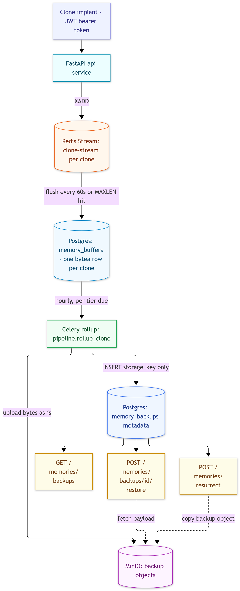

### C4 container diagram

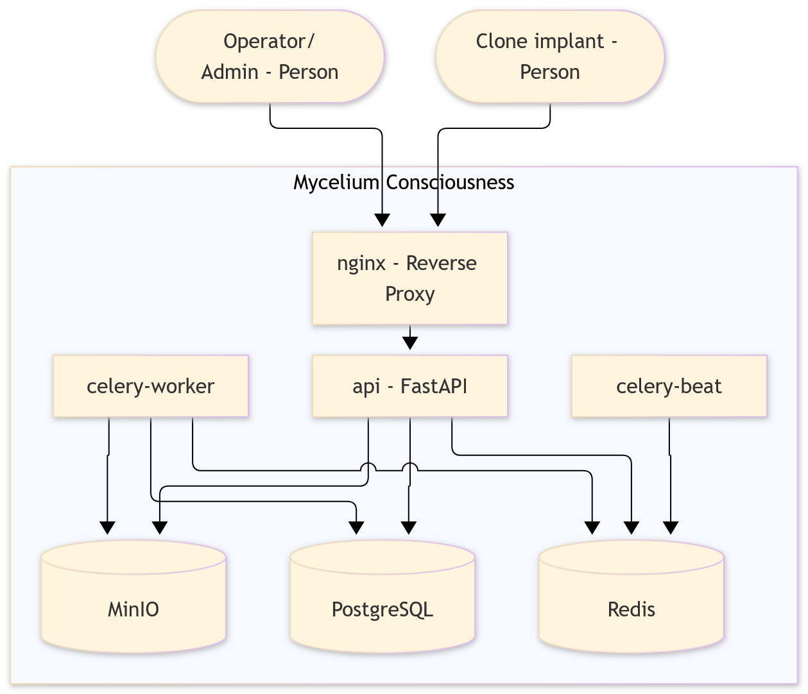

```
Clone (JWT, same auth as REST)
  |  POST /memories/write  {"content": "..."}
  v
FastAPI  ->  XADD  ->  Redis Stream "clone-stream:{clone_id}"
                          |                     |
                          |          length >= MEMORY_STREAM_MAXLEN?
                          |          --> immediate one-clone flush (async)
                          |
                          | celery-beat, every STREAM_FLUSH_INTERVAL_SECONDS
                          | (default 60s), drains every clone's stream
                          v
              memory_buffers (Postgres) — one row per clone, a bytea column
              of msgpack+gzip entries appended in place on every flush
                          |
                          | celery-beat checks hourly which clones are due
                          | for a rollup, per their subscription tier
                          v
              upload the buffer's bytes to MinIO as-is (already encoded)
              INSERT memory_backups row (storage_key only) -> DELETE the buffer
              (one Postgres transaction, after the upload succeeds)
                          |
                          v
              GET /memories/backups            (list)
              POST /memories/backups/{id}/restore
              POST /memories/resurrect         (seed a new clone from a dead one)
              POST /admin/clones/{id}/rollup   (force one clone now, ops/testing)
```

Main components:

- `services/api` — FastAPI: auth, profiles, the fast write endpoint, and
  backup listing/restore.
- Redis — the hot buffer for each clone's raw stream (`clone-stream:{id}`),
  the safety-valve trigger for an out-of-band flush, and the Celery broker.
- `services/celery` — `celery-worker` runs the flush and rollup tasks,
  `celery-beat` triggers both on their own schedules
  (`STREAM_FLUSH_INTERVAL_SECONDS`, `ROLLUP_CHECK_INTERVAL_SECONDS`).
- PostgreSQL — durable storage for users, clone profiles, live
  `memory_buffers` (flushed out of Redis, not yet backed up), and
  `memory_backups` metadata. No vector extension: nothing here is searched.
- MinIO (or any S3-compatible service) — the actual backup archives.
  `memory_backups` rows only hold a pointer (`storage_key`); the payload
  itself never touches the relational database.

### Two buffering stages, two different reasons

`POST /memories/write` never touches Postgres — it's one `XADD`, so the write
path stays fast under load regardless of database contention. That buffer is
bounded two ways: a scheduled flush every `STREAM_FLUSH_INTERVAL_SECONDS`
(default 60s) drains every clone's stream into `memory_buffers`, and if a
single clone's stream reaches `MEMORY_STREAM_MAXLEN` (default 10,000) before
its turn, the write that crossed the threshold fires an immediate one-clone
flush in the background rather than waiting for the schedule or letting the
stream grow further. Redis has `--appendonly yes` with a mounted volume, so
this buffer survives a container restart; it just isn't meant to hold data
for long.

`memory_buffers` in Postgres is the second, coarser buffer: everything
flushed out of Redis lives there, durable, until its clone's subscription
tier says it's time for a backup rollup (see below). This second stage is
what actually absorbs a slow or paused rollup schedule — Postgres can hold
far more than Redis's working-memory footprint without risking the whole
service.

### Subscription tiers

How often a clone is backed up, and how many backups are kept, comes from its
subscription tier (`shared.subscriptions`):

| Tier | Backup frequency | Backups retained | Effective restore depth |
| --- | --- | --- | --- |
| free | monthly | 1 | ~30 days |
| standard | weekly | 4 | ~28 days |
| premium | daily | 30 | ~30 days, day by day |

A cheaper tier does not lose data between backups — writes keep accumulating
in `memory_buffers` regardless of tier — it just gets folded into fewer,
coarser-grained backups, and older ones are pruned sooner (both the
`memory_backups` row and its object in MinIO).

### Backup history and resurrection

Each rollup inserts a new `memory_backups` row rather than overwriting the
previous one, so a clone's past periods stay listed (`GET
/memories/backups`) and restorable (`POST /memories/backups/{id}/restore`)
independently of whatever the current, not-yet-backed-up period in
`memory_buffers` holds. Retention (see the table above) only prunes the
*oldest* rows past the tier's count, using the tier each backup was actually
taken under — a later downgrade never deletes backups already made under a
richer tier.

A dead clone's last backup can seed a brand-new identity —
`POST /memories/resurrect {"source_profile_id": ...}` copies the source
clone's latest backup into the caller's own history as an already-restored
entry. The source must first be marked non-`"active"` (`PATCH
/profiles/{id}` with a `status` such as `"deceased"`, by its owner or an
admin) — resurrecting from a clone that is still active is rejected with
409, so a second identity can never fork off memory that is still live.

## API and high-load scenario

Interactive specification (generated from the code, always current):
Swagger UI at `http://localhost/docs`, OpenAPI JSON at
`http://localhost/openapi.json`. Errors use standard status codes (401
unauthenticated, 403 wrong role, 404 not yours / not found, 409 state
conflict, 422 validation, 503 degraded `/health`).

| Area | Endpoint | Operation |
| --- | --- | --- |
| Auth | `POST /auth/register`, `POST /auth/login`, `GET /auth/me` | create account, issue JWT, read self |
| Profiles | `GET /profiles/me`, `PATCH /profiles/me`, `GET /profiles`, `GET/PATCH /profiles/{id}` | read / update clone profile |
| Memory | `POST /memories/write` | create: append one memory frame (202) |
| Memory | `GET /memories/stream/status` | read: frames buffered in Redis |
| Backups | `GET /memories/backups`, `GET /memories/backups/{id}` | read backup history / one backup |
| Backups | `POST /memories/backups/{id}/restore`, `POST /memories/resurrect` | business logic: restore, fork a dead clone |
| Admin | `GET /admin/users`, `/admin/clones`, `/admin/stats`, `PATCH /admin/clones/{id}/subscription`, `POST /admin/clones/{id}/rollup`, `POST /admin/users/{id}/deactivate` | operate the registry (deactivation is a soft delete) |
| Ops | `GET /health` | readiness: Postgres, Redis, MinIO |

Domain entities and relations: `users` 1—1 `clone_profiles` 1—1
`memory_buffers` (live, not yet archived) and 1—N `memory_backups`
(archived periods, payload in MinIO).

**High-load scenario.** Many clones each stream `POST /memories/write` at a
high rate. Per request that is a JWT check, an authenticated Postgres lookup
and one Redis `XADD`; behind it the heaviest work is background: the flush
(decode, append and re-encode a growing `bytea` under a row lock, every 60 s
or at `MEMORY_STREAM_MAXLEN`) and the rollup (upload to MinIO plus metadata
insert per due clone). This is the scenario the load tests (lab 5, scenario B
and the mixed workflow C) drive, and the one the bottleneck analysis
([`docs/bottleneck-analysis.md`](docs/bottleneck-analysis.md)) reasons about.

## Development

Install dependencies and run quality checks:

```bash
uv sync --all-packages --dev

uv run ruff check .
uv run ruff format --check .
uv run pre-commit run --all-files
```

Run local infrastructure:

```bash
cp infra/.env.example infra/.env
docker compose -f infra/docker-compose.yaml up --build
```

The stack is reached through nginx on `http://localhost` — `GET /health` for
the API. The `migrate` service applies Alembic migrations to completion before
`api`, `celery-worker`, and `celery-beat` start.

Scale the stateless API horizontally:

```bash
docker compose -f infra/docker-compose.yaml up --scale api=3
```

Database migrations:

```bash
uv run alembic -c shared/alembic.ini upgrade head
uv run alembic -c shared/alembic.ini check    # fails if models drift from schema
```

Run the tests (needs reachable Postgres, Redis, and MinIO instances):

```bash
uv sync --all-packages --dev --group test
uv run pytest
```

Tests live in `tests/` at the workspace root because they span `api`,
`celery_worker` and `shared`. They create and drop their own
`${POSTGRES_DB}_test` database and refuse to run against one whose name does
not contain `test`; the same guard applies to `MINIO_BUCKET`, since a
`clean_object_storage` fixture wipes the whole bucket before and after every
test — point it at something like `memory-backups-test`, not a real one. A
`clean_redis_streams` fixture clears only keys under the `clone-stream:`
prefix before and after each test, so it's safe to point at a shared Redis
instance without a similar guard.

After recreating or scaling `api`, reload the gateway so it re-resolves the
upstream address:

```bash
docker compose -f infra/docker-compose.yaml restart nginx
```

### Load-testing the write path

`tools/load_generator.py` simulates an implant writing large volumes of noise
through the real authenticated HTTP path — the only write path there is now:

```bash
uv run --with httpx python tools/load_generator.py \
  --base-url http://localhost --email alpha@clones.example.com \
  --password alphapass123 --rate 200 --duration 30 --concurrency 20
```

It reports throughput and p50/p99 latency. Each write is one authenticated
HTTP request ending in a single Redis `XADD` (Postgres is touched only for the
auth lookup), so this measures the real write path end to end. The k6 suite in
`load-tests/` (lab 5) is the reproducible, staged version of the same idea.

## Users, roles and access control

Authentication lives in a `users` table linked one-to-one to `clone_profiles`,
so credentials stay off the domain entity on the ingestion hot path. The link
is nullable and unique: a clone owns exactly one profile, while an admin owns
none rather than carrying a synthetic one. Two roles: `clone` (regular user)
and `admin` (operator).

Access control runs on two axes. Vertical (`require_role`) separates privilege
levels and answers 403, not 401, to an authenticated caller with the wrong
role. Horizontal checks resolve ownership from the token subject, never from
the path, and listing endpoints filter by owner inside the SQL query.

Tokens are stateless JWTs, so the API scales horizontally without a shared
session store; the user is re-read on every request, which makes deactivation
take effect immediately rather than at token expiry.

| Endpoint | Anonymous | Clone | Admin |
| --- | --- | --- | --- |
| `POST /auth/register` | 201 | – | – |
| `POST /auth/login` | 200 / 401 | – | – |
| `GET /me/home` | 401 | 200 | 403 |
| `GET /admin/home` | 401 | 403 | 200 |
| `GET /profiles/me` | 401 | 200 | 403 |
| `PATCH /profiles/{id}` | 401 | own only, else 403 | any |
| `POST /memories/write` | 401 | 202 (own stream) | 403 |
| `GET /memories/backups` | 401 | own only | 403 |
| `POST /memories/backups/{id}/restore` | 401 | own only, else 404 | – |
| `PATCH /admin/clones/{id}/subscription` | 401 | 403 | 200 |
| `GET /admin/*` | 401 | 403 | 200 |

Admins cannot self-register; seed one out of band:

```bash
uv run --package api seed-admin ops@example.com <password>
```

## Lab 1 — Deliverables

### Data model

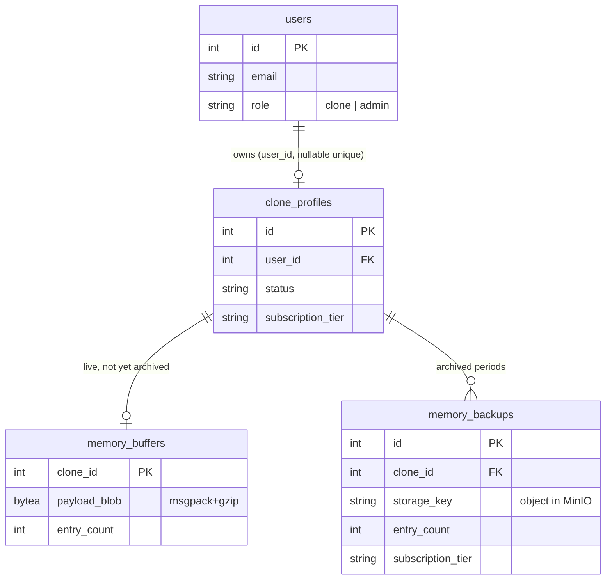

Protocols between components: client → nginx → api over HTTP/1.1 with a JWT
bearer token; api → Redis over RESP (`XADD`); api/celery → Postgres over
asyncpg (SQL); celery → MinIO over S3 (HTTP); api → celery over the Redis
broker (Celery task messages).

### Cold start and demo (5 endpoints)

```bash
cp infra/.env.example infra/.env
docker compose -f infra/docker-compose.yaml up -d --build
docker compose -f infra/docker-compose.yaml exec api   uv run --package api --frozen --no-sync seed-admin ops@example.com 'AdminPass-123'

# 1. register   2. login   3. profile   4. write   5. backups
curl -s -X POST http://localhost/auth/register -H 'Content-Type: application/json'   -d '{"email":"me@example.com","password":"changeme-123","designation":"clone-me"}'
TOKEN=$(curl -s -X POST http://localhost/auth/login -H 'Content-Type: application/json'   -d '{"email":"me@example.com","password":"changeme-123"}' | python -c 'import sys,json;print(json.load(sys.stdin)["access_token"])')
curl -s http://localhost/profiles/me -H "Authorization: Bearer $TOKEN"
curl -si -X POST http://localhost/memories/write -H "Authorization: Bearer $TOKEN"   -H 'Content-Type: application/json' -d '{"content":"first frame"}'      # 202
curl -s http://localhost/memories/backups -H "Authorization: Bearer $TOKEN"
```

Admin-only demo: log in as the seeded admin and call `GET /admin/stats`
(a clone gets 403). Swagger UI: `http://localhost/docs`.

**Persistence check.** Restart the database and read the data back:

```bash
docker compose -f infra/docker-compose.yaml restart db
curl -s http://localhost/profiles/me -H "Authorization: Bearer $TOKEN"   # same profile
```

Postgres (`postgres_data`), Redis (`redis_data`, AOF on) and MinIO
(`minio_data`) all use named volumes, so nothing is lost on restart.

### Bottleneck analysis (summary)

Full write-up: [`docs/bottleneck-analysis.md`](docs/bottleneck-analysis.md).

| # | Component / operation | Root cause | Symptom |
| --- | --- | --- | --- |
| 1 | Postgres connection pool | Pool size is per *process*; ceiling is `(DB_POOL_SIZE + DB_MAX_OVERFLOW) × processes`, so scaling `api` multiplies DB connections | p95/p99 grow on pool waits, then `too many connections` / 500s |
| 2 | Redis stream on `POST /memories/write` | `MEMORY_STREAM_MAXLEN` only triggers an async flush, it is not a hard cap; Redis has no `maxmemory` | `used_memory` grows during a burst; OOM would lose unflushed frames |
| 3 | nginx as the only entry point | One proxy container, no redundancy (SPOF) | 100% errors from outside while every backend is healthy |
| 4 | `flush_one_stream` | Decodes and re-encodes the whole growing `bytea` under `SELECT ... FOR UPDATE`; cost is O(total buffer), not O(new frames) | Flush time and celery CPU grow each cycle, flushes for one clone serialize, Redis backlog grows |
| 5 | API worker CPU + per-request auth lookup | JWT check, Postgres user lookup, Pydantic and JSON all run in Python | Throughput plateaus at ~250 RPS from ~10 VUs; p99 climbs to seconds (measured in lab 5) |

Items 1–3 are the pre-scaling analysis; 4 comes from reading the flush code and
5 was confirmed by the lab 5 measurements.

### Responsibility matrix (RACI)

Full matrix: [`docs/raci-matrix.md`](docs/raci-matrix.md).

| Area | Modules | Owner |
| --- | --- | --- |
| Domain, API spec, DB schema and migrations | `shared/db`, `shared/migrations`, `api/schemas.py` | Давид |
| Auth, RBAC, profiles, admin endpoints | `shared/auth`, `api/deps.py`, `api/routers/{auth,profiles,admin}.py` | Давид |
| Tests | `tests/` | Давид |
| Write path, flush, rollup, backups, cache | `shared/streams.py`, `celery_worker/`, `shared/{object_storage,backup_codec,cache}.py`, `api/routers/memories.py` | Нікіта |
| Containers, compose, nginx, CI | `services/*/Dockerfile*`, `infra/`, `.github/workflows/` | Нікіта |
| Load testing, docs, diagrams | `tools/`, `load-tests/`, `scripts/`, `README.md`, `docs/` | Нікіта |

## Lab 2 — Stateless architecture

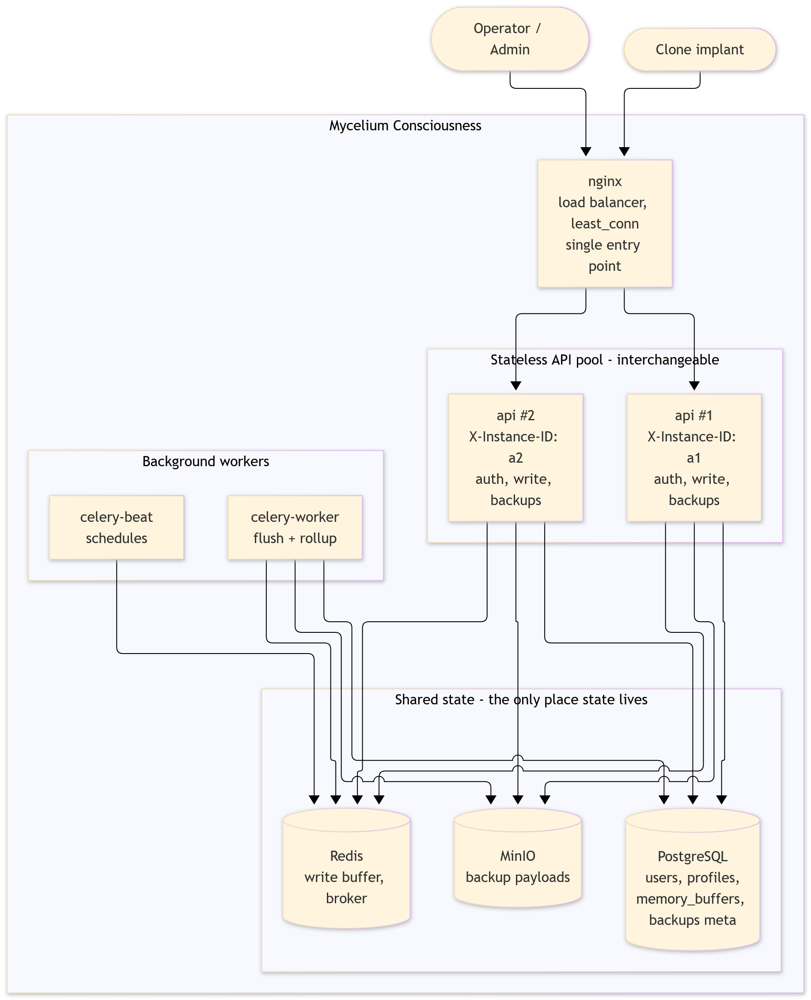

### State audit

| Category | What | Where it lives |
| --- | --- | --- |
| Ephemeral / local safe | request-scoped DB session, logs, `INSTANCE_ID` (read once from env/hostname, never mutated) | process memory, discarded per request |
| Shared / externalized | users, profiles, subscription tier, buffered memory, backup metadata | Postgres |
| Shared / externalized | hot write buffer (`clone-stream:{id}`), Celery broker | Redis |
| Shared / externalized | backup payloads | MinIO |
| Shared / externalized | auth state | none — stateless JWT, user re-read from Postgres on every request |
| Critical stateful (removed / absent) | in-memory collections, local caches, app-level locks, local counters, file sessions | none in the API; the only lock is Postgres `SELECT ... FOR UPDATE` on `memory_buffers` |

In-memory dependencies eliminated: the write buffer is Redis, not a process
list; flush serialization uses a row lock in Postgres, not a Python lock;
sessions are JWTs, not server-side files or dicts.

### Request flow (`POST /memories/write`)

1. Input: `Authorization: Bearer <JWT>` + `{"content": ...}`; `clone_id` is
   resolved from the token, never from the body.
2. Context read: user + profile from Postgres.
3. Atomic state change: one Redis `XADD` (returns stream length).
4. Nothing is retained in the process afterwards.

### Multi-instance run and identification

```bash
docker compose -f infra/docker-compose.yaml up -d --build --scale api=2
docker compose -f infra/docker-compose.yaml restart nginx   # re-resolve upstream
```

Every response carries `X-Instance-ID` (container hostname, overridable via
`INSTANCE_ID`); `GET /health` also returns it.

```bash
for i in 1 2 3 4; do curl -si http://localhost/health | grep -i x-instance-id; done
```

### Cross-instance consistency (no sticky sessions)

`scripts/cross_instance_check.sh` registers a clone, then alternates
`GET /profiles/me` and `PATCH /profiles/{id}` through nginx (`least_conn`, no
`ip_hash`) and prints the serving instance for each call plus the status read
back, which must match what was just written regardless of instance.

Manual check with plain cURL (each response shows which instance served it):

```bash
curl -s -X POST http://localhost/auth/register -H 'Content-Type: application/json' \
  -d '{"email":"me@example.com","password":"changeme-123","designation":"clone-me"}'
TOKEN=$(curl -s -X POST http://localhost/auth/login -H 'Content-Type: application/json' \
  -d '{"email":"me@example.com","password":"changeme-123"}' | python -c 'import sys,json;print(json.load(sys.stdin)["access_token"])')
curl -si http://localhost/profiles/me -H "Authorization: Bearer $TOKEN" | grep -i -e x-instance-id -e status   # instance A
curl -si -X PATCH http://localhost/profiles/1 -H "Authorization: Bearer $TOKEN" \
  -H 'Content-Type: application/json' -d '{"status":"deceased"}' | grep -i x-instance-id           # instance B
curl -s http://localhost/profiles/me -H "Authorization: Bearer $TOKEN"                            # shows the new status
```

(Replace the profile id `1` with the `id` returned by `GET /profiles/me`.)

### Instance-loss scenario

```bash
docker compose -f infra/docker-compose.yaml ps api          # note both names
docker stop <one api container>                              # mid-run
bash scripts/cross_instance_check.sh                         # still succeeds, served by the survivor
```

Writes already accepted are in Redis/Postgres, not in the stopped process, so
nothing is lost; nginx's passive check (`max_fails=3 fail_timeout=15s`) drops
the dead upstream. Restart nginx after re-scaling (upstream IPs are resolved
at startup).

### Stateless vs. no data, and hidden affinity

Stateless means the *process* holds no per-client state — data still exists,
in shared stores. Hidden affinity risks: in-process caches or counters,
local files, node-local locks, and anything that only works because the
same client keeps hitting the same node.

## Lab 3 — Horizontal scaling and load balancing

### Topology

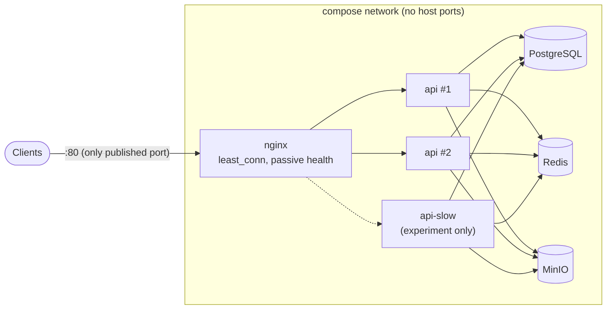

Clients reach only nginx (`:80`); `api` replicas publish no host ports, so the
upstream pool is unreachable from outside the compose network. The pool and
algorithm come from two env vars rendered into
`infra/nginx/default.conf.template`:

| Env var | Default |
| --- | --- |
| `LB_ALGORITHM` | `least_conn;` (empty string = round robin, `ip_hash;`) |
| `LB_SERVERS` | `server api:8000 max_fails=3 fail_timeout=15s;` |

Switch live: `LB_ALGORITHM="ip_hash;" docker compose -f infra/docker-compose.yaml up -d --no-deps --force-recreate nginx`.
`api-slow` (same image, `SIMULATED_LATENCY_MS`, compose profile `slow`) is the
degraded node for the asymmetric experiment.

Health: `GET /health` checks Postgres, Redis and MinIO (2s timeout each) and
returns **503** with per-dependency status when any fails. nginx does *passive*
health checking (`max_fails`/`fail_timeout` plus `proxy_next_upstream`);
open-source nginx has no active probes — that needs HAProxy/Traefik/nginx Plus.

Reproduce everything: `scripts/lb_experiments.sh {distribution|asymmetric|scaleout|failover}`
(uses `tools/lb_bench.py`). Environment: one Windows/Docker Desktop laptop,
`API_WORKERS=2` per replica, load generator on the same host (so absolute
numbers are only comparable to each other, not to a real deployment).

### Algorithm comparison (1 fast node + 1 node with 300 ms added latency, 30 workers, 20 s)

| Algorithm | RPS | p50 ms | p95 ms | p99 ms | Share to slow / fast |
| --- | --- | --- | --- | --- | --- |
| round robin | 169 | 324 | 340 | 409 | 50% / 50% |
| least_conn | 139 | 129 | 590 | 885 | 23% / 77% |
| weighted RR (fast=3, slow=1) | 142 | 117 | 579 | 848 | 25% / 75% |
| ip_hash | 87 | 338 | 375 | 467 | 100% / 0% (single client) |

Reading it honestly: `least_conn` and weighted RR do what they should —
they steer ~75% of traffic away from the slow node and cut the median from
324 to ~120 ms. But **round robin has the better p99 and throughput here**,
because the "slow" node's delay is a sleep that burns no CPU, while the fast
node (2 workers, sharing the host with the generator, Postgres and Redis)
saturates when it takes three quarters of the load. So the tail latency of the
weighted/least_conn runs is queueing on the fast node, not on the slow one.
Least-connections wins when the slowness is real (CPU-bound or slow I/O on a
node with the same capacity); here it does not. `ip_hash` gives session
affinity — with one client it pins everything to one node, the worst case for
distribution and exactly the affinity lab 2 removed the need for.
Equal replicas, 200 sequential requests: RR 94/106, least_conn 94/106 —
with no concurrency, `least_conn` degenerates to round robin.

### Scale-out (least_conn, 30 workers, 20 s)

| Instances | Write RPS | Write p99 ms | Read (`/profiles/me`) RPS | Read p99 ms |
| --- | --- | --- | --- | --- |
| 1 | 88 | 2309 | 121 | 1154 |
| 2 | 121 | 1624 | 162 | 823 |
| 3 | 120 | 1605 | 169 | 809 |

1→2 replicas gives +37% writes / +34% reads; 2→3 gives essentially nothing.
**The next bottleneck is not the API layer.** Every request runs on the same
Docker host CPU shared with Postgres, Redis, MinIO and the load generator, and
every authenticated request does a Postgres round trip (user + profile
lookup) through a per-process connection pool
(`(DB_POOL_SIZE + DB_MAX_OVERFLOW) × processes`, see
`docs/bottleneck-analysis.md`). Adding API processes past two only adds
contention for the same database and CPU. Also visible: p99 is 5–20× p50 at
every size, a queueing signature rather than a slow-node one.

### Node failure under load

`scripts/lb_experiments.sh failover`: 20 workers POSTing `/memories/write`
for 25 s, `docker stop infra-api-2` at t=8s.

| nginx config | Requests | 5xx |
| --- | --- | --- |
| default retry (idempotent methods only) | 4252 | **14 (0.33%)** |
| `proxy_next_upstream … non_idempotent` | 4293 | **0** |

Without `non_idempotent`, nginx will not retry a POST that failed mid-flight,
so the requests in flight on the dying node surfaced as 502. Enabling it fixes
that; the cost is that a write frame may be applied twice if the node died
after processing it but before responding. For this system's append-only
memory stream that is tolerable; for a non-idempotent business operation it
would need an idempotency key instead. After the node came back it re-entered
the pool automatically (`fail_timeout` expiry), no nginx restart.

### The balancer as a single point of failure

The one nginx container is itself a SPOF — the whole API tier can be healthy
and clients still see 100% errors. Remedies: two nginx nodes sharing a virtual
IP via Keepalived/VRRP (active/passive failover in seconds), or DNS round robin
across several balancers (cheap, but DNS caching delays failure detection), or
a cloud L4 load balancer in front of a pair of nginx nodes.

## Lab 4 — Distributed caching (Cache-Aside)

### What is cached and why

This system is write-only by design, so there is exactly one read-heavy
scenario worth caching: **`GET /memories/backups`**, a clone's own backup
history (metadata only — never memory payloads). It is the endpoint a
dashboard or restore UI polls, it is a `ORDER BY period_end DESC LIMIT n`
scan over `memory_backups`, and it changes only on rollup (at most daily on the
premium tier), restore, or resurrect — so reads outnumber writes by orders of
magnitude. Deliberately **not** cached: `/profiles/me` and the auth lookup (a
deactivation must take effect immediately, so those stay on Postgres), backup
payloads (large, fetched once), and anything on the write path.

Acceptable staleness: a missed invalidation may show an out-of-date list for at
most the TTL (60 s); the listing carries no security-relevant data.

### Cache-Aside flow

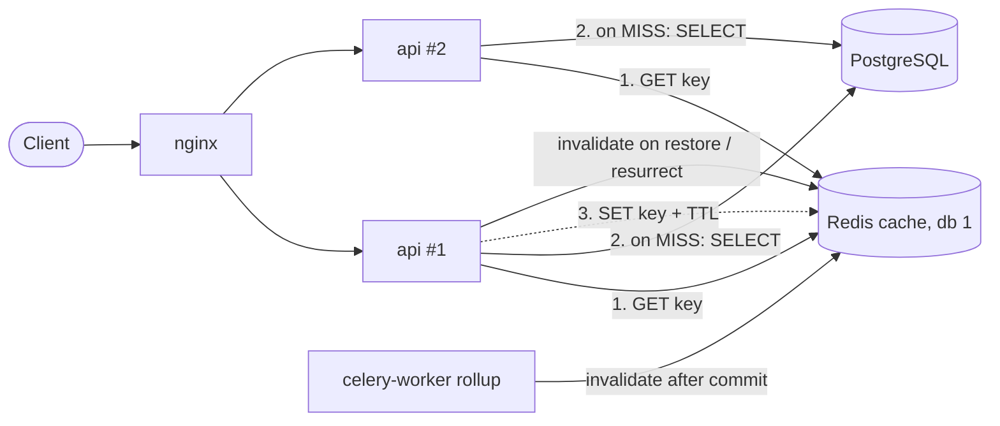

`HIT` returns straight from Redis; `MISS` reads Postgres, stores the JSON with
a TTL and returns it; `BYPASS` means the cache was unreachable (or the client
sent `Cache-Control: no-cache`) and the answer came from Postgres. Every
response carries `X-Cache: HIT | MISS | BYPASS`.

### Key scheme and TTL

`cache:<version>:<domain>:<entity-id>:<params-hash>`, e.g.
`cache:v1:backups:42:9f2c1a7e` (`params-hash` = first 8 hex of SHA-1 over the
sorted query params, here `limit`). The clone id is part of the key, so one
clone can never read another's entry, and the id-before-hash order lets one
prefix scan drop every variant of one clone. The version segment (`v1`) lets a
response-shape change invalidate everything by bumping it.

| Setting | Value | Why |
| --- | --- | --- |
| TTL | 60 s (`CACHE_BACKUPS_TTL_SECONDS`), ±10% jitter | Safety net for missed invalidation; jitter stops keys created together expiring together (avalanche). |
| Storage | Redis **db 1** on the same container | Separate keyspace from the write-path streams and Celery broker on db 0. |
| Eviction | not set | Cache keys are small and TTL-bounded; a real deployment would set `maxmemory` + `allkeys-lru` on a dedicated cache instance. |

### Invalidation

Every mutation of a clone's backup list drops that clone's keys **after** the
Postgres commit: the rollup (`celery_worker.pipeline.rollup_clone`, which
also covers admin force-rollup and pruning), `POST /memories/backups/{id}/restore`,
and `POST /memories/resurrect`. The next read is a `MISS` with fresh data.
Remaining race: a reader that queried Postgres just before the commit can
re-populate the old list just after the invalidation; the TTL bounds that.

### Fallback (graceful degradation)

Cache calls are fail-open with a 0.5 s socket timeout: any Redis error is
logged and treated as `BYPASS`, and the request is served from Postgres. The
write path does need Redis (it is the stream buffer), but reads keep working.
Try it: `bash scripts/cache_experiment.sh demo`.

### Results (`scripts/cache_experiment.sh demo|bench`)

Demo, one clone with 200 seeded backups: `MISS` → `HIT` → restore →
`MISS` (fresh) → `HIT` → `docker stop redis` → `BYPASS` with HTTP 200 → Redis
restarted → `HIT`.

Single-request latency, curl through nginx: MISS ≈ 17–23 ms, HIT ≈ 13–15 ms.

Load (`limit=200`, 30 workers, 20 s, 2 api replicas, same laptop as the
generator):

| Mode | RPS | p50 ms | p95 ms | p99 ms | Postgres rows read |
| --- | --- | --- | --- | --- | --- |
| cold (`Cache-Control: no-cache`, every request hits Postgres) | 97 | 166 | 1018 | 1530 | 782,691 |
| warm (cache enabled) | 121 | 138 | 758 | 1233 | 53,641 |

The main effect is on the database: **~93% fewer rows read** for the same
traffic. The latency gain is modest (+24% RPS, p50 −17%) because every request
still does the authentication lookup in Postgres (deliberately uncached) and
the client, nginx, api and Postgres all share one host's CPU. On a real
deployment the freed database capacity is the benefit, not the millisecond.
Right after Redis restarts, the first request can still be a `BYPASS` while
the client reconnects.

### Theory notes

- **Expiration vs invalidation:** expiration (TTL) is time-driven and
  best-effort; invalidation is event-driven and exact. We use both: explicit
  invalidation on every mutation, TTL as the backstop.
- **Cache stampede / thundering herd:** when a hot key expires or is
  invalidated, many concurrent readers all miss and hit Postgres at once. Not
  mitigated here beyond the short listing query; the standard fixes are a
  per-key lock / single-flight, or refreshing early.
- **Cache avalanche:** many keys expiring together — mitigated by the TTL jitter.
- **Eviction (LRU/LFU):** what Redis drops when `maxmemory` is reached; LRU
  favours recency, LFU frequency. Unset here (see table above).

## Lab 5 — Load testing and performance baseline

Scripts: [`load-tests/mycelium.js`](load-tests/mycelium.js) (k6), runner
`scripts/run_load_tests.sh`, report generator `load-tests/summarize.py`. Raw
k6 exports, container CPU samples and DB counters are in `load-tests/results/`,
the generated tables in `load-tests/results/REPORT.md`, charts in
`load-tests/charts/`. Reproduce:

```bash
bash scripts/run_load_tests.sh prep      # create 50 accounts + seed backups
bash scripts/run_load_tests.sh matrix    # 3 scenarios x load levels
bash scripts/run_load_tests.sh low       # 2 and 5 VUs (locates the knee)
bash scripts/run_load_tests.sh scaling   # 1 vs 3 instances
bash scripts/run_load_tests.sh cache     # scenario A with the cache bypassed
bash scripts/run_load_tests.sh ramp      # one live staged run 10->25->50->100->200 VUs
uv run --with matplotlib python load-tests/summarize.py
```

### Scenarios

| | Type | Flow | Resource profile |
| --- | --- | --- | --- |
| A | Read-intensive | `GET /memories/backups?limit=50` | Redis cache + Postgres read, 50 accounts with 50 backups each |
| B | Write-intensive | `POST /memories/write` | JWT check + Postgres auth lookup + Redis `XADD` |
| C | Complex workflow | `GET /profiles/me` → 3× `POST /memories/write` → `GET /memories/stream/status` → `GET /memories/backups` | mixed read / compute / write, 6 requests per iteration |

Each run is a 10 s warm-up (connection pools, DNS, bytecode; not measured) then
30 s of constant VUs; metrics come only from the measured phase. VUs spread
over 50 pre-registered accounts, so writes hit 50 different Redis streams
rather than one hot key. Think time is zero (closed loop).

### Baseline environment

One Windows laptop, Docker Desktop VM: 12 vCPU, 7.4 GiB RAM, no per-container
limits. **2 `api` replicas** × 2 uvicorn workers each (`API_WORKERS=2`),
Postgres pool `DB_POOL_SIZE=10` + `DB_MAX_OVERFLOW=5` per process, nginx
`least_conn`, Redis with the cache on (db 1, TTL 60 s), 1 Celery worker + beat.
The k6 generator runs in its own container capped at `--cpus=2` on the same
Docker network; the host cannot be split further, so generator and system
under test still share physical cores.

### Results: throughput and latency by load

Full tables (avg/p50/p95/p99 and error rate for every level, including 2, 5
and 25 VUs) are in `load-tests/results/REPORT.md`; the four levels the lab
asks for:

| Scenario | VUs | RPS | Avg ms | p50 | p95 | p99 | Error % |
| --- | --- | --- | --- | --- | --- | --- | --- |
| A read | 10 | 257 | 24 | 21 | 36 | 49 | 0.00 |
| A read | 50 | 268 | 113 | 99 | 158 | 315 | 0.00 |
| A read | 100 | 214 | 274 | 145 | 1012 | 2189 | 0.00 |
| A read | 200 | 253 | 463 | 135 | 1955 | 3706 | 0.00 |
| B write | 10 | 314 | 19 | 17 | 31 | 44 | 0.00 |
| B write | 50 | 216 | 138 | 120 | 196 | 312 | 0.00 |
| B write | 100 | 226 | 261 | 221 | 454 | 1365 | 0.00 |
| B write | 200 | 211 | 546 | 410 | 1399 | 2915 | 0.00 |
| C workflow | 10 | 228 | 24 | 20 | 43 | 61 | 0.00 |
| C workflow | 50 | 238 | 120 | 102 | 191 | 375 | 0.00 |
| C workflow | 100 | 260 | 235 | 182 | 512 | 914 | 0.00 |
| C workflow | 200 | 242 | 482 | 240 | 1563 | 2897 | 0.00 |

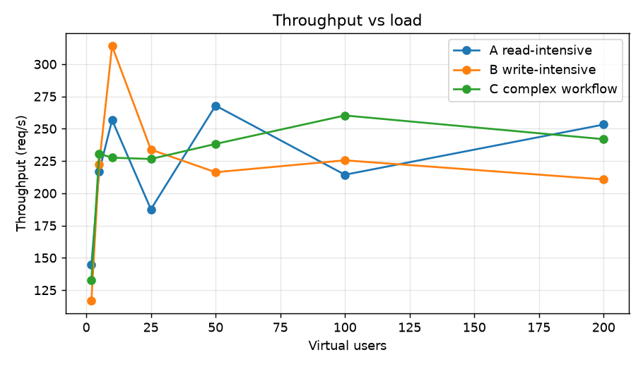
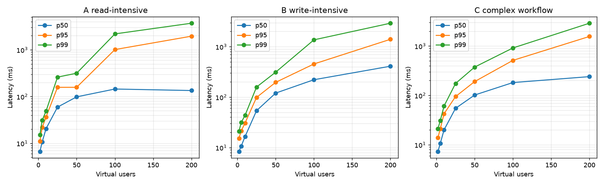

**Mean vs tail.** At 200 VUs scenario A has a 463 ms average but a 3.7 s p99
and a p50 of only 135 ms: most requests are still fast while a minority queue
behind saturated workers, so the mean hides the pain. Tail latency grows
non-linearly because once arrivals exceed service capacity, queue wait, not
service time, dominates, and it is unevenly distributed (unlucky requests land
behind full worker queues and pool waits).

### Saturation point and primary bottleneck

Throughput stops growing almost immediately: it is 117–145 RPS at 2 VUs,
217–231 at 5 VUs, and roughly **230–310 RPS from 10 VUs on, flat up to 200
VUs** (±15% run-to-run noise). Beyond ~10 VUs extra users buy nothing but
latency (scenario B p99: 44 ms at 10 VUs, 2915 ms at 200). Errors stayed at 0%
even at 200 VUs: degradation shows up as queueing latency, not failures (k6's
60 s timeout is never reached).

**Primary bottleneck: CPU of the Python API workers.** Container CPU sampled
mid-run (`load-tests/results/*.stats`, 100 VUs, scenario B):

| Container | CPU |
| --- | --- |
| `api-1` / `api-2` | ~222% each (both workers pegged) |
| Postgres | 45% |
| nginx | 20% |
| Redis | 12% |

Every request pays for JWT verification, an authenticated Postgres lookup
(deliberately uncached, see lab 4), Pydantic validation and JSON serialization
in Python; four workers saturate around 250 RPS (about 60 RPS per core) while
the database has headroom. This refines the lab 3 finding: on this hardware
the first wall is API compute, and the Postgres pool
(`(10+5) × 4 processes = 60` connections) becomes the next one if workers are
added.

### Scaling impact (100 VUs, 1 vs 2 vs 3 instances)

| Scenario | Instances | RPS | p95 ms | p99 ms | Efficiency (RPS ÷ N·RPS₁) |
| --- | --- | --- | --- | --- | --- |
| A | 1 | 173 | 1668 | 3305 | 1.00 |
| A | 2 | 214 | 1012 | 2189 | 0.62 |
| A | 3 | 238 | 424 | 1491 | 0.46 |
| B | 1 | 166 | 934 | 2120 | 1.00 |
| B | 2 | 226 | 454 | 1365 | 0.68 |
| B | 3 | 291 | 285 | 686 | 0.59 |

Adding instances helps sub-linearly (efficiency 0.46–0.68): the extra
processes compete with Postgres, Redis, nginx and the load generator for the
same host CPU. Tail latency improves faster than throughput (B p99: 2120 ms
with 1 instance, 686 ms with 3). Read scenario A gains little beyond 2
instances (238 vs 214 RPS is within noise).

### Caching impact (scenario A, 100 VUs, 2 instances)

| Mode | RPS | p50 ms | p95 ms | p99 ms | `memory_backups` rows read |
| --- | --- | --- | --- | --- | --- |
| cache disabled (`Cache-Control: no-cache`) | 186 | 179 | 869 | 1937 | 16,780 |
| cache enabled (warm) | 214 | 145 | 1012 | 2189 | 2,833 |

The cache removes **83% of reads on the cached table** and gives +15% RPS and
−19% p50, but p95/p99 are not better (within run-to-run noise). The reason is
the bottleneck above: the request still burns API CPU on auth and
serialization, so shielding the database does not raise the ceiling here. The
benefit is database headroom, not raw latency.

### System performance baseline

```
=== SYSTEM PERFORMANCE BASELINE ===
Environment Config: 12 vCPU / 7.4 GiB Docker VM, no container limits;
                    2 api replicas x 2 workers, DB pool 10+5 per process,
                    nginx least_conn, Redis cache on (TTL 60s), k6 --cpus=2
Stable Throughput:  ~230-310 RPS with p95 < 45 ms (reached at ~10 VUs)
Saturation Point:   ~5-10 VUs (~250 RPS); flat to 200 VUs
p95 / p99 Latency:  A 36 / 49 ms, B 31 / 44 ms, C 43 / 61 ms at 10 VUs;
                    beyond saturation p99 reaches 2.9-3.7 s at 200 VUs
Error Rate:         0.00% up to 200 VUs (degrades by latency, not errors)
Critical Scenario:  C (complex workflow): highest latency at equal VUs
                    (p99 61 ms at 10 VUs); B degrades fastest past saturation
Primary Bottleneck: API worker CPU (~220% per api container vs Postgres 45%)
```

### Caveats and theory

- **Noise, and one result that disagrees.** Each point is one 30 s run.
  Identical configurations differed by ~15% (scenario A at 100 VUs: 258 and
  214 RPS in two runs). Worse, the single staged run
  (`bash scripts/run_load_tests.sh ramp`, scenario B, 10 → 25 → 50 → 100 →
  200 VUs in 30 s stages, 0% errors) averaged **385 RPS with p99 823 ms** over
  the whole ramp, clearly above the constant-VU figures for the same scenario
  (211–314 RPS, p99 up to 2.9 s at 200 VUs). Its aggregate mixes the low-load
  stages in, so it is not directly comparable, but it does show that
  run-to-run and host-state variance on this shared laptop can reach tens of
  percent. Treat the baseline card as indicative: the qualitative findings
  (early knee, API-CPU-bound, flat throughput, growing tail) are consistent,
  the exact RPS ceiling is not pinned down and should be re-measured on a quiet,
  dedicated machine with several repetitions per point.
- **Coordinated omission.** This is a closed-loop test: a VU waits for its
  response before sending the next request, so when the server stalls the
  generator silently stops sending and the missing (slow) requests are never
  measured. Reported tail latencies under saturation are therefore **lower
  bounds**. An open-model executor (`constant-arrival-rate`) would expose the
  true tail.
- **GC / JIT.** CPython has no JIT, so the warm-up here mainly primes
  connection pools, DNS and import/bytecode caches; garbage-collector pauses
  would show up as isolated p99/max spikes. On JVM/Node targets, JIT
  compilation and GC pauses skew percentiles right after start, which is why a
  warm-up phase is discarded.
- **Isolation.** Generator and SUT share one host; `--cpus=2` bounds the
  generator, but a real baseline needs a separate machine.

## Lab 6 — Database replication and read/write separation

Lab 5 showed one Postgres serving every statement. Lab 6 adds a **streaming
replica** and splits traffic: writes (and anything that must be exact) go to
the primary, lag-tolerant reads go to the replica, with a mechanism that keeps
a client from seeing its own write disappear.

### Topology

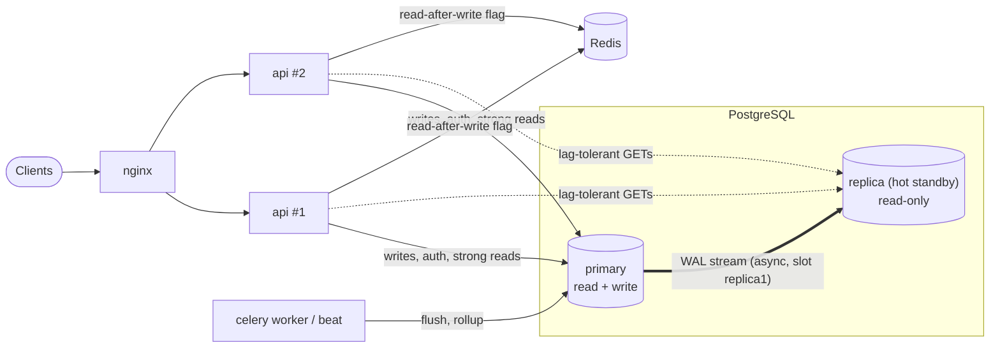

What changed relative to lab 5:

| Area | Lab 5 | Lab 6 |
| --- | --- | --- |
| Postgres | one node | primary (`wal_level=replica`, replication slot) + hot standby `db-replica` cloned with `pg_basebackup`, streaming WAL |
| Sessions | `DatabaseSession` | `DatabaseSession` (primary) + `ReadDatabaseSession` (replica, with fallback) |
| Consistency | n/a | read-after-write window in Redis, `X-Read-Consistency` override, `X-DB-Node` label |
| Failure | DB down = 503 | replica down = reads fall back; primary down = reads served from replica, writes 503 |
| Celery | primary | primary only (a replica cannot be written) |

### Replication setup (`infra/docker-compose.yaml`, `infra/postgres/`)

- **Primary** (`db`): started with `-c wal_level=replica -c max_wal_senders=10
  -c max_replication_slots=10 -c max_slot_wal_keep_size=1GB` and a
  `pg_hba.conf` that adds `host replication all all scram-sha-256` (the
  `replication` keyword is *not* matched by `all`).
- **`replication-setup`**: idempotent one-shot that creates the `replicator`
  role and the physical slot `replica1`. It runs as a service rather than an
  init script so it also works on a data volume that already exists. A slot
  makes the primary keep the WAL a stopped standby has not consumed
  (`max_slot_wal_keep_size` caps the disk it may pin).
- **Replica** (`db-replica`): `replica-entrypoint.sh` takes a
  `pg_basebackup -R -X stream` on first boot (empty data dir), then starts
  with `hot_standby=on`. `-R` writes `standby.signal`, which is what makes it a
  standby; the replica refuses writes (`cannot execute … in a read-only
  transaction`).
- **Asynchronous** replication (default): the primary commits without waiting
  for the standby. Fast writes, but a replica read can be stale, which is the
  whole point of the consistency design below. `synchronous_commit=remote_apply`
  would remove staleness at the price of write latency and of a dead replica
  blocking commits.

`scripts/replication_experiments.sh topology` prints `pg_stat_replication`,
`pg_is_in_recovery()` on both nodes and the refused write.

### Read/write separation (where in the code)

`shared/db/db.py` builds a second engine from `POSTGRES_REPLICA_HOST` (empty =
single node, the code degrades to lab 5). `api/deps.py` exposes two sessions:

| Request | Node | Why |
| --- | --- | --- |
| `POST /auth/*`, every `PATCH`/`POST` write, restore, resurrect, admin mutations | primary | writes |
| Authentication (`get_current_user`), `GET /profiles/me`, `GET /memories/backups/{id}` | primary | **strong**: a stale `is_active`/role is a security bug; backup detail shares the restore path |
| `GET /profiles`, `GET /profiles/{id}`, `GET /memories/backups`, `GET /admin/{users,clones,stats,clones/{id}/backups}` | replica | **eventual**: lists and aggregates tolerate seconds of lag |
| Celery flush / rollup | primary | writes |

Business-logic classification: *Strictly consistent* = identity, authorization,
anything that is the input to a write. *Eventually consistent* = browsing
listings and operator statistics. Every response carries `X-DB-Node` so the
routing is observable.

### Replication lag and stale reads

`scripts/replication_experiments.sh lag 3s` makes the standby replay WAL 3 s
late (`recovery_min_apply_delay`), writes, and reads straight away. Measured
output:

```
-- immediately, forced to the replica (what a naive router would do):
HTTP 200  node=replica            status=before-lag     <- stale read
-- immediately, automatic routing (read-after-write):
HTTP 200  node=primary-sticky     status=fresh-write
-- after 3s the standby has caught up:
HTTP 200  node=replica            status=fresh-write
```

Without induced delay the lag on this stack is a few milliseconds
(`pg_stat_replication`, `GET /admin/replication`), so stale reads are rare but
real; the delay knob makes them reproducible for the demo.

### Read-after-write consistency

| Mechanism | Status | How |
| --- | --- | --- |
| **Session sticky routing** | implemented | after a successful non-GET, a Redis key `rw:v1:user:<id>` lives `REPLICA_STICKY_SECONDS` (5 s). While it exists the user's lag-tolerant reads use the primary (`X-DB-Node: primary-sticky`). Redis, not process memory, so it holds across API instances (lab 2). |
| **Explicit primary routing** | implemented | `X-Read-Consistency: strong` forces the primary, `eventual` forces the replica. |
| **Writes the owner did not make** | implemented | a rollup in celery sets `rw:v1:clone:<id>`, so the owner's next listing is not re-cached from a standby that has not replayed the new backup. |
| LSN verification | described only | record `pg_current_wal_lsn()` after a write and read from a replica only once `pg_last_wal_replay_lsn()` has passed it: exact, no fixed window, but needs an extra query per read. |

The window must exceed the worst replication lag, otherwise it closes too
early; failing to read the flag **fails closed** (primary). Cache-Aside (lab 4)
interacts: a listing cached from the replica can be at most `TTL + lag` old, and
the invalidation points above close the window for the writer.

### Fault tolerance (`scripts/replication_experiments.sh failover`)

| Failure | Behaviour (measured) |
| --- | --- |
| Replica stopped | reads keep returning 200 with `X-DB-Node: primary-fallback`; per-process circuit breaker skips the dead node for `REPLICA_BREAKER_COOLDOWN_SECONDS`; `/health` stays 200 with `"replica":"error"` |
| Replica restarted | after the cooldown reads return to `X-DB-Node: replica` |
| Primary stopped | `GET /profiles` still 200 (`replica-degraded`, identity read from the standby); `PATCH` → **503** `Primary database unavailable; service is read-only`; primary-only GET → 503; `/health` → 503 |
| Primary restarted | writes succeed again without restarting the API |

Authentication in degraded mode can lag the primary by the replication delay
(a deactivation made seconds earlier is not seen yet); that is the accepted
price of keeping reads up and is limited to safe methods.

There is **no automatic promotion**: promoting the standby (`pg_ctl promote`
or `SELECT pg_promote()`) and repointing the application is a manual step.
Doing it automatically needs a consensus-based manager (Patroni/etcd, which
rely on Raft-style leader election) to avoid **split-brain**: two nodes both
believing they are primary.

### Read scaling impact (`scripts/run_load_tests.sh replica`)

Scenario A (read-intensive) with the lab 4 cache bypassed so every read
reaches Postgres; 2 API instances, 30 s per point, same host and caveats as
lab 5. "Single" = `POSTGRES_REPLICA_HOST=` (all reads on the primary).
Rows are `tup_returned + tup_fetched` from `pg_stat_database` during the run.

| VUs | Topology | RPS | p50 ms | p95 ms | p99 ms | Primary rows | Replica rows |
| --- | --- | --- | --- | --- | --- | --- | --- |
| 10 | single | 260 | 22 | 44 | 66 | 3.46 M | — |
| 10 | primary + replica | 202 | 25 | 63 | 110 | 0.85 M | 1.21 M |
| 50 | single | 252 | 113 | 195 | 270 | 3.02 M | — |
| 50 | primary + replica | 207 | 134 | 240 | 354 | 1.03 M | 1.53 M |
| 100 | single | 239 | 231 | 476 | 628 | 2.78 M | — |
| 100 | primary + replica | 215 | 264 | 513 | 677 | 1.05 M | 1.54 M |
| 200 | single | 230 | 469 | 1339 | 1991 | 2.67 M | — |
| 200 | primary + replica | 192 | 581 | 1475 | 2234 | 0.93 M | 1.35 M |

Findings, stated plainly:

- **Throughput did not improve; it dropped ~10–20%.** The system is bound by
  API worker CPU (both api containers sit at ~200% in both topologies, lab 5's
  bottleneck), not by Postgres. Splitting adds work per request on the same CPU:
  a second connection checkout/ping, the Redis window lookup, and a second
  session. Saturation point is unchanged (~10 VUs, ~250 RPS).
- **Database load did move.** The primary reads ~65% fewer rows
  (~2.8 M → ~1.0 M at 100 VUs) and its CPU falls from ~50% to ~31% while the
  replica carries ~29%. The remaining primary load is authentication, which
  is deliberately strong.
- So read replicas pay off when the **database** is the bottleneck (heavier
  queries, analytics, more clients per node), not when the application tier is.
  Here the right next step is more API CPU, which the replica does not provide.
- Single 30 s runs on a shared laptop vary ~15% (lab 5 caveats), so the 10–20%
  gap is at the edge of the noise; the 65% row reduction is not.

### Theory notes

- **Sync vs async vs semi-sync.** Async: lowest write latency, replica may lag
  and a primary crash can lose the unreplicated tail. Sync: no loss, but every
  commit waits and a down replica stalls writes. Semi-sync: wait for one of
  several standbys.
- **Eventual consistency / CAP / PACELC.** During a partition a system picks
  availability or consistency (CAP); PACELC adds that even without a partition
  it trades latency for consistency. This design is PA/EL for listings and
  PC/EC for identity and writes.
- **Failover and split-brain.** Promotion must be fenced so the old primary
  cannot accept writes; leader election with a consensus protocol (Raft in
  Patroni/etcd) is the standard answer. The old primary must be re-cloned or
  rewound to rejoin as a standby.

Reproduce: `docker compose -f infra/docker-compose.yaml up -d --build`, then
`scripts/replication_experiments.sh {topology|routing|lag|failover}` and
`scripts/run_load_tests.sh prep && scripts/run_load_tests.sh replica`.

## Lab 7 — Data scaling: sharding and partitioning

Lab 6 scaled *reads* of one dataset. Lab 7 splits the dataset itself: the
memory data plane is spread over two independent PostgreSQL nodes, selected by
a deterministic router.

### Dataset and shard key

| Entity | Growth | Access key | Decision |
| --- | --- | --- | --- |
| `users`, `clone_profiles` | one row per clone | email, user id, designation | **not sharded** (control plane): small, read-mostly, needs global uniqueness (`email`, `designation`) |
| `memory_buffers` | rewritten continuously, one row/clone | `clone_id` | **sharded** |
| `memory_backups` | unbounded (hourly/daily/weekly per clone) | `clone_id` | **sharded** |

**Shard key: `clone_id`.**

- *Cardinality*: one value per clone, so the key space is as large as the
  fleet and can be spread over many nodes. A low-cardinality key such as
  `subscription_tier` (3 values, most clones `free`) would pin most data to one
  shard no matter how many shards exist.
- *Query locality*: every data-plane operation is per clone — a write drains
  one clone's stream into its buffer, a rollup reads that buffer and writes that
  clone's backups, a listing reads one clone's backups — so each stays on one
  shard.
- *Why not the surrogate `memory_backups.id`*: an auto-increment id says
  nothing about the owner, so "list this clone's backups" would have to ask
  every shard, and monotonic ids concentrate all new inserts on the shard that
  owns the newest range.

### Topology

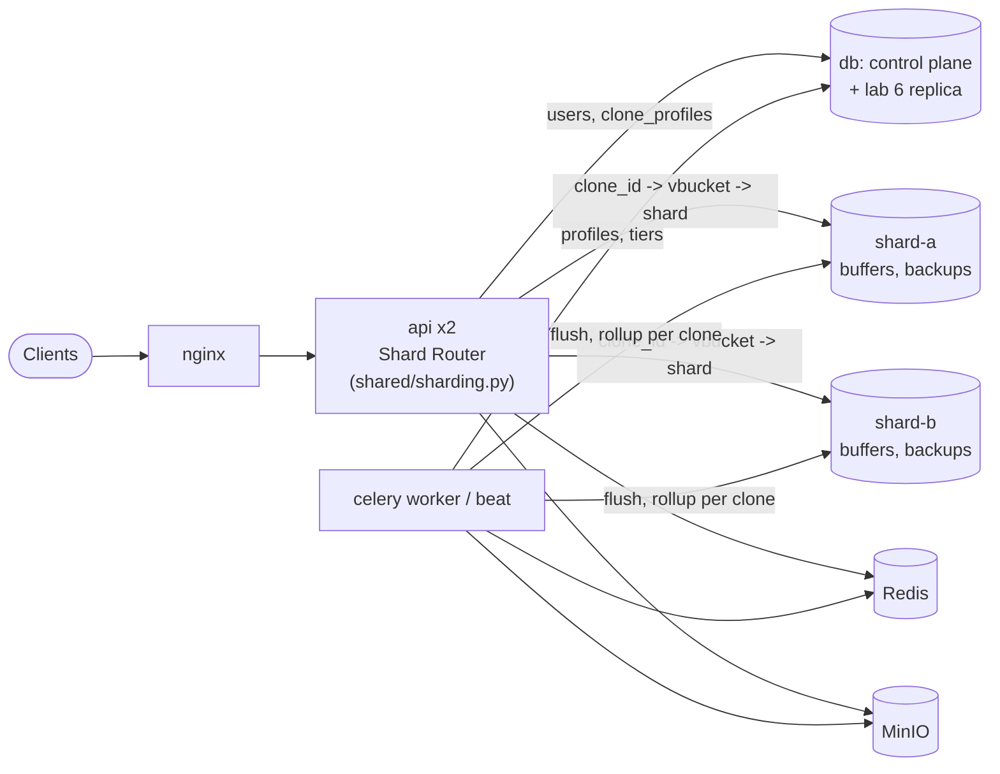

Each shard may itself be a lab 6 primary + replica pair; here each is a single
node to keep the stack small (the control plane keeps its replica).

What changed relative to lab 6:

| Area | Lab 6 | Lab 7 |
| --- | --- | --- |
| Data plane | `memory_*` on the primary | `memory_*` on `shard-a` / `shard-b`, chosen by `ShardRouter` |
| Schema | FKs `memory_*.clone_id -> clone_profiles` | FKs removed (migration `0002`): a constraint cannot span databases |
| API sessions | `DatabaseSession`, `ReadDatabaseSession` | + `ShardDatabaseSession`, `ShardReadSession` |
| Celery | single session | per-clone shard session; due-clone join done in the application |
| Migrations | one database | the same revision applied to `db` and every shard |
| Single node | n/a | `SHARD_NODES=` (empty) reproduces lab 6 exactly |

### Shard Router (`shared/sharding.py`)

`router.shard_for(clone_id)` is a pure function of the id and the configured
shard list (`SHARD_NODES`, `SHARD_STRATEGY`), so every API worker and Celery
process routes identically with no coordination. Python's `hash()` is salted per
process and is never used; placement uses BLAKE2b.

| Strategy | Placement | Property |
| --- | --- | --- |
| `modulo` | `shards[id % N]` | cheapest; inherits any regularity of the id sequence |
| `hash` | `shards[hash(id) % N]` | breaks id patterns; adding a shard still moves most keys |
| `vbucket` (default) | `hash(id) % 1024` selects a *virtual bucket*; a bucket -> shard table (rendezvous hashing) says where it lives | adding a shard moves ~1/N of the data; single buckets can be moved on their own |

Inspect a decision: `GET /admin/shards/locate/{clone_id}` (admin). Every
response served from a shard carries `X-DB-Node: shard-<name>`.

### Data distribution baseline (`scripts/shard_experiments.sh distribution`)

120 clones, 367 writes with a skewed (Zipf-like) profile, strategy `vbucket`,
measured through `GET /admin/shards`:

| Shard | vbuckets | Clones | Clones % | Entries | Entries % | Write ops | Write ops % |
| --- | --- | --- | --- | --- | --- | --- | --- |
| A | 523 | 63 | 52.5 | 214 | 58.3 | 63 | 52.5 |
| B | 501 | 57 | 47.5 | 153 | 41.7 | 57 | 47.5 |

Keys are spread almost evenly; the 58/42 split of *entries* is the traffic
skew of a few busy clones, which a key-based function cannot see. "Write ops" is
`n_tup_ins + n_tup_upd + n_tup_del` on the two data-plane tables.

### Hot shard and its fix (`scripts/shard_experiments.sh hotshard`)

Scenario: two onboarding pipelines hand out alternating clone ids; one large
tenant owns every even id and gets 90% of the connections (reads of its
backups, cache bypassed, 24 connections, 30 s). Offline model over 10 000 such
clones (`tools/shard_model.py`):

| Strategy | Shard A % | Shard B % |
| --- | --- | --- |
| `key % N` | **100.0** | 0.0 |
| `hash(key) % N` | 48.9 | 51.0 |
| virtual buckets | 50.7 | 49.3 |

Live, 3 passes per strategy (the order was rotated, see the note below), mean
values; the tenant's 20 clones:

| Strategy | Tenant clones on A / B | Rows read A / B, % | DB CPU A / B, % |
| --- | --- | --- | --- |
| `modulo` | 20 / 0 | **87.3** / 12.7 | **29.2** / 4.8 |
| `hash` | 13 / 7 | 61.3 / 38.7 | 16.6 / 10.0 |
| `vbucket` | 11 / 9 | 52.4 / 47.6 | 15.5 / 12.9 |

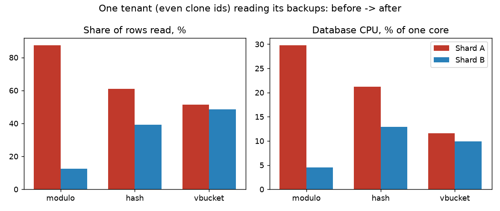

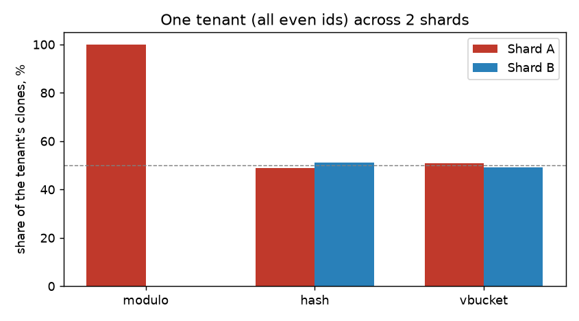

What this does and does not show:

- Under `modulo` shard A does ~87% of the reads and burns ~6x the CPU of shard
  B; the remaining 13% on B are the quiet odd-id tenant. Hashing the key removes
  the id pattern; with 20 clones hash still lands 13/7 by chance, buckets 11/9.
- **Latency did not follow cleanly.** Per-run RPS ranged 89-173 and p95
  216-480 ms. `vbucket` was the slowest run in the first two passes (89 and 92
  RPS against 109-150) but the fastest in the pass with the order reversed (173
  against 165-171), so the gap is run-to-run/host noise on a shared laptop, not
  a property of the router (a placement decision is one hash and a table
  lookup). The API tier (CPU-bound since lab 5) hides the database imbalance at
  this load; the distribution of work (rows, CPU) is the robust result, a real
  latency effect would appear when a single shard saturates.
- A single hot *clone* (not a pattern of ids) is still one row on one shard.
  Virtual buckets do not split it, but they let that bucket be moved alone to an
  emptier shard (edit the bucket table) - plain `hash % N` cannot.

### Cross-shard queries: scatter-gather

`GET /admin/backups?limit=50` needs the newest backups of the whole fleet; no
shard can answer alone, so each shard returns its own top 50 and the router
merges (`X-Shards-Queried: 2`). `GET /admin/stats` sums per-shard counts the same
way. Compared with the shard-local `GET /memories/backups` (cache bypassed), same
data, same load generator (`scripts/shard_experiments.sh fanout`, tables emptied
and re-seeded for each topology):

| Topology | Query | RPS | p50 ms | p95 ms | p99 ms |
| --- | --- | --- | --- | --- | --- |
| single db | shard-local list | 209 | 88 | 142 | 207 |
| single db | global list | 234 | 79 | 114 | 172 |
| 2 shards | shard-local list | 211 | 85 | 146 | 261 |
| 2 shards | **global list (fan-out)** | 194 | 87 | **223** | **369** |

The local query is untouched by sharding (it still reads one node). The
fan-out costs roughly +2x at the tail: two round trips (latency = slowest
shard + merge), twice the connections held per request, and the work grows
linearly with the shard count while a single-node query would have stayed one
index scan. Here the tables are tiny (a few thousand rows), so sharding cannot
buy anything back; the penalty is the fixed per-shard overhead.

Related consequences handled in code:

- **Distributed JOIN.** Due-clone detection used to join `clone_profiles` with
  `memory_backups` in SQL. With the tables on different databases it is now two
  queries - newest `period_end` per clone from every shard, then a filtered scan
  of profiles - joined in Python (`find_due_clones`).
- **Uniqueness.** `memory_backups.id` comes from a per-shard sequence, so ids
  repeat across shards; an id is only meaningful together with its owner, which
  is how `/memories/backups/{id}` already resolves it. Global uniqueness would
  need ULIDs or an id-range per shard. `users.email` / `designation` stay unique
  because they live on the single control plane.
- **Referential integrity** moves into the application: a profile is created
  before its data and no code path hard-deletes profiles.

### Cross-shard writes and transactions

`POST /memories/resurrect` copies the latest backup of a *source* clone (one
shard) into the *caller* (generally another shard). A local ACID transaction
cannot cover two databases: if the insert on shard B committed and a failure hit
before the matching step on A (or the reverse) there is no atomic rollback.
Options, in the order they were considered:

1. **Two-phase commit (2PC)**: a coordinator asks all shards to PREPARE, then
   COMMIT. Correct, but blocking: if the coordinator dies between phases the
   participants hold locks until it recovers; every write pays two round trips
   and a prepared-transaction store.
2. **Saga**: a chain of local transactions with compensations. Cheap and
   non-blocking, but the intermediate states are visible and compensations must
   be idempotent.
3. **Re-design so the operation is shard-local.** What is implemented: the
   operation is ordered as *read source shard -> copy the object in MinIO ->
   insert one row on the caller's shard -> invalidate cache*. Exactly one
   database writes, so one local transaction decides the outcome; the only
   failure residue is an unreferenced object, which is harmless and can be
   garbage-collected. This is a Saga whose only compensation is "ignore".

### Resharding model (`tools/shard_model.py`)

Adding a shard changes `N`. Fraction of 20 000 keys that must move (production
router code):

| Change | `key % N` | `hash(key) % N` | consistent-hash ring (128 vnodes) | 1024 virtual buckets | Ideal |
| --- | --- | --- | --- | --- | --- |
| 2 -> 3 shards | 66.7% | 66.6% | 32.0% | 32.7% | 33.3% |
| 2 -> 4 shards | 50.0% | 50.0% | 46.9% | 49.5% | 50.0% |
| 3 -> 4 shards | 75.0% | 75.0% | 23.7% | 25.0% | 25.0% |

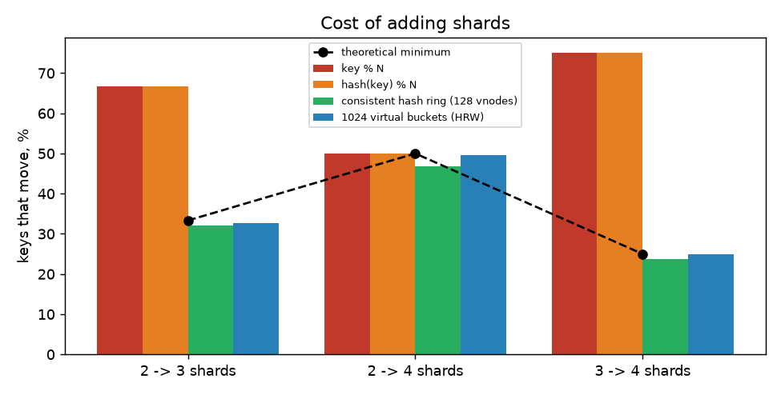

Going from `N` to `N+1` with `key % N` moves a fraction `N/(N+1)` of the data
(67%, 75%, ... approaching 100% for large clusters); only the doubling
2 -> 4 is "cheap" because the old residues nest in the new ones. Consistent
hashing places both nodes and keys on a ring so a new node only takes the
keys between itself and its predecessor - `~1/(N+1)` of the data, all of it
flowing *to* the new node. Virtual buckets achieve the same with a fixed number
of buckets: only the reassigned buckets move (`test_vbucket_moves_about_one_over_n_and_only_to_the_new_shard`
asserts that nothing moves between existing shards). The bucket count caps the
granularity (1024 buckets over 3 shards are ~341 each) and must be chosen up
front; changing it is itself a full reshard.

Live migration is not implemented. The procedure the design supports: add the
node to `SHARD_NODES`, copy the rows of reassigned buckets while dual-writing
or pausing their streams, switch the table, delete the source rows.

### Benchmark: single database vs two shards (k6, `scripts/run_load_tests.sh shard`)

Lab 5 scripts, 2 API instances, 30 s per point, 10/50/100 VUs, tables emptied
and re-seeded per topology (50 clones x 50 backups), same host caveats as lab 5.
Scenario A = shard-local read (cache bypassed), E = cross-shard fan-out
(`/admin/backups`).

| VUs | Topology | A: RPS | A: p95 ms | A: p99 ms | E: RPS | E: p95 ms | E: p99 ms | Errors |
| --- | --- | --- | --- | --- | --- | --- | --- | --- |
| 10 | single | 227 | 45 | 93 | 303 | 33 | 40 | 0% |
| 10 | 2 shards | 238 | 42 | 70 | 215 | 39 | 124 | 0% |
| 50 | single | 204 | 253 | 350 | 292 | 155 | 234 | 0% |
| 50 | 2 shards | 207 | 257 | 326 | 152 | 329 | 418 | 0% |
| 100 | single | 222 | 510 | 695 | 279 | 393 | 525 | 0% |
| 100 | 2 shards | 213 | 557 | 765 | 173 | 601 | 760 | 0% |

Reading it:

- **Shard-local reads: no change** (within the ~15% run-to-run noise of lab 5).
  The bottleneck is still API CPU (~200% per container), so doubling the
  database nodes cannot raise throughput - the saturation point (~10 VUs,
  ~220-250 RPS for A) is the same in both topologies.
- **Fan-out reads: 29-48% less throughput and 1.5-2x p95** (10-100 VUs) - the
  measured price of a query without the shard key.
- Sharding here buys capacity headroom (storage, flush write throughput, per-node
  working set), not speed; at 2 500 backup rows it has nothing to win back.
  It pays off when one node cannot hold or write the dataset, not on a laptop.

### Partitioning vs sharding vs replication

| | Partitioning | Sharding | Replication |
| --- | --- | --- | --- |
| Splits | one table into pieces inside **one** database (range/list/hash `PARTITION BY`) | the dataset across **several** independent databases | copies the **same** data to more nodes |
| Goal | smaller indexes, partition pruning, cheap retention (`DROP PARTITION`) | capacity and write throughput beyond one node | read scaling, availability |
| Cost | none for the application | routing, cross-shard queries/transactions, resharding | lag, failover |

They compose: each shard can be partitioned (e.g. `memory_backups` by
`period_end`) and replicated (lab 6). Native partitioning was not applied here:
`memory_backups` is pruned by per-tier retention (a handful of rows per clone),
so there is no big time-ordered table to prune.

Reproduce: `docker compose -f infra/docker-compose.yaml up -d --build`, then
`scripts/shard_experiments.sh {model|distribution|hotshard|fanout}` and
`scripts/run_load_tests.sh prep && scripts/run_load_tests.sh shard`
(`RESET_DATA_PLANE=1` empties `memory_*` first - destructive, opt-in).
