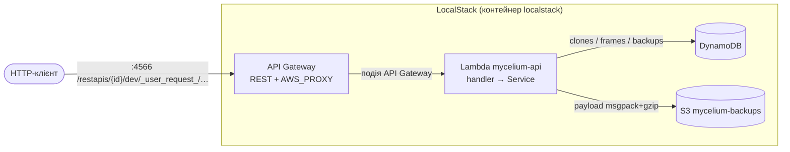

# Mycelium Consciousness у LocalStack (ЛР №8)

Serverless-версія нашого проєкту: той самий домен (клони, кадри пам'яті, резервні
копії, рівні підписки) і той самий код кодування резервних копій
(`shared.backup_codec`) та політик (`shared.subscriptions`), але на AWS-сервісах,
які емулює **LocalStack**.

| Основний проєкт | ЛР №8 |
| --- | --- |
| FastAPI + uvicorn | **Lambda** (`aws/lambda/handler.py`) |
| nginx / Ingress | **API Gateway** (REST API, proxy-інтеграція) |
| Redis Stream + `memory_buffers` | DynamoDB `mycelium-frames` |
| `clone_profiles` | DynamoDB `mycelium-clones` |
| `memory_backups` | DynamoDB `mycelium-backups` |
| MinIO | **S3** бакет `mycelium-backups` (payload) |



## API

| Метод і шлях | Що робить | Успіх |
| --- | --- | --- |
| `GET /health` | перевірка працездатності | 200 |
| `POST /clones` `{designation, tier?}` | створити клона (**create**) | 201, 409 дубль, 422 валідація |
| `GET /clones/{id}` | отримати клона (**get**) | 200, 404 |
| `DELETE /clones/{id}` | видалити клона з усіма кадрами й копіями (**delete**) | 204, 404 |
| `POST /clones/{id}/memories` `{content}` | дописати кадр пам'яті | 202 |
| `GET /clones/{id}/memories/status` | скільки кадрів у буфері | 200 |
| `POST /clones/{id}/backups` | згорнути буфер у копію (rollup → S3 + метадані) | 201, 409 якщо буфер порожній |
| `GET /clones/{id}/backups` | список копій, найновіші першими | 200 |
| `GET /clones/{id}/backups/{backup_id}` | копія з розкодованим payload (restore) | 200, 404 |
| `DELETE /clones/{id}/backups/{backup_id}` | видалити копію (рядок і об'єкт S3) | 204, 404 |

Рівні підписки як у проєкті: після rollup зберігається лише `retain_count` найновіших
копій (free — 1, standard — 4, premium — 30).

## Запуск (PowerShell, з кореня репозиторію)

Потрібні: Docker Desktop, AWS CLI v2 (`winget install Amazon.AWSCLI`), Python з
`uv` у PATH (для упаковки `msgpack` під Linux).

```powershell
# 1. LocalStack
docker compose -f aws/docker-compose.yaml up -d
docker compose -f aws/docker-compose.yaml ps          # чекати (healthy)

# 2. розгортання ресурсів одним скриптом (можна запускати повторно)
.\aws\scripts\deploy.ps1

# 3. перевірка HTTP-клієнтом: усі маршрути, успіх і помилки
.\aws\scripts\smoke.ps1

# 4. прибрати все
.\aws\scripts\destroy.ps1
docker compose -f aws/docker-compose.yaml down
```

Перший запуск Lambda тягне образ середовища виконання (`public.ecr.aws/lambda/python:3.12`),
тож `deploy.ps1` може чекати кілька хвилин на стан `Active`.

### Якщо LocalStack не стартує

| Симптом | Що робити |
| --- | --- |
| образ просить акаунт / токен | вказати `LOCALSTACK_AUTH_TOKEN` (безкоштовний акаунт) у `aws/.env` (див. `.env.example`) або взяти інший образ |
| хочу зберігати стан між перезапусками | `docker compose -f aws/docker-compose.persist.yaml up -d` (образ `gresau/localstack-persist`, стан у `aws/volume`) |
| Lambda не стартує, помилка Docker socket | Docker Desktop запущений? у Settings → Advanced дозволено Docker socket |
| `deploy.ps1` чекає `Active` довго | перший pull образу runtime; дивитись `docker logs localstack` |

## Без Docker (розробка)

```powershell
python aws/scripts/local_server.py 8099                  # той самий handler, in-memory сховища
.\aws\scripts\smoke.ps1 -ApiUrl http://127.0.0.1:8099
uv run pytest aws/tests                                  # 27 unit-тестів
```

## Структура

```
aws/
  lambda/handler.py    точка входу Lambda: подія API Gateway -> маршрут -> відповідь
  lambda/service.py    бізнес-логіка (без boto3), перевикористовує shared.backup_codec/subscriptions
  lambda/stores.py     реалізації для DynamoDB та S3 (boto3)
  lambda/inmemory.py   фейкові сховища для тестів і local_server.py
  scripts/package.py   збирає build/function.zip (код + shared + msgpack під Linux)
  scripts/deploy.ps1   розгортання: S3, 3 таблиці, IAM-роль, Lambda, API Gateway
  scripts/destroy.ps1  знесення ресурсів
  scripts/smoke.ps1    перевірка HTTP-клієнтом
  scripts/local_server.py  запуск handler без AWS
  tests/               unit-тести service і handler
  docker-compose.yaml  LocalStack  (+ docker-compose.persist.yaml)
```
