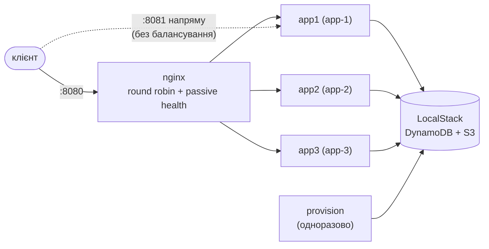

# ЛР №9: балансування навантаження (nginx + docker compose)

Три однакові екземпляри застосунку з ЛР №8 (той самий `handler`/`service`/`stores`),
кожен у контейнері і з власним `X-Instance-ID`, за одним nginx. LocalStack лишається
емулятором AWS: усі екземпляри ділять ті самі таблиці DynamoDB і бакет S3, тому
застосунок stateless і будь-який екземпляр відповість на будь-який запит.



## Запуск (PowerShell, з кореня репозиторію)

LocalStack з ЛР №8 має бути зупинений (`docker compose -f aws/docker-compose.yaml down`):
обидва стеки використовують контейнер `localstack`.

```powershell
docker compose -f aws/lb/docker-compose.yaml up -d --build
docker compose -f aws/lb/docker-compose.yaml ps          # усі (healthy), provision — Exited (0)
Invoke-RestMethod http://localhost:8080/health            # відповідь одного з екземплярів
```

| Адреса | Що |
| --- | --- |
| `http://localhost:8080` | nginx — єдина точка входу, балансує між app1..app3 |
| `http://localhost:8081` | app1 напряму — «без балансування» |
| `http://localhost:4566` | LocalStack |

## Експерименти (`aws/lb/scripts/lbtool.py`, лише стандартна бібліотека Python)

```powershell
# 1. розподіл запитів між екземплярами (по X-Instance-ID)
python aws/lb/scripts/lbtool.py distribution --url http://localhost:8080 --count 60

# 2. вивести екземпляр з роботи, перевірити розподіл, повернути
docker stop lb-app2
python aws/lb/scripts/lbtool.py distribution --url http://localhost:8080 --count 60
docker start lb-app2
Start-Sleep 12                                            # fail_timeout=10s: nginx знову пробує app2
python aws/lb/scripts/lbtool.py distribution --url http://localhost:8080 --count 60

# 3. з балансуванням і без: навантаження, під час якого зупиняється й повертається контейнер
python aws/lb/scripts/lbtool.py outage --url http://localhost:8080 --container lb-app2   # через nginx
python aws/lb/scripts/lbtool.py outage --url http://localhost:8081 --container lb-app1   # напряму в app1

# 4. продуктивність: один екземпляр проти трьох за nginx
python aws/lb/scripts/lbtool.py load --url http://localhost:8081 --duration 15 --concurrency 20
python aws/lb/scripts/lbtool.py load --url http://localhost:8080 --duration 15 --concurrency 20
```

Корисні команди для демонстрації:

```powershell
docker logs lb-nginx --tail 20        # upstream=<адреса> upstream_status=... для кожного запиту
docker logs lb-app1 --tail 5          # JSON-лог: instance, path, status, ms
docker inspect --format "{{.State.Health.Status}}" lb-app1
```

## Як це влаштовано

| Файл | Роль |
| --- | --- |
| `Dockerfile` | образ застосунку: код ЛР №8 + `shared` + HTTP-обгортка, `HEALTHCHECK` на `/health` |
| `server.py` | HTTP-сервер навколо `handler.lambda_handler`; додає `X-Instance-ID`, пише JSON-лог |
| `provision.py` | одноразово створює 3 таблиці DynamoDB і бакет S3 в LocalStack |
| `docker-compose.yaml` | localstack, provision, app1–app3, nginx |
| `nginx.conf` | `upstream` із трьох екземплярів, `max_fails`/`fail_timeout`, `proxy_next_upstream` |
| `scripts/lbtool.py` | розподіл, навантаження, сценарій відмови з таймлайном по секундах |

`GET /health` перевіряє DynamoDB і S3 (`Service.health`): якщо залежність недоступна,
відповідь 503, а Docker помічає контейнер `unhealthy`.

## Розробка без Docker

```powershell
$env:PYTHONPATH = "aws\lambda"; $env:STORE = "memory"; $env:INSTANCE_ID = "dev"; $env:PORT = "8091"
python aws/lb/server.py                                    # in-memory сховища
python aws/lb/scripts/lbtool.py load --url http://127.0.0.1:8091 --duration 5
```
