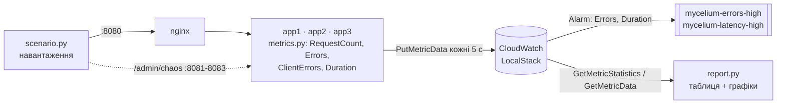
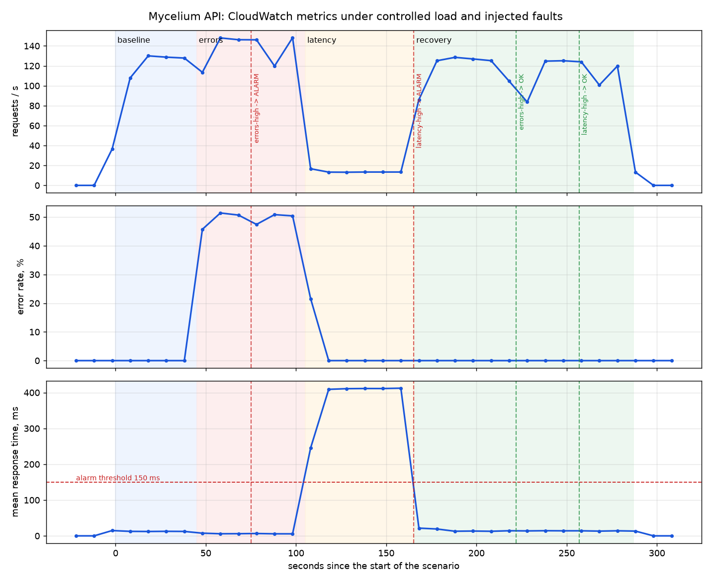
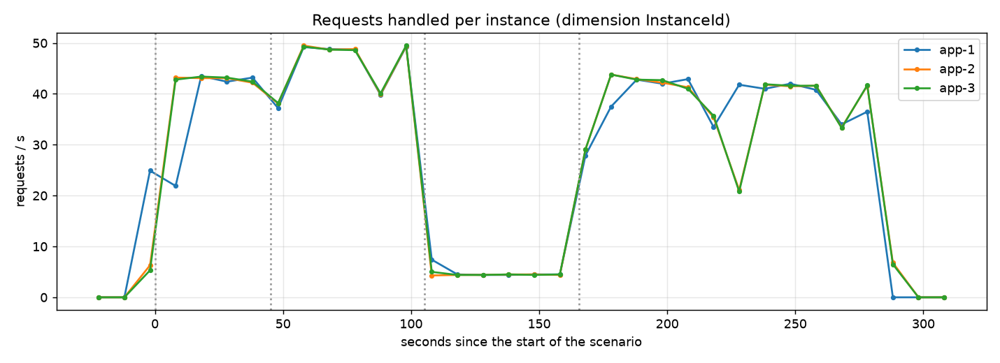

# ЛР №10: моніторинг у CloudWatch (LocalStack)

Три екземпляри застосунку з ЛР №9 за nginx публікують власні метрики в **Amazon
CloudWatch** (`PutMetricData`); на їх основі створено **аларми**, виконано
контрольований експеримент з навантаженням і штучними збоями, обчислено показники
(`GetMetricStatistics` / `GetMetricData`) і побудовано графіки.



## Метрики

Простір імен `Mycelium/Api`. Екземпляр накопичує вікно запитів і кожні 5 с надсилає
**набір статистик** (кількість / сума / мін / макс), а не по метриці на запит.

| Метрика | Що означає | Одиниця |
| --- | --- | --- |
| `RequestCount` | запитів за вікно | Count |
| `Errors` | відповідей 5xx | Count |
| `ClientErrors` | відповідей 4xx | Count |
| `Duration` | час обробки (набір статистик: Sum/SampleCount/Min/Max) | Milliseconds |

Кожна метрика публікується у **двох наборах вимірювань**:

| Вимірювання | Для чого |
| --- | --- |
| `Service=mycelium-api`, `Scope=all` | вся система (сума по екземплярах) — для алармів і загальних графіків |
| `Service=mycelium-api`, `InstanceId=app-N` | окремий екземпляр |

Запити `/health` і `/admin/chaos` не рахуються як трафік. Метрики публікуються з
`StorageResolution=1` (висока роздільність), тому доступні періоди 10 і 30 секунд.

> **Чому `Scope=all`.** Перша версія публікувала загальну серію лише з `Service`.
> LocalStack зіставляє вимірювання як підмножину, тож запит `Service` повертав дані і
> загальної серії, і всіх екземплярів — **удвічі більше за правду** (виявлено порівнянням
> з клієнтським лічильником). Окреме вимірювання `Scope=all` це виключає (у справжньому
> AWS потрібне точне співпадіння, тож так правильно в обох випадках).

## Аларми

| Аларм | Умова | Період |
| --- | --- | --- |
| `mycelium-errors-high` | `Errors` Sum ≥ 5 | 30 с |
| `mycelium-latency-high` | `Duration` Average > 150 мс | 30 с |

`treat-missing-data=notBreaching`: відсутність трафіку не вважається збоєм.

## Запуск (PowerShell, з кореня репозиторію)

```powershell
docker compose -f aws/lb/docker-compose.yaml up -d --build         # LocalStack, 3 екземпляри, nginx
docker compose -f aws/lb/docker-compose.yaml ps                    # усі (healthy)
.\aws\monitoring\scripts\alarms.ps1                                # аларми через AWS CLI
uv run --with boto3 python aws/monitoring/scripts/scenario.py      # ≈5 хв: baseline, помилки, затримка, відновлення
uv run --with boto3 --with matplotlib python aws/monitoring/scripts/report.py
```

`report.py --api data` читає ті самі метрики через `GetMetricData`.
Результати: таблиця в консолі і `aws/monitoring/results/summary.md`, графіки
`docs/img/lab10-metrics.png`, `docs/img/lab10-instances.png`.

### Ручні команди (AWS CLI, `$e = "http://localhost:4566"`)

```powershell
aws --endpoint-url $e cloudwatch list-metrics --namespace Mycelium/Api
aws --endpoint-url $e cloudwatch put-metric-data --namespace Demo/Manual --metric-name Hello --value 42 --unit Count
aws --endpoint-url $e cloudwatch describe-alarms --query "MetricAlarms[].[AlarmName,StateValue]" --output table
# перевести аларм вручну (запасний варіант, якщо вичікувати довго)
aws --endpoint-url $e cloudwatch set-alarm-state --alarm-name mycelium-errors-high --state-value ALARM --state-reason "demo"
```

### Штучні збої вручну

```powershell
Invoke-RestMethod -Method Post http://localhost:8082/admin/chaos -ContentType application/json -Body '{"error_rate":0.5,"latency_ms":300}'
Invoke-RestMethod http://localhost:8082/admin/chaos                 # поточні налаштування екземпляра app-2
Invoke-RestMethod -Method Delete http://localhost:8082/admin/chaos  # зняти
```

## Результати контрольованого експерименту (прогін автора)

6 воркерів, 85 % GET + 15 % POST, через nginx; кожна фаза обрізана на 10 с з обох боків
(період не змішує дві фази).

| Фаза | Тривалість | Запитів | RPS | 5xx | Частка помилок | Середній час, мс |
| --- | --- | --- | --- | --- | --- | --- |
| baseline | 25 с | 2587 | 103,1 | 0 | 0,0 % | 12,4 |
| errors (`error_rate=0.5`) | 40 с | 5601 | 139,7 | 2804 | **50,1 %** | 6,1 |
| latency (`latency_ms=400`) | 40 с | 533 | 13,2 | 0 | 0,0 % | **410,6** |
| recovery | 101 с | 11685 | 115,2 | 0 | 0,0 % | 14,2 |

Стани алармів за журналом опитування (кожні 5 с), від старту сценарію:

| Подія | Момент |
| --- | --- |
| фаза помилок починається | +45 с |
| `mycelium-errors-high` → ALARM | +75 с (через 30 с) |
| фаза затримки починається | +105 с |
| `mycelium-latency-high` → ALARM | +165 с (через 60 с) |
| відновлення починається | +165 с |
| `mycelium-errors-high` → OK | +222 с |
| `mycelium-latency-high` → OK | +257 с |




## Що показав експеримент

- Помилки: частка 5xx 50,1 % при `error_rate=0.5`; **середній час при цьому нижчий** (6 мс),
  бо ін'єктований збій відповідає, не звертаючись до DynamoDB.
- Затримка: середній час 410 мс = 400 мс ін'єкції + ~10 мс роботи; **пропускна здатність
  впала** з ~100 до ~13 RPS (закритий цикл: 6 воркерів / 0,4 с ≈ 15 RPS).
- Аларми спрацювали на обидві аварії й повернулись в OK, але з **затримкою 30–90 с**:
  LocalStack оцінює аларми з періодичністю, а не миттєво.
- Після відновлення показники повернулись до baseline.

## Обмеження

- **Перцентилів (p95/p99) немає:** набір статистик (Sum/Min/Max/SampleCount) не дає
  розподілу. Для них треба публікувати окремі значення (`Values`/`Counts`) або
  використовувати Embedded Metric Format. Є лише середнє й максимум.
- `DescribeAlarmHistory` у LocalStack має неточні часові позначки, тому графіки
  використовують власний журнал опитування станів.
- Сповіщень (SNS, e-mail) немає — лише стани алармів.
- Fault injection (`CHAOS_ENABLED=1`) — лише для лабораторії.

## Файли

| Файл | Роль |
| --- | --- |
| `aws/lb/metrics.py` | збір і публікація метрик (`PutMetricData`) |
| `aws/lb/chaos.py`, `aws/lb/server.py` | `/admin/chaos`, запис метрик у запитах |
| `aws/monitoring/scripts/alarms.ps1` | аларми через AWS CLI |
| `aws/monitoring/scripts/scenario.py` | контрольоване навантаження + збої + опитування алармів |
| `aws/monitoring/scripts/report.py` | `GetMetricStatistics`/`GetMetricData`, таблиця, графіки |
| `aws/monitoring/results/` | журнал сценарію і таблиця прогону автора |
| `aws/tests/test_metrics.py`, `test_report.py` | unit-тести публікації, chaos і розрахунків |
