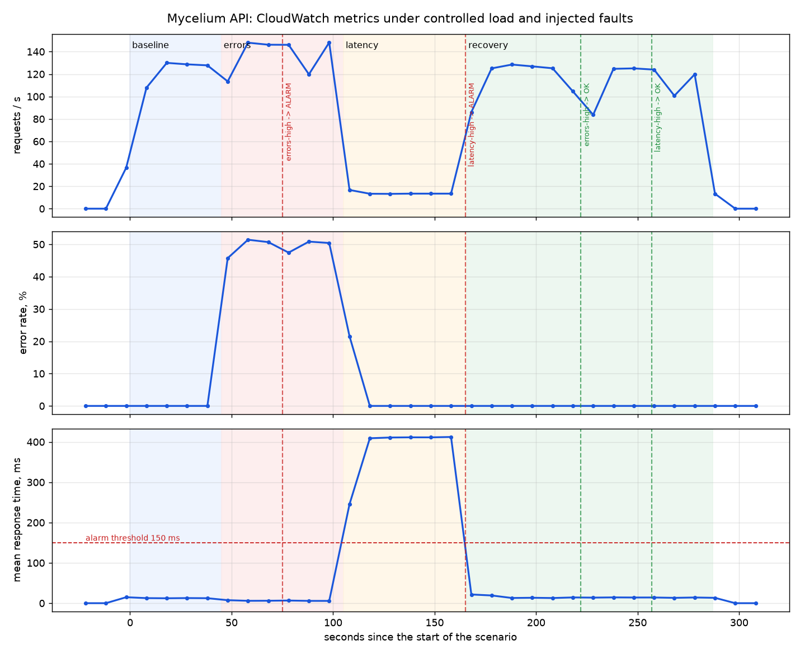
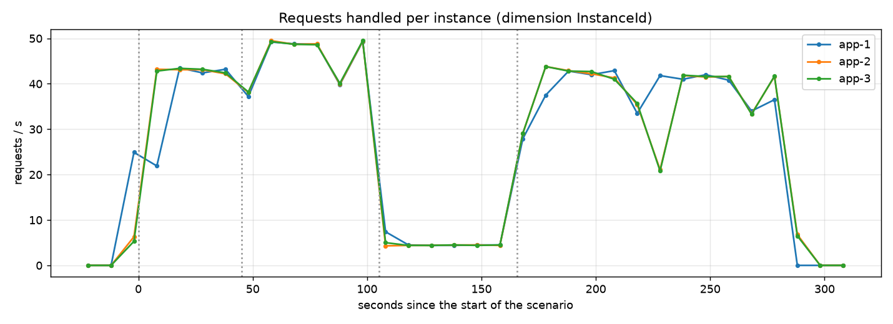

# Звіт: DevOps, лабораторна робота №10

Моніторинг застосунку через Amazon CloudWatch у LocalStack: власні метрики, аларми,
контрольоване навантаження зі штучними збоями, графіки. Застосунок — три екземпляри
з ЛР №9 за nginx. Код: [`aws/lb/`](../aws/lb/README.md) і [`aws/monitoring/`](../aws/monitoring/README.md).
Інструкція до здачі: [devops-lab10-defense.md](devops-lab10-defense.md).

> Замініть блоки `<вивід …>` власним виводом з терміналу. Числа в таблицях нижче —
> прогін автора; підставте свої. Скриншоти — розділ 9.

## 1. Середовище і доступ до CloudWatch API

```
> docker compose -f aws/lb/docker-compose.yaml up -d --build
> docker compose -f aws/lb/docker-compose.yaml ps
<вивід: app1..3 і localstack (healthy)>
> docker logs localstack 2>&1 | Select-String "version"
<вивід: LocalStack version: 4.14.0>
> aws --endpoint-url http://localhost:4566 cloudwatch list-metrics --namespace Mycelium/Api --query "length(Metrics)" --output text
<вивід: число метрик>
```

LocalStack 4.14.0: це остання версія без облікового запису; 3.x не розуміє CloudWatch-запитів
сучасних AWS CLI/boto3, а `latest` вимагає `LOCALSTACK_AUTH_TOKEN`.

## 2. Збір метрик (`aws/lb/metrics.py`)

Кожен екземпляр рахує запити у вікні й кожні 5 с публікує **набір статистик**:

| Метрика | Значення |
| --- | --- |
| `RequestCount` | запитів за вікно |
| `Errors` | відповідей 5xx |
| `ClientErrors` | відповідей 4xx |
| `Duration` | час обробки, мс (SampleCount, Sum, Minimum, Maximum) |

Вимірювання: `Service=mycelium-api, Scope=all` (вся система) і
`Service=mycelium-api, InstanceId=app-N`. Роздільність висока (`StorageResolution=1`).

```
> aws --endpoint-url http://localhost:4566 cloudwatch list-metrics --namespace Mycelium/Api --query "Metrics[].[MetricName,Dimensions[0].Value]" --output text
<вивід>
```

## 3. Публікація й читання

`PutMetricData` вручну і читання `GetMetricStatistics`:

```
> aws --endpoint-url http://localhost:4566 cloudwatch put-metric-data --namespace Demo/Manual --metric-name Hello --value 42 --unit Count
> aws --endpoint-url http://localhost:4566 cloudwatch get-metric-statistics --namespace Demo/Manual --metric-name Hello --start-time … --end-time … --period 60 --statistics Sum
<вивід>
```

`report.py` читає метрики експерименту обома API:

```
> uv run --with boto3 --with matplotlib python aws/monitoring/scripts/report.py
> uv run --with boto3 --with matplotlib python aws/monitoring/scripts/report.py --api data
<вивід: ті самі числа GetMetricStatistics і GetMetricData>
```

Формули: запитів = Sum(`RequestCount`); частка помилок = Sum(`Errors`) / Sum(`RequestCount`);
середній час = Sum(`Duration.Sum`) / Sum(`Duration.SampleCount`).

## 4. Аларми

```
> .\aws\monitoring\scripts\alarms.ps1
<вивід: таблиця алармів, стан OK>
```

| Аларм | Умова | Період |
| --- | --- | --- |
| `mycelium-errors-high` | `Errors` Sum ≥ 5 | 30 с |
| `mycelium-latency-high` | `Duration` Average > 150 мс | 30 с |

## 5. Контрольований експеримент

```
> uv run --with boto3 python aws/monitoring/scripts/scenario.py
<вивід: фази та зміни станів алармів>
```

Фази: baseline (45 с) → errors (`error_rate=0.5`, 60 с) → latency (`latency_ms=400`, 60 с) →
recovery (120 с). Збої вмикаються на всіх екземплярах через `/admin/chaos`.

## 6. Результати (прогін автора)

| Фаза | Тривалість | Запитів | RPS | 5xx | Частка помилок | Середній час, мс |
| --- | --- | --- | --- | --- | --- | --- |
| baseline | 25 с | 2587 | 103,1 | 0 | 0,0 % | 12,4 |
| errors | 40 с | 5601 | 139,7 | 2804 | 50,1 % | 6,1 |
| latency | 40 с | 533 | 13,2 | 0 | 0,0 % | 410,6 |
| recovery | 101 с | 11685 | 115,2 | 0 | 0,0 % | 14,2 |

(кожна фаза обрізана на 10 с з обох боків). Ваш прогін: `<таблиця з report.py>`.

Стани алармів (від старту сценарію): `errors-high` → ALARM +75 с, → OK +222 с;
`latency-high` → ALARM +165 с, → OK +257 с.

## 7. Графіки




## 8. Висновки

- Метрики запитів, помилок і тривалості збираються самим застосунком і публікуються набором
  статистик; читаються обома API CloudWatch з однаковим результатом.
- Частка помилок 50,1 % при ін'єкції 0,5 підтвердила вимірювання; середній час у фазі
  помилок нижчий, бо збій відповідає, не звертаючись до DynamoDB — показники треба
  читати разом.
- У фазі затримки середній час 410 мс (400 + ~10), а пропускна здатність упала приблизно
  вдесятеро (закритий цикл).
- Обидва аларми спрацювали на відповідні аварії й повернулись в OK. LocalStack оцінює аларми
  із затримкою 30–90 с.
- Виявлено й виправлено подвійний підрахунок через зіставлення вимірювань підмножиною в
  LocalStack (`Scope=all`).
- Обмеження: немає перцентилів (лише середнє/максимум), немає SNS-сповіщень, один хост.

## 9. Скриншоти

| # | Що |
| --- | --- |
| 1 | `docker compose ps` і версія LocalStack |
| 2 | `list-metrics` для `Mycelium/Api` |
| 3 | `alarms.ps1`: таблиця алармів |
| 4 | вивід `scenario.py` зі змінами станів алармів |
| 5 | таблиця `report.py` (обидва API) |
| 6 | графік `lab10-metrics.png` |
| 7 | аларм у стані ALARM (`describe-alarms`) |
