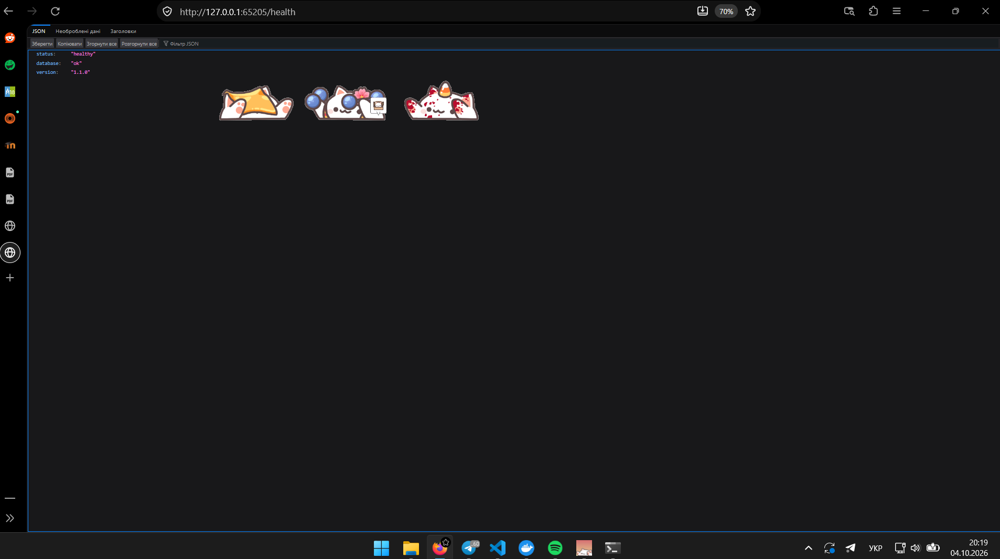
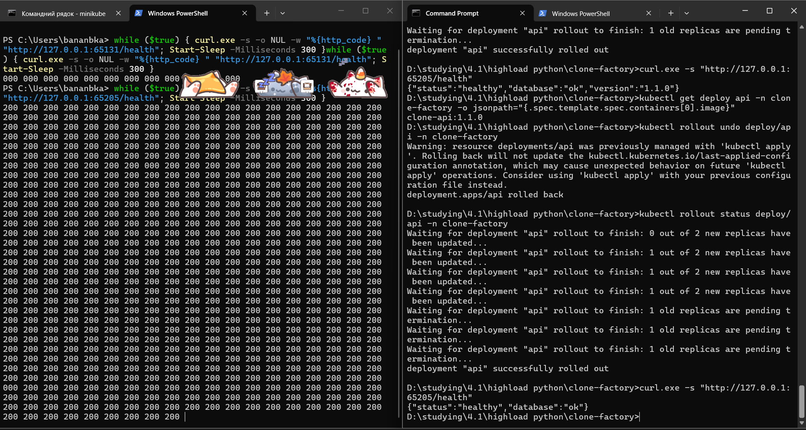
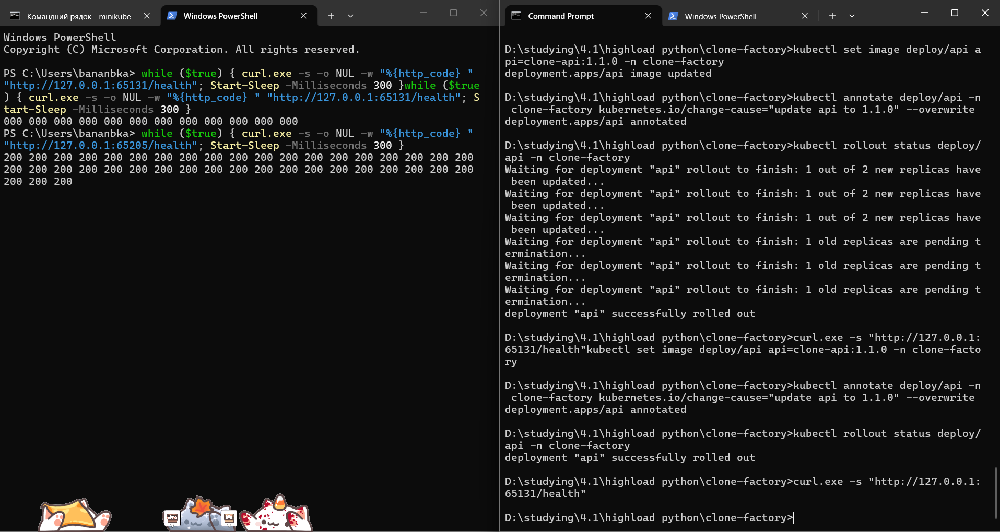
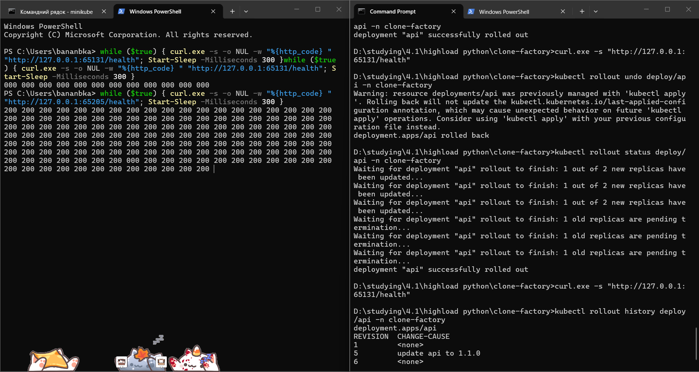
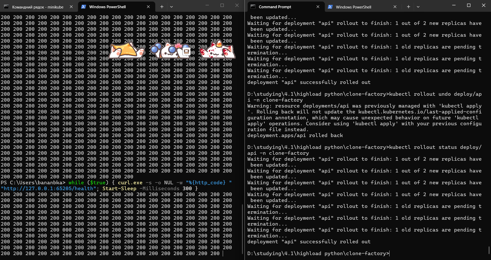
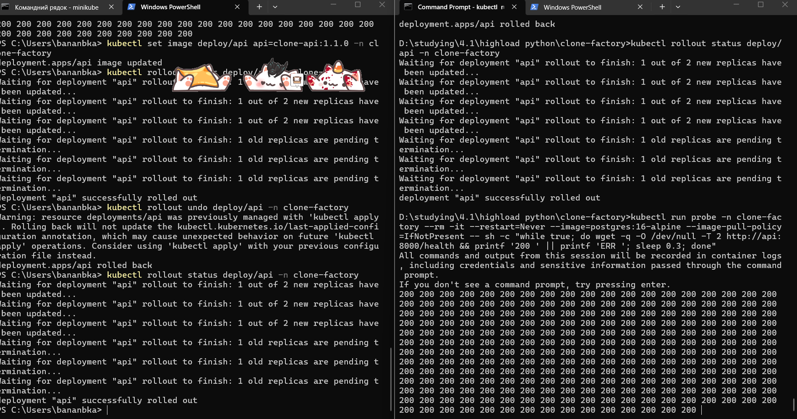

# Звіт: DevOps, лабораторна робота №3

Розгортання застосунку «Mycelium Consciousness» (clone-factory) у Kubernetes
(minikube). Усі виводи нижче скопійовані з терміналу без змін, окрім двох
місць, де прибрано пароль і нерелевантні рядки (позначено).

Маніфести: каталог [`k8s/`](../k8s/), порядок розгортання і таблиці параметрів:
[`k8s/README.md`](../k8s/README.md).

## 1. Образи

Зібрано чотири теги, `latest` не використовується:

```
clone-api:1.0.0      a3ea31b84932
clone-api:1.1.0      dabca90260a4
clone-celery:1.0.0   cecc0058eb16
clone-celery:1.1.0   cecc0058eb16
```

`clone-api:1.1.0` відрізняється від `1.0.0` полем `version` у `GET /health`
(різні IMAGE ID). `clone-celery:1.1.0` — другий тег того самого образу, бо код
Celery не змінювався. Образи завантажено в кластер через `minikube image load`,
тому в маніфестах `imagePullPolicy: IfNotPresent`.

## 2. Кластер

`minikube start --driver=docker`, Kubernetes v1.37.0.

```
> kubectl get nodes
NAME       STATUS   ROLES           AGE   VERSION
minikube   Ready    control-plane   15m   v1.37.0

> kubectl get pods -n kube-system
NAME                               READY   STATUS    RESTARTS   AGE
coredns-559f6c778d-ck2nm           1/1     Running   0          15m
etcd-minikube                      1/1     Running   0          15m
kindnet-pk58v                      1/1     Running   0          15m
kube-apiserver-minikube            1/1     Running   0          15m
kube-controller-manager-minikube   1/1     Running   0          15m
kube-proxy-tnw8z                   1/1     Running   0          15m
kube-scheduler-minikube            1/1     Running   0          15m
metrics-server-768f9f6999-fd47x    1/1     Running   0          2m16s
storage-provisioner                1/1     Running   0          15m
```

Додатки:

```
> minikube addons list | findstr ingress
| ingress                     | minikube | enabled |
| ingress-dns                 | minikube | disabled |

> kubectl get pods -n ingress-nginx
ingress-nginx-controller-d7cd8c989-p4r62   1/1     Running     0          5m1s
```

`metrics-server` також увімкнено (поди `kube-system` вище).

## 3. Namespace

Усі об'єкти створені в namespace `clone-factory`
(`k8s/00-namespace.yaml`).

## 4. Маніфести

Вісімнадцять файлів у `k8s/`, по одному на об'єкт: Namespace, ConfigMap,
Secret, три PVC, Deployment для `postgres`, `redis`, `minio`, `api`,
`celery-worker`, `celery-beat`, Service для `postgres`, `redis`, `minio`, `api`,
Job `migrate`, Ingress. Опис і параметри:
[`k8s/README.md`](../k8s/README.md).

Основні рішення:

- `api`: 2 репліки, `requests` і `limits` для CPU та пам'яті, `readinessProbe`
  на `/health` (перевіряє БД), `livenessProbe` на `/docs` (без БД), щоб збій
  Postgres не перезапускав поди. Стратегія `RollingUpdate`, `maxSurge: 1`,
  `maxUnavailable: 0`.
- ConfigMap: 20 параметрів, Secret: 4 тестові значення. Обидва підключено через
  `envFrom`.
- Service `api` типу NodePort плюс Ingress.
- PVC для Postgres (1Gi), Redis (512Mi) і MinIO (2Gi).
- Init-контейнери в `api`, `celery-worker`, `celery-beat` чекають, поки Job
  `migrate` створить запис у `alembic_version`.

## 5. Розгортання

Одна команда: `kubectl apply -f k8s/`.

```
> kubectl get pods,deploy,rs,svc -n clone-factory
NAME                                 READY   STATUS      RESTARTS   AGE
pod/api-dddfb74f-dvsd5               1/1     Running     0          41s
pod/api-dddfb74f-qf5vb               1/1     Running     0          55s
pod/celery-beat-66bd5dccb4-29z7x     1/1     Running     0          20m
pod/celery-worker-78d56549d7-mmfx4   1/1     Running     0          89s
pod/migrate-dt6vx                    0/1     Completed   0          20m
pod/minio-54f685bfd7-ghg5z           1/1     Running     0          88s
pod/postgres-7dffcd574d-5drkz        1/1     Running     0          20m
pod/redis-5bbb8c84d5-lnc5v           1/1     Running     0          20m

NAME                            READY   UP-TO-DATE   AVAILABLE   AGE
deployment.apps/api             2/2     2            2           20m
deployment.apps/celery-beat     1/1     1            1           20m
deployment.apps/celery-worker   1/1     1            1           20m
deployment.apps/minio           1/1     1            1           20m
deployment.apps/postgres        1/1     1            1           20m
deployment.apps/redis           1/1     1            1           20m

NAME               TYPE        CLUSTER-IP      EXTERNAL-IP   PORT(S)             AGE
service/api        NodePort    10.109.50.147   <none>        8000:30080/TCP      20m
service/minio      ClusterIP   10.97.170.243   <none>        9000/TCP,9001/TCP   20m
service/postgres   ClusterIP   10.101.181.54   <none>        5432/TCP            20m
service/redis      ClusterIP   10.96.27.94     <none>        6379/TCP            20m
```

(Список ReplicaSet скорочено.)

```
> kubectl get ingress,pvc -n clone-factory
NAME                            CLASS   HOSTS   ADDRESS        PORTS   AGE
ingress.networking.k8s.io/api   nginx   *       192.168.49.2   80      20m

NAME                                  STATUS   VOLUME                                     CAPACITY   ACCESS MODES   STORAGECLASS
persistentvolumeclaim/minio-data      Bound    pvc-d53ecc98-e523-462b-b3f6-9f2708a2088f   2Gi        RWO            standard
persistentvolumeclaim/postgres-data   Bound    pvc-e0277150-197f-4b52-8de8-e60edc18cad5   1Gi        RWO            standard
persistentvolumeclaim/redis-data      Bound    pvc-ee65f1bb-64cd-42ca-92df-12f20cb7ff51   512Mi      RWO            standard
```

Застосунок відкрито через `minikube service api -n clone-factory --url`;
`GET /health` повернув `healthy`.

ConfigMap у контейнері:

```
> kubectl exec -n clone-factory deploy/api -- printenv POSTGRES_HOST API_WORKERS MINIO_BUCKET
postgres
1
memory-backups
```

Значення Secret у звіт не включено навмисно: перевірялась лише його наявність
(`printenv JWT_SECRET_KEY | wc -c`).

## 6. Життєвий цикл

### 6а. Самовідновлення

Видалено `api-dddfb74f-qf5vb`. Deployment одразу створив заміну
`api-dddfb74f-bjmdw` (фрагмент `kubectl get pods -w`):

```
api-dddfb74f-qf5vb   1/1     Terminating   0          6m52s
api-dddfb74f-bjmdw   0/1     Pending       0          0s
api-dddfb74f-bjmdw   0/1     Init:0/1      0          0s
api-dddfb74f-bjmdw   0/1     PodInitializing   0      2s
api-dddfb74f-bjmdw   0/1     Running           0      2s
api-dddfb74f-bjmdw   1/1     Running           0      8s
```

### 6б. Масштабування і розподіл трафіку

`kubectl scale deploy/api --replicas=4` дав чотири поди `Running`. Щоб відрізнити
свої запити від проб Kubernetes, їх надіслано з параметром `?demo=1`:

```
> kubectl logs -n clone-factory -l app.kubernetes.io/component=api --prefix --since=2m | findstr "demo=1"
[pod/api-dddfb74f-66v84/api] INFO:  10.244.0.1:64262 - "GET /health?demo=1 HTTP/1.1" 200 OK
[pod/api-dddfb74f-66v84/api] INFO:  10.244.0.1:33235 - "GET /health?demo=1 HTTP/1.1" 200 OK
... (всього 7 запитів)
[pod/api-dddfb74f-8ln5k/api] INFO:  10.244.0.1:58021 - "GET /health?demo=1 HTTP/1.1" 200 OK
... (всього 5 запитів)
```

Запити розподілились між репліками. Після цього кількість реплік повернуто
до двох. Частина запитів потрапила на репліки, видалені після повернення до двох,
тому їхніх логів у виводі немає.

### 6в. Оновлення (rolling update)

```
> kubectl set image deploy/api api=clone-api:1.1.0 -n clone-factory
deployment.apps/api image updated

> kubectl annotate deploy/api -n clone-factory kubernetes.io/change-cause="update api to 1.1.0" --overwrite
deployment.apps/api annotated

> kubectl rollout status deploy/api -n clone-factory
Waiting for deployment "api" rollout to finish: 1 out of 2 new replicas have been updated...
Waiting for deployment "api" rollout to finish: 1 old replicas are pending termination...
deployment "api" successfully rolled out

> curl http://127.0.0.1:65205/health
{"status":"healthy","database":"ok","version":"1.1.0"}

> kubectl get deploy api -n clone-factory -o jsonpath="{.spec.template.spec.containers[0].image}"
clone-api:1.1.0
```

Нові поди підіймались по одному: старий Pod не зупинявся, поки новий не проходив
readiness-пробу (`maxUnavailable: 0`).

`GET /health` у браузері після оновлення (поле `version` з'явилось):



### 6г. Історія та відкат

```
> kubectl rollout undo deploy/api -n clone-factory
deployment.apps/api rolled back

> kubectl rollout status deploy/api -n clone-factory
deployment "api" successfully rolled out

> curl http://127.0.0.1:65205/health
{"status":"healthy","database":"ok"}

> kubectl rollout history deploy/api -n clone-factory
REVISION  CHANGE-CAUSE
1         <none>
5         update api to 1.1.0
6         <none>
```

Що змінювалось: ревізія 5 — образ `api` змінено на `clone-api:1.1.0`; ревізія 6 —
відкат, шаблон попередньої ревізії (образ `1.0.0`) записано як нову ревізію, тому
проміжні ревізії зникли з історії. Після відкату поле `version` у `/health`
зникло, тобто застосунок знову працює на 1.0.0.

Зліва — безперервні запити до `/health`, справа — команди `set image`, перевірка
`version` і `rollout undo`:



### 6д. Доступність під час оновлення

Під час оновлення і відкату працював цикл запитів до `/health` кожні 300 мс
(PowerShell: `curl.exe -s -o NUL -w "%{http_code} "` у циклі `while`).

**Перший прогін (без `preStop`).** Переважна більшість відповідей — `200`, але
серед сотень запитів траплялись поодинокі `000` (збій з'єднання), три випадки на
скриншотах нижче, усі в момент перемикання подів. Перші `000` на початку лівого
вікна — не збій оновлення: тунель `minikube service` був перезапущений на іншому
порту (`65131` → `65205`).





**Перша гіпотеза.** Pod отримує сигнал завершення одночасно з видаленням зі
Service, а `kube-proxy` ще короткий час може спрямовувати на нього нові запити.
Щоб це перевірити, у контейнер `api` додано `lifecycle.preStop` із `sleep 5`
(`k8s/60-api-deployment.yaml`): Pod, що завершується, ще 5 секунд обслуговує
запити, поки його прибирають зі Service.

**Другий прогін (з `preStop`, через той самий тунель).** Поодинокі `000`
залишились (два випадки в нижньому циклі), тобто `preStop` їх не прибрав:



**Перевірка без тунелю.** Запити з `127.0.0.1` йдуть через тунель
`minikube service`, який на Windows з драйвером Docker є додатковою ланкою між
клієнтом і кластером. Щоб відокремити його вплив, у кластері запущено Pod, який
кожні 300 мс звертається до Service `api:8000` напряму
(`wget`), а в цей час виконано `set image`, `rollout undo` і `rollout status`:

```
kubectl run probe -n clone-factory --rm -it --restart=Never \
  --image=postgres:16-alpine --image-pull-policy=IfNotPresent -- \
  sh -c "while true; do wget -q -O /dev/null -T 2 http://api:8000/health \
         && printf '200 ' || printf 'ERR '; sleep 0.3; done"
```



У видимій частині виводу — лише `200`, жодного `ERR`, при тому що обидва rollout
завершились успішно (ліве вікно).

**Висновок.** Усередині кластера застосунок лишається доступним під час
rolling update і відкату: `maxUnavailable: 0` не дозволяє прибрати старий Pod,
поки новий не пройшов readiness-пробу. Поодинокі `000` у прогонах через
`127.0.0.1` пов'язані з тунелем `minikube service`, а не з застосунком чи
Service. Вплив `preStop` окремо не вимірювався (його додано між прогонами), тому
він залишений як звичайна практика коректного завершення, а не як доведене
виправлення.

## 7. Діагностика

### 7а. Неіснуючий тег

```
> kubectl set image deploy/api api=clone-api:9.9.9 -n clone-factory
> kubectl get pods -n clone-factory -l app.kubernetes.io/component=api
NAME                   READY   STATUS         RESTARTS   AGE
api-76f78fb56f-r2mmc   0/1     ErrImagePull   0          26s
api-dddfb74f-j6fjg     1/1     Running        0          2m27s
api-dddfb74f-pvksq     1/1     Running        0          2m19s
```

Через хвилину статус змінився на `ImagePullBackOff`. Старі поди лишилися
`Running`, тож застосунок працював: нова версія не стала готовою, а
`maxUnavailable: 0` не дозволив вимкнути старі.

### 7б. Причина

Фрагмент `kubectl describe pod api-76f78fb56f-r2mmc`:

```
Containers:
  api:
    Image:          clone-api:9.9.9
    State:          Waiting
      Reason:       ImagePullBackOff
Events:
  Normal   Scheduled  83s  default-scheduler  Successfully assigned clone-factory/api-76f78fb56f-r2mmc to minikube
  Normal   Pulling    38s  kubelet            Pulling image "clone-api:9.9.9"
  Warning  Failed     37s  kubelet            Failed to pull image "clone-api:9.9.9": failed to pull and unpack image
                                             "docker.io/library/clone-api:9.9.9": ... pull access denied,
                                             repository does not exist or may require authorization
  Warning  Failed     37s  kubelet            Error: ErrImagePull
  Normal   BackOff    6s   kubelet            Back-off pulling image "clone-api:9.9.9"
  Warning  Failed     6s   kubelet            Error: ImagePullBackOff
```

Причина: образу з тегом `9.9.9` немає ні на вузлі, ні в Docker Hub. Init-контейнер
`wait-for-migrations` при цьому завершився успішно (`Completed`), тобто
проблема лише в основному контейнері.

### 7в. Логи та інтерактивний вхід

У Pod із помилкою логів немає: контейнер ніколи не запускався, причина видна
лише в `describe` і подіях. Логи та оболонка у справному Pod:

```
> kubectl logs -n clone-factory deploy/api --tail=10
INFO:     10.244.0.1:16157 - "GET /health HTTP/1.1" 200 OK
... (проби readiness)

> kubectl exec -it -n clone-factory deploy/api -- sh
$ printenv | grep POSTGRES | grep -v PASSWORD
POSTGRES_HOST=postgres
POSTGRES_USER=admin
POSTGRES_PORT=5432
POSTGRES_DB=clone_memory_db
$ cat /proc/1/cmdline | tr '\0' ' '
uv run --package api --frozen --no-sync api
```

(Рядок із паролем у цьому виводі прибрано.) Команди `ps` в образі
`python:3.11-slim` немає, тому головний процес показано через `/proc/1/cmdline`.

### 7г. Виправлення

```
> kubectl set image deploy/api api=clone-api:1.1.0 -n clone-factory
deployment.apps/api image updated

> kubectl rollout status deploy/api -n clone-factory
Waiting for deployment "api" rollout to finish: 1 out of 2 new replicas have been updated...
Waiting for deployment "api" rollout to finish: 1 old replicas are pending termination...
deployment "api" successfully rolled out

> kubectl get pods -n clone-factory -l app.kubernetes.io/component=api
NAME                   READY   STATUS    RESTARTS   AGE
api-8669c9f994-jfqkj   1/1     Running   0          15s
api-8669c9f994-mp96x   1/1     Running   0          23s
```

## Проблеми, які виникли під час розгортання

| Симптом | Причина | Виправлення |
|---|---|---|
| `minio` у `ImagePullBackOff` | Тег образу з Docker Hub не існує (`repository does not exist`); образ з Quay теж недоступний (`401 Unauthorized`) | Локально наявний `minio/minio:latest` закріплено як `minio-local:lab` і завантажено в кластер через `minikube image load` |
| `api` у `CrashLoopBackOff` | При старті `ensure_bucket()` не міг підключитись до MinIO (`Could not connect to the endpoint URL: "http://minio:9000/memory-backups"`) | Усунуто після запуску MinIO, `kubectl rollout restart deploy/api` |
| `celery-worker` у `OOMKilled` | Prefork-пул Celery за замовчуванням запускає процес на кожне ядро вузла, і ліміт пам'яті 512Mi не вистачає | `CELERY_WORKER_CONCURRENCY=2` у Deployment |

## Висновок

Застосунок описано маніфестами в `k8s/`, розгортається однією командою
`kubectl apply -f k8s/` і проходить сценарії самовідновлення, масштабування,
rolling update, відкату та діагностики. Скриншоти за бажанням можна додати до
відповідних розділів; виводи команд, наведені вище, відповідають п. 5–7 завдання.
