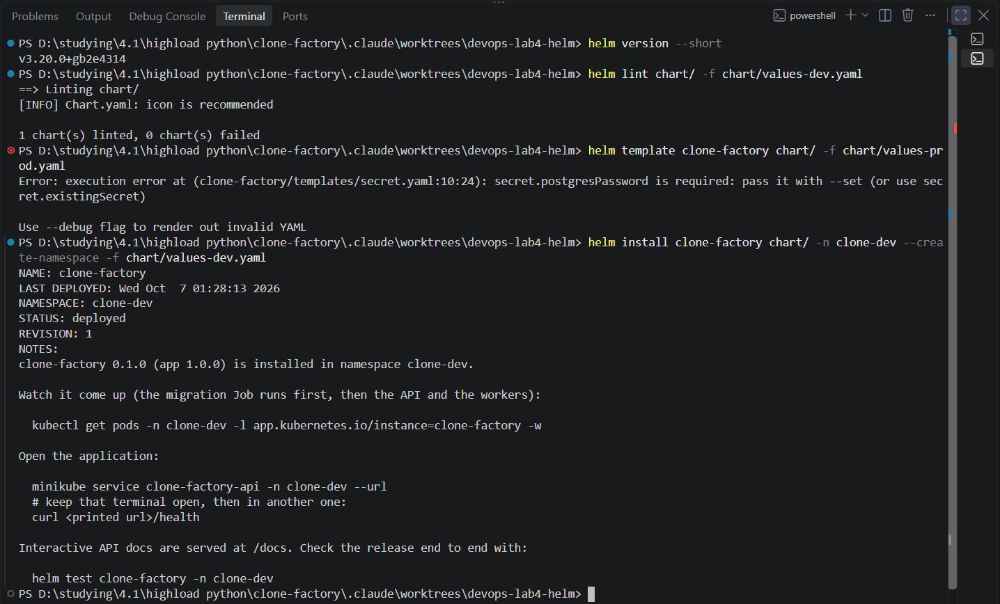
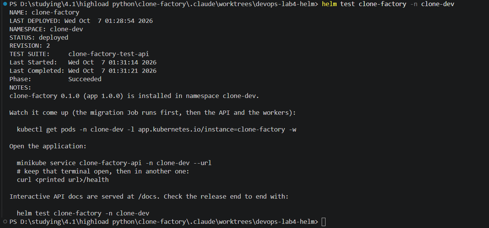

# Звіт: DevOps, лабораторна робота №4

Пакування застосунку «Mycelium Consciousness» (clone-factory) у Helm-чарт.
Чарт: [`chart/`](../chart/), параметри та команди: [`chart/README.md`](../chart/README.md).

Усі виводи нижче скопійовані з терміналу; довгі рядки й нерелевантні колонки
скорочені (позначено `…`). Helm 3.20.0, minikube (docker driver).

## 1. Підготовка середовища

```
> helm version --short
v3.20.0+gb2e4314

> minikube start --driver=docker --memory=4096 --cpus=2
* Enabled addons: storage-provisioner, metrics-server, ingress, default-storageclass
* Done! kubectl is now configured to use "minikube" cluster and "default" namespace by default
```

Застосунок із лаби 3 працював до видалення:

```
> kubectl get deploy,job,pvc -n clone-factory
deployment.apps/api             2/2   …   deployment.apps/celery-beat  1/1   …
deployment.apps/celery-worker   1/1   …   deployment.apps/minio        1/1   …
deployment.apps/postgres        1/1   …   deployment.apps/redis        1/1   …
job.batch/migrate   Complete   1/1
persistentvolumeclaim/minio-data      Bound   2Gi
persistentvolumeclaim/postgres-data   Bound   1Gi
persistentvolumeclaim/redis-data      Bound   512Mi

> kubectl exec -n clone-factory deploy/api -c api -- /app/.venv/bin/python -c "…urlopen('http://localhost:8000/health')…"
{"status":"healthy","database":"ok"}

> kubectl delete -f k8s/
namespace "clone-factory" deleted
… (усі 17 об'єктів deleted)
> kubectl get all,pvc -n clone-factory
No resources found in clone-factory namespace.
```

## 2. Структура чарта

`chart/` містить `Chart.yaml`, `values.yaml`, `values-dev.yaml`,
`values-prod.yaml`, `templates/` (17 шаблонів об'єктів, `_helpers.tpl`,
`NOTES.txt`, `hooks/`, `tests/`) і `README.md`.

`version` (`0.1.0`) — версія самого чарта: шаблони та значення за
замовчуванням. `appVersion` (`1.0.0`) — версія застосунку, який чарт
розгортає за замовчуванням; збігається з тегом образів `clone-api` /
`clone-celery` і є запасним тегом, якщо `image.tag` порожній. Змінюються вони
незалежно: нова версія застосунку міняє `appVersion`, а нова змінна чи шаблон
— `version`. У `helm list` це колонки `CHART` та `APP VERSION`.

## 3–5. Шаблони, значення, спільні шаблони

Кожен маніфест з лаби 3 став окремим файлом у `chart/templates/`
(Namespace замінено на `helm install --create-namespace`). Імена об'єктів
будуються з `{{ .Release.Name }}` через `_helpers.tpl`; мітки й повні імена
підключені через `include` в усіх шаблонах. Адреси Postgres, Redis і MinIO в
ConfigMap виводяться з імені релізу, тому два релізи не звертаються до баз один
одного. Secret бере значення з `values`; у `values-prod.yaml` паролі порожні, і
без `--set` чарт не рендериться. Ingress і PVC вмикаються прапорцем
`enabled`. Перевірка на «жорсткі» значення в шаблонах:

```
> grep -rnE "image: *[a-z]|replicas: *[0-9]|clone-api|1\.0\.0" chart/templates
(порожньо)
```

## 6. Два середовища

Різниця `values-dev.yaml` і `values-prod.yaml`: репліки API 2 → 3 і воркерів
1 → 2, ресурси, тег образів `1.0.0` → `1.1.0`, Ingress вимкнено → увімкнено
(`clone-factory.example.com`), `LOG_LEVEL`/`API_WORKERS`, порожні паролі.

Без встановлення в кластер:

```
> helm template clone-factory chart/ -n clone-dev  -f chart/values-dev.yaml  > dev.yaml
> helm template clone-factory chart/ -n clone-prod -f chart/values-prod.yaml --set secret.… > prod.yaml
> diff dev.yaml prod.yaml        (змістовні рядки)
<   replicas: 2                  >   replicas: 3          # api
<   image: clone-api:1.0.0       >   image: clone-api:1.1.0
<   image: clone-celery:1.0.0    >   image: clone-celery:1.1.0
<   replicas: 1                  >   replicas: 2          # celery-worker
<   cpu: 100m / memory: 192Mi    >   cpu: 250m / memory: 256Mi
<   API_WORKERS: "1"             >   API_WORKERS: "2"
<   LOG_LEVEL: "INFO"            >   LOG_LEVEL: "WARNING"
                                 >   kind: Ingress  (clone-factory-api, лише в prod)

> helm template clone-factory chart/ -f chart/values-prod.yaml     # без паролів
Error: … Missing required value: secret.postgresPassword is required …
```

Пріоритет значень (від найнижчого до найвищого): `values.yaml` чарта → файли
`-f` (у порядку слідування, останній сильніший) → прапорці `--set` (завжди
найсильніші). Мапи зливаються за ключами, списки замінюються цілком. Приклад:
`-f values-prod.yaml --set api.replicas=5` дає 5 реплік (прапорець) і тег
`1.1.0` (файл).

## 7. Перевірка та встановлення

```
> helm lint chart/ -f chart/values-dev.yaml
==> Linting chart/
[INFO] Chart.yaml: icon is recommended
1 chart(s) linted, 0 chart(s) failed
```

Те саме для `values-prod.yaml` (з `--set secret.…`): `0 chart(s) failed`.

Скріншот терміналу: версія Helm, `helm lint` для dev-значень, відмова
рендерингу prod-значень без пароля (`secret.postgresPassword is required`) і
перше встановлення релізу `clone-factory` у namespace `clone-dev`:



### Згенеровані маніфести та порівняння з лабою 3 (п. 7б)

Згенеровані маніфести — це результат підстановки значень у шаблони. Їх дає
`helm template` (без кластера) або `helm get manifest <реліз>` (те, що
встановлено); окремим файлом у репозиторії вони не зберігаються:

```
helm template clone-factory chart/ -n clone-dev -f chart/values-dev.yaml > rendered-dev.yaml
helm get manifest clone-factory -n clone-dev          # для встановленого релізу
```

Порівняння з `k8s/` зроблено скриптом
[`tools/compare_chart_with_lab3.py`](../tools/compare_chart_with_lab3.py): він
розбирає обидва набори маніфестів, відкидає те, що за задумом відрізняється
(namespace, мітки, анотації, префікс `clone-factory-` в іменах, номер ревізії
в імені Job `migrate`), і порівнює решту поле за полем:

```
> python tools/compare_chart_with_lab3.py rendered-dev.yaml
lab3 objects (no Namespace): 17   chart objects (no hooks): 16
only in lab3: [('Ingress', 'api')]
only in chart: []

Deployment/api            .spec.template.spec.initContainers[0].imagePullPolicy: lab3=None  chart='IfNotPresent'
Deployment/celery-beat    .spec.template.spec.initContainers[0].imagePullPolicy: lab3=None  chart='IfNotPresent'
Deployment/celery-worker  .spec.template.spec.initContainers[0].imagePullPolicy: lab3=None  chart='IfNotPresent'
Deployment/postgres       .spec.template.spec.containers[0].imagePullPolicy:     lab3=None  chart='IfNotPresent'
Deployment/redis          .spec.template.spec.containers[0].imagePullPolicy:     lab3=None  chart='IfNotPresent'
Job/migrate               .spec.template.spec.initContainers[0].imagePullPolicy: lab3=None  chart='IfNotPresent'
Secret/secret   .stringData.JWT_SECRET_KEY / MINIO_ACCESS_KEY / MINIO_SECRET_KEY / POSTGRES_PASSWORD:
                lab3='lab-…' values   chart='dev-only-…' placeholders
Service/api     .spec.ports[0].nodePort: lab3=30080  chart=None

identical after normalisation: 8, with differences: 8
```

Висновок: з 17 об'єктів лаби 3 (без Namespace) чарт у dev-режимі дає 16, а
`Ingress` з'являється з `api.ingress.enabled=true` (у prod він увімкнений).
Вісім об'єктів збігаються поле в поле. Решта вісім відрізняються лише трьома
навмисними речами: `imagePullPolicy` тепер задається явно з `values` для всіх
контейнерів (у лабі 3 ним керував дефолт Kubernetes), паролі в Secret — це
dev-заглушки замість лабораторних значень, а `nodePort` не зафіксований
(`30080` заважав би поставити чарт двічі, тому Kubernetes обирає порт сам).
Додатково чарт має два об'єкти-хуки (Job `preupgrade-check` і Pod `test-api`),
яких немає в лабі 3 (див. п. 9); у порівняння вони не входили.

```
> helm install clone-factory chart/ -n clone-dev --create-namespace -f chart/values-dev.yaml
NAME: clone-factory   NAMESPACE: clone-dev   STATUS: deployed   REVISION: 1

> kubectl wait --for=condition=Available deploy --all -n clone-dev
… усі 6 deployment condition met

> kubectl get pods,job,pvc -n clone-dev
clone-factory-api-…              1/1  Running   (2 пода)
clone-factory-celery-beat-…      1/1  Running
clone-factory-celery-worker-…    1/1  Running
clone-factory-migrate-1-…        0/1  Completed
clone-factory-minio-…  / -postgres-… / -redis-…   1/1  Running
job.batch/clone-factory-migrate-1   Complete   1/1
… PVC minio-data 2Gi, postgres-data 1Gi, redis-data 512Mi  Bound

> helm list -n clone-dev
NAME           NAMESPACE  REVISION  STATUS    CHART                APP VERSION
clone-factory  clone-dev  1         deployed  clone-factory-0.1.0  1.0.0

> helm get values clone-factory -n clone-dev          # лише те, що задано
USER-SUPPLIED VALUES:
api: {image: {tag: 1.0.0}, ingress: {enabled: false}, replicas: 2, resources: …}
celeryBeat: …   celeryWorker: …   config: {API_WORKERS: 1, LOG_LEVEL: INFO}

> helm get values clone-factory -n clone-dev --all    # злите з дефолтами
COMPUTED VALUES:
api: {image: {repository: clone-api, tag: 1.0.0}, ingress: {className: nginx, enabled: false, host: ""}, …}

> kubectl get secret -n clone-dev -l owner=helm
NAME                                  TYPE                 DATA   AGE
sh.helm.release.v1.clone-factory.v1   helm.sh/release.v1   1      63s
```

Стан релізу Helm зберігає в самому кластері: по одному Secret типу
`helm.sh/release.v1` з іменем `sh.helm.release.v1.<реліз>.v<ревізія>` у
namespace релізу (всередині — стиснуті gzip+base64 маніфест, значення й
метадані ревізії). Окремої бази чи серверної частини немає.

## 8. Життєвий цикл релізу

**8а. Оновлення тегу через `--set`.**

```
> helm upgrade clone-factory chart/ -n clone-dev -f chart/values-dev.yaml --set api.image.tag=1.1.0
Release "clone-factory" has been upgraded. Happy Helming!   REVISION: 2
> kubectl rollout status deploy/clone-factory-api -n clone-dev
deployment "clone-factory-api" successfully rolled out
> kubectl get job -n clone-dev
clone-factory-migrate-2   Complete   1/1        # migrate-1 прибрано, створено новий Job
> … /health
{"status":"healthy","database":"ok","version":"1.1.0"}
```

**8б. Оновлення з файлом іншого середовища.** Перша спроба впала:

```
> helm upgrade clone-factory chart/ -n clone-dev -f chart/values-prod.yaml --set secret.…
Error: UPGRADE FAILED: cannot patch "clone-factory-minio-data" with kind PersistentVolumeClaim:
persistentvolumeclaims "clone-factory-minio-data" is forbidden: only dynamically provisioned pvc
can be resized and the storageclass that provisions the pvc must support resize && … postgres-data …
```

Причина: `values-prod.yaml` збільшував розміри PVC (1Gi → 5Gi, 2Gi → 10Gi), а клас
сховища minikube не підтримує зміну розміру. Виправлення: з `values-prod.yaml`
прибрано розміри томів (розмір задається один раз при першому встановленні, див.
`chart/README.md`). Повторна спроба:

```
> helm upgrade clone-factory chart/ -n clone-dev -f chart/values-prod.yaml --set secret.…
REVISION: 4   STATUS: deployed
> kubectl get deploy -n clone-dev
api 3/3   celery-beat 1/1   celery-worker 2/2   minio 1/1   postgres 1/1   redis 1/1
> kubectl get ingress -n clone-dev
clone-factory-api   nginx   clone-factory.example.com   192.168.49.2   80
```

Паролі при цьому лишено ті самі, що й при встановленні: база вже ініціалізована
старим паролем, а `POSTGRES_PASSWORD` діє лише на порожній том.

**8в. Історія ревізій.**

```
> helm history clone-factory -n clone-dev
REVISION  STATUS      CHART                APP VERSION  DESCRIPTION
1         superseded  clone-factory-0.1.0  1.0.0        Install complete
2         superseded  clone-factory-0.1.0  1.0.0        Upgrade complete
3         failed      clone-factory-0.1.0  1.0.0        Upgrade "clone-factory" failed: cannot patch "…-minio-data" …
4         superseded  clone-factory-0.1.0  1.0.0        Upgrade complete
```

Ревізія 1 — перше встановлення (dev, тег 1.0.0). Ревізія 2 змінила лише тег
образу API на 1.1.0. Ревізія 3 — невдала спроба з prod-значеннями (відхилена
через розмір PVC; частину об'єктів Helm уже встиг застосувати, але реліз
лишився на ревізії 2). Ревізія 4 — prod-значення: 3 репліки API, 2 воркери, тег
1.1.0, більші ресурси, Ingress.

**8г. Відкат.**

```
> helm rollback clone-factory 1 -n clone-dev
Rollback was a success! Happy Helming!
> helm history clone-factory -n clone-dev
…
4         superseded  …  Upgrade complete
5         deployed    …  Rollback to 1
> kubectl get deploy,ingress -n clone-dev
api 2/2 … (Ingress зник, тег 1.0.0)
```

Відкат не перезаписує історію, а додає ревізію 5 з вмістом ревізії 1.

**8д. Видалення.**

```
> helm uninstall clone-factory -n clone-dev
release "clone-factory" uninstalled
> kubectl get all,pvc,cm,secret,ingress -n clone-dev
NAME                         DATA   AGE
configmap/kube-root-ca.crt   1      9m15s          # створює сам Kubernetes у кожному namespace
```

Одразу після `uninstall` у namespace лишився Job `clone-factory-migrate-3`:
він був створений під час невдалої ревізії 3, а Helm керує лише об'єктами
останнього успішного маніфеста. Його видалено вручну
(`kubectl delete job clone-factory-migrate-3 -n clone-dev`), після чого
namespace порожній. Висновок: невдалий `helm upgrade` може залишити сирітські
об'єкти, і їх треба перевіряти.

## 9. Додаткове завдання: хук і тест релізу (варіант b)

- `chart/templates/hooks/pre-upgrade-check.yaml`: Job з анотацією
  `helm.sh/hook: pre-upgrade`; перед оновленням виконує `pg_isready` до
  Postgres релізу. Політика `before-hook-creation,hook-succeeded` прибирає Job
  після успіху, тому після `uninstall` він нічого не лишає.
- `chart/templates/tests/test-api-health.yaml`: Pod з `helm.sh/hook: test`,
  що викликає `/health` сервісу API (він виконує `SELECT 1`).

Тест:

```
> helm test clone-factory -n clone-dev
TEST SUITE:     clone-factory-test-api
Last Started:   Wed Oct  7 00:07:21 2026
Last Completed: Wed Oct  7 00:07:32 2026
Phase:          Succeeded
```

Скріншот того самого тесту після оновлення (реліз на ревізії 2, `Phase:
Succeeded`):



Тест слід запускати, коли всі Deployment уже доступні
(`kubectl wait --for=condition=Available deploy --all -n clone-dev`). Перший
запуск, зроблений за 31 секунду після `install`, закінчився `Phase: Failed`
(`Connection refused`): API ще чекав на міграцію. Повторний запуск пройшов.

(`helm test --logs` у цьому чарті не працює: Pod видаляється одразу після
успіху, тому логи недоступні; це ціна за відсутність залишків у namespace.
Невдалий тестовий Pod, навпаки, лишається, і його видаляє наступний `helm test`
або `kubectl delete pod`.)

Хук блокує погане оновлення. Postgres зупинено, після чого оновлення не
проходить, а працююча ревізія не змінюється:

```
> kubectl scale deploy/clone-factory-postgres -n clone-dev --replicas=0
> helm upgrade clone-factory chart/ -n clone-dev -f chart/values-dev.yaml --set api.image.tag=1.1.0
Error: UPGRADE FAILED: pre-upgrade hooks failed: 1 error occurred:
	* job clone-factory-preupgrade-check failed: BackoffLimitExceeded
> helm history clone-factory -n clone-dev
1   deployed  …  Install complete
2   failed    …  Upgrade "clone-factory" failed: pre-upgrade hooks failed: 1 error occurr…
> kubectl get deploy clone-factory-api -n clone-dev -o jsonpath="{.spec.template.spec.containers[0].image}"
clone-api:1.0.0                       # образ API не змінився
```

Після `kubectl scale … --replicas=1` те саме оновлення проходить
(ревізія 3, `Upgrade complete`), а `helm test` дає `Phase: Succeeded`.

## 10. Підсумок

Чарт закомічено в `chart/`, параметри та команди для обох середовищ описані в
[`chart/README.md`](../chart/README.md). Пункти 6–9 підтверджені виводами вище.
Окремо зафіксовано дві знахідки: розмір PVC не можна змінити оновленням на
живому релізі (тому його прибрано з `values-prod.yaml`), і невдале оновлення
лишає сирітський Job, який `helm uninstall` не видаляє.
