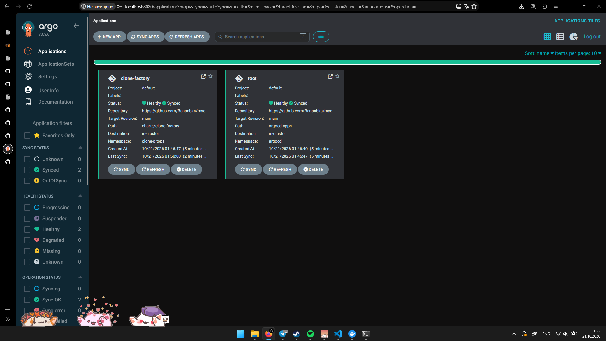
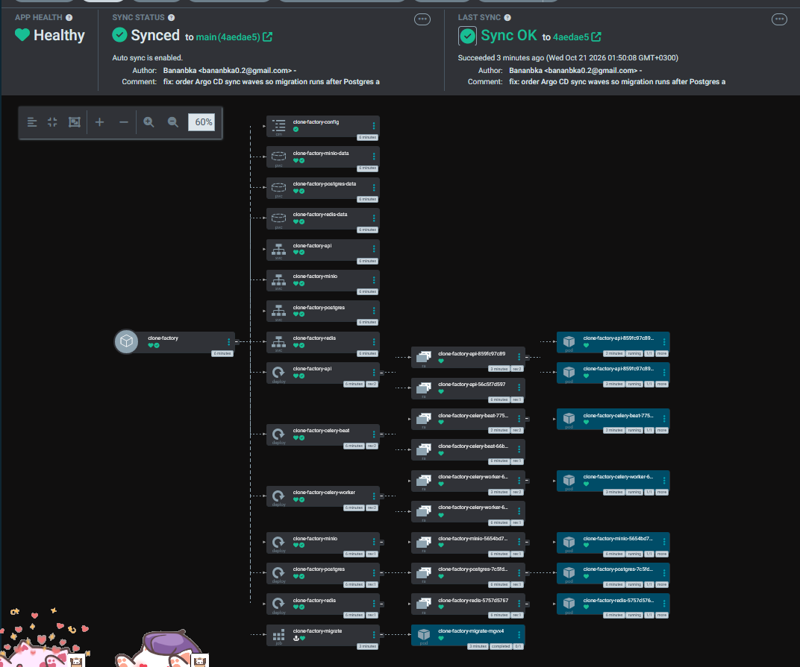
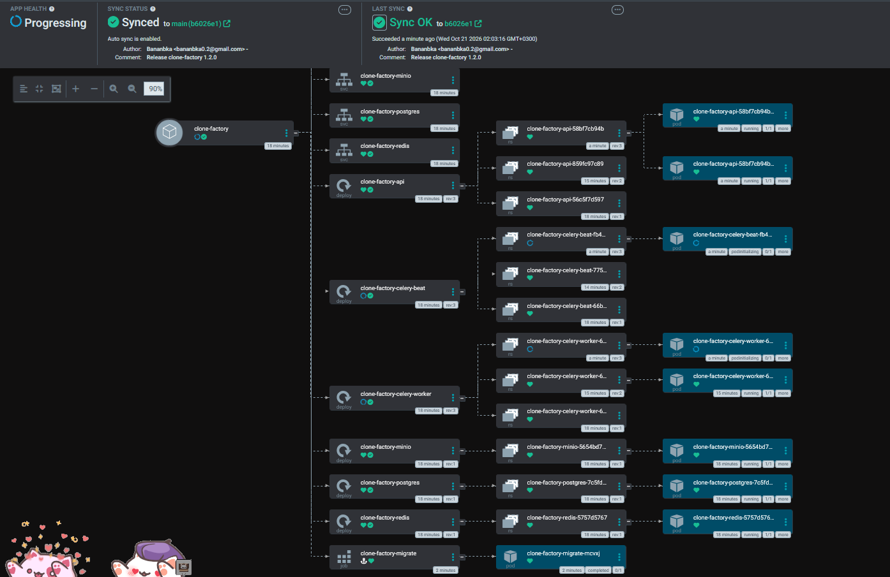
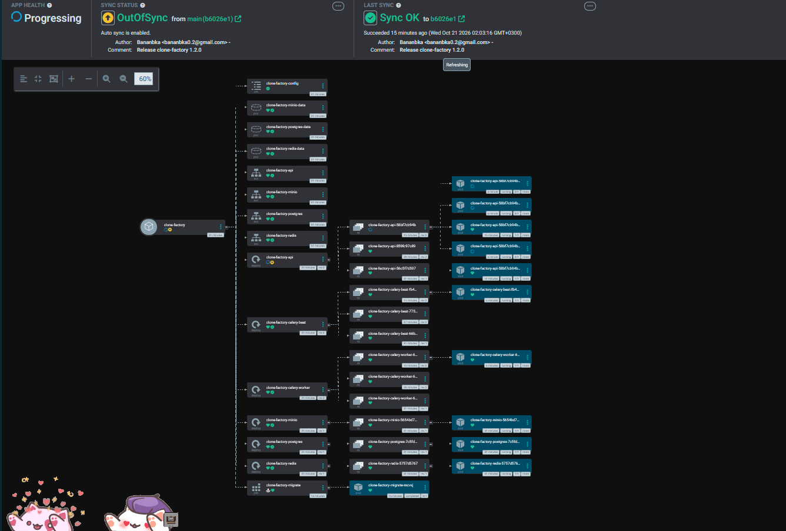
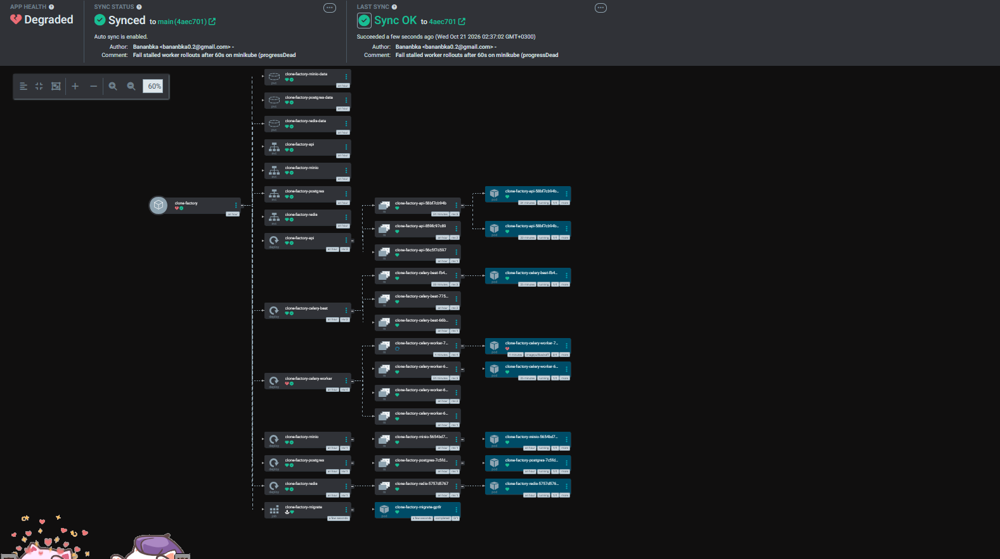

# Звіт: DevOps, лабораторна робота №5

GitOps-розгортання застосунку «Mycelium Consciousness» (clone-factory) через Argo CD.
Репозиторій конфігурації: <https://github.com/Bananbka/mycelium-gitops>.

Виводи нижче скопійовані з терміналу; довгі рядки скорочені (позначено `…`).
Argo CD v3.5.6 (CLI і сервер), minikube (docker driver, containerd), кластер `v1.37.0`.

## 1. Репозиторій конфігурації

Обрано окремий репозиторій `mycelium-gitops` (рекомендований варіант).

```
mycelium-gitops/
├── bootstrap/root.yaml               # кореневий Application, застосовується вручну один раз
├── argocd-apps/clone-factory.yaml    # Application для чарту, ним керує root
└── charts/clone-factory/             # чарт з ЛР-4
    ├── Chart.yaml, values.yaml, templates/
    └── values-minikube.yaml          # теги образів і значення для minikube
```

Паролі й токени в Git не зберігаються. Чарт з ЛР-4 вже вміє `secret.existingSecret`:
у `values-minikube.yaml` задано `existingSecret: clone-factory-secret`, а сам Secret
створюється вручну один раз і Argo CD його не видаляє, бо він не створений із Git.

### Зміни чарта відносно ЛР-4

Argo CD рендерить чарт через `helm template`, а не `helm install`, тому довелося
виправити три речі. Вони описані тут, бо без них перша синхронізація не проходить.

| Проблема | Причина | Виправлення |
|---|---|---|
| Job міграції не можна оновити при зміні образу | Ім'я Job містило `.Release.Revision`, а під Argo воно завжди `1` | `migrate.argoHook: true`: Job стає Argo-хуком `Sync` із фіксованим іменем і `hook-delete-policy: BeforeHookCreation`, тобто перестворюється на кожному синку |
| Helm-хук `pre-upgrade` ламає першу синхронізацію | Argo відображає `pre-upgrade` на `PreSync`, а Postgres на першому синку ще не існує | `preUpgradeCheck.enabled: false` у `values-minikube.yaml` |
| Синхронізація зависала, Job міграції не створювався | Deployment-и api, worker і beat стоять у `sync-wave 0` і чекають готовності міграції, а Job міграції стояв у wave 1 і чекав на Healthy усієї wave 0 | Postgres (Deployment, Service, PVC) і ConfigMap у wave `-2`, Job міграції у wave `-1`, решта у wave `0` |

## 2. Образ застосунку в реєстрі

Образи зібрані з конкретними тегами і опубліковані в GHCR. Пакети зроблено
публічними, тому кластер тягне їх без `minikube image load` і без `imagePullSecrets`.

```
ghcr.io/bananbka/clone-api:1.1.0      ghcr.io/bananbka/clone-api:1.2.0
ghcr.io/bananbka/clone-celery:1.1.0   ghcr.io/bananbka/clone-celery:1.2.0
ghcr.io/bananbka/clone-minio:14cea493
```

Образ MinIO з ЛР-3 і ЛР-4 був локальним (`minikube image load`): upstream-реєстри
більше не віддають `minio/minio`. Щоб виконати вимогу «без ручного image load»,
локальний образ `minio-local:lab` опубліковано як `ghcr.io/bananbka/clone-minio:14cea493`.

Версія видна двома способами. `/health` повертає поле `version`, а в релізі 1.2.0
додано окремий ендпоінт `/version`
([`services/api/src/api/main.py`](../services/api/src/api/main.py)):

```
> curl.exe -s http://localhost:8081/version
{"version":"1.2.0"}
```

## 3. Встановлення Argo CD

```
> kubectl create namespace argocd
> kubectl apply -n argocd --server-side --force-conflicts -f https://raw.githubusercontent.com/argoproj/argo-cd/stable/manifests/install.yaml
> argocd version --client
argocd: v3.5.6+c2b1e30   Platform: windows/amd64
> kubectl -n argocd port-forward svc/argocd-server 8080:443
> argocd login 127.0.0.1:8080 --username admin --insecure --grpc-web
'admin:login' logged in successfully
> argocd account update-password --grpc-web
> kubectl -n argocd delete secret argocd-initial-admin-secret
```

Початковий пароль `admin` змінено, початковий Secret видалено. Репозиторій публічний,
тому `argocd repo add` не потрібен. На Windows CLI працює тільки з `--grpc-web`
і адресою `127.0.0.1` (з `localhost` gRPC-з'єднання не встановлювалось).

## 4. Застосунок під керуванням Argo CD (App of Apps)

Вручну застосовано один об'єкт: namespace і Secret (одноразово) та `root`.

```
> kubectl create namespace clone-gitops
> kubectl -n clone-gitops create secret generic clone-factory-secret --from-literal=POSTGRES_PASSWORD=… --from-literal=MINIO_ACCESS_KEY=… --from-literal=MINIO_SECRET_KEY=… --from-literal=JWT_SECRET_KEY=…
> kubectl apply -f bootstrap/root.yaml
application.argoproj.io/root created
```

`root` стежить за `argocd-apps/` і сам створив Application `clone-factory`. Назва
Helm-релізу задана явно (`releaseName: clone-factory`), тому імена об'єктів збігаються
з ЛР-4.

```
> argocd app list --grpc-web
NAME                  NAMESPACE     PROJECT  STATUS  HEALTH   SYNCPOLICY  REPO                     PATH                  TARGET
argocd/clone-factory  clone-gitops  default  Synced  Healthy  Auto-Prune  …/mycelium-gitops.git    charts/clone-factory  main
argocd/root           argocd        default  Synced  Healthy  Auto-Prune  …/mycelium-gitops.git    argocd-apps           main
```





Helm сам нічого не встановлював, тому `helm list -n clone-gitops` порожній.

## 5. Оновлення через Git

Нова версія: `APP_VERSION = 1.2.0` і ендпоінт `/version`. Образи `1.2.0` зібрані й
опубліковані, далі лише Git: у `values-minikube.yaml` три теги `1.1.0` → `1.2.0`
(`api`, `celeryWorker`, `celeryBeat`), commit і push.

```
> git commit -am "Release clone-factory 1.2.0" && git push
```

Argo CD сам помітив коміт, виконав синхронізацію і перекотив Deployment-и: у дереві
видно нові ReplicaSet (rev:3) поруч зі старими, поки нові поди прогрівалися.



```
> curl.exe -s http://localhost:8081/version
{"version":"1.2.0"}
```

## 6. Дрейф, Health і відкат

### 6а. Дрейф без selfHeal і з selfHeal

У `argocd-apps/clone-factory.yaml` спершу `selfHeal: false`. Ручна зміна кластера:

```
> kubectl -n clone-gitops scale deployment clone-factory-api --replicas=5
> kubectl -n clone-gitops get deploy clone-factory-api
clone-factory-api   2/5   5   2      # Argo CD позначив OutOfSync, але репліки лишились 5
```



Далі в Git змінено `selfHeal: true` (коміт `01ff691`); `root` сам застосував зміну до
Application `clone-factory`. Повторна ручна зміна (3 репліки, а не 5: вузол minikube
має ~7,5 ГБ пам'яті, і при 5 репліках api він увійшов у свопінг):

```
> kubectl -n clone-gitops scale deployment clone-factory-api --replicas=3
02:27:53  spec.replicas=3  sync=Synced
02:27:58  spec.replicas=3  sync=OutOfSync
  …       (≈30 с OutOfSync: selfHeal з затримкою на перевантаженому вузлі)
> kubectl -n argocd get app clone-factory -o jsonpath='{.status.operationState.phase}: {.status.operationState.message}'
Succeeded: successfully synced (all tasks run)
> kubectl -n clone-gitops get deploy clone-factory-api
clone-factory-api   2/2   2   2
```

Argo CD повернув значення з Git (`replicas: 2`) без жодного коміту.

### 6б. Synced, але Degraded

Спершу неіснуючий тег `9.9.9` поставлено образу api (коміт `c1342f3`). Це не дало
потрібного стану: Job міграції теж використовує образ api, тому він застряг у
`ErrImagePull` у wave `-1`, синхронізація зависла на хуку (`OutOfSync` / `Running`),
а Deployment-и не оновлювались. Для production це правильна поведінка (реліз зі
зламаним образом зупиняється на міграції), але лаба вимагає `Synced` + `Degraded`.
Тому цей коміт відкотили (`3b0c69a`), а `9.9.9` поставили образу `celeryWorker`
(коміт `7147cfa`), який міграція не використовує. Застрягла операція скинута
вручну (`kubectl -n argocd patch application clone-factory --type json -p '[{"op":"remove","path":"/operation"}]'`).

Sync одразу став `Synced`, а Health тримався `Progressing` до `progressDeadlineSeconds`
(за замовчуванням 600 с). Щоб не чекати 10 хвилин, у чарт додано
`celeryWorker.progressDeadlineSeconds` (600 за замовчуванням, 60 для minikube,
коміт `4aec701`).

```
> argocd app get clone-factory --grpc-web
Sync Status:        Synced to main (4aec701)
Health Status:      Degraded
> kubectl -n clone-gitops get pods
clone-factory-api-58bf7cb94b-…               1/1  Running
clone-factory-celery-worker-6fbb484d4f-…     1/1  Running           # старий worker живий
clone-factory-celery-worker-7d789fb8dc-…     0/1  ImagePullBackOff  # новий, з тегом 9.9.9
```



Сервіс не постраждав: rolling update не прибирає живі поди, поки нові не готові.

### 6в. Відкат через git revert

Відкочується опис у Git, а не кластер:

```
> git revert 7147cfa && git push
> git log --oneline -8
c841470 Revert "Break release: non-existent celery-worker image tag 9.9.9 (lab 5 step 6b)"
4aec701 Fail stalled worker rollouts after 60s on minikube (progressDeadlineSeconds)
7147cfa Break release: non-existent celery-worker image tag 9.9.9 (lab 5 step 6b)
3b0c69a Revert "Break release: non-existent api image tag 9.9.9 (lab 5 step 6b)"
c1342f3 Break release: non-existent api image tag 9.9.9 (lab 5 step 6b)
01ff691 Enable selfHeal for clone-factory
b6026e1 Release clone-factory 1.2.0
4aedae5 fix: order Argo CD sync waves so migration runs after Postgres and before the app

> argocd app get clone-factory --grpc-web
Sync Status:  Synced to main (c841470)      Health Status:  Healthy

> argocd app history clone-factory --grpc-web
ID  DATE                            REVISION
0   2026-10-21 01:50:08 +0300 EEST  main (4aedae5)
1   2026-10-21 02:03:13 +0300 EEST  main (b6026e1)    # реліз 1.2.0
2   2026-10-21 02:28:33 +0300 EEST  main (01ff691)    # selfHeal: true
3   2026-10-21 02:32:40 +0300 EEST  main (7147cfa)    # тег 9.9.9
4   2026-10-21 02:37:02 +0300 EEST  main (4aec701)    # progressDeadlineSeconds
5   2026-10-21 02:38:25 +0300 EEST  main (c841470)    # відкат
```

`argocd app rollback` тут не використовувався: він працює лише з вимкненою
автосинхронізацією, інакше Argo CD одразу повернув би стан із Git.

## 7. Проблеми, які виникли по дорозі

- **Push у GHCR:** `permission_denied: The token provided does not match expected scopes`
  (токен без `write:packages`), потім `denied`, поки токен не отримав потрібні права.
  Новий пакет у GHCR створюється приватним і стає публічним лише в налаштуваннях
  пакета (через REST API видимість змінити не можна).
- **Argo CD CLI на Windows:** `gRPC connection not ready: context deadline exceeded`.
  Допомогла адреса `127.0.0.1` і прапорець `--grpc-web`.
- **Нестача пам'яті minikube:** вузол має ~7,5 ГБ, при 5 репліках api swap заповнився
  (`2047/2048 МБ`), проби `argocd-server` і `argocd-repo-server` стали падати з
  `failed to sync secret cache: timed out waiting for the condition`
  (`CreateContainerConfigError`). Після повернення api до 2 реплік поди Argo CD
  піднялися самі.
- **Повільний pull образу Celery:** `Pulling` 6+ хвилин без `Pulled`. Kubelet тягне один
  образ одним потоком, тож завислий pull блокував нові поди (в подіях:
  `in 723ms (2m7.402s including waiting)`). Видалення застряглих подів допомогло.

## 8. Підсумок

| Вимога | Результат |
|---|---|
| 1. Репозиторій конфігурації | окремий `mycelium-gitops`: `bootstrap/`, `argocd-apps/`, `charts/`, без секретів у Git |
| 2. Образ у реєстрі | GHCR, теги `1.1.0` / `1.2.0`, публічні, `/version` і `version` у `/health` |
| 3. Argo CD | namespace `argocd`, CLI v3.5.6, пароль `admin` змінено |
| 4. App of Apps | вручну застосовано лише `root`, `clone-factory` створений із Git, Synced / Healthy |
| 5. Оновлення через Git | тег `1.1.0` → `1.2.0` комітом, Argo CD сам розгорнув, `/version` → `1.2.0` |
| 6а. Дрейф | без selfHeal: OutOfSync, 5 реплік лишаються; з selfHeal: повернуто 2 за кілька секунд |
| 6б. Synced + Degraded | тег `9.9.9` у worker: `Synced`, `Degraded`, `ImagePullBackOff` |
| 6в. Відкат | `git revert`, Healthy, історія в `git log` і `argocd app history` |

Нетипова деталь: зламаний тег образу api блокує реліз ще на хуку міграції, тому
демонстрацію `Synced` + `Degraded` зроблено на образі worker. Для production це
перевага, а не недолік: зламаний реліз не доходить до Deployment-ів.
