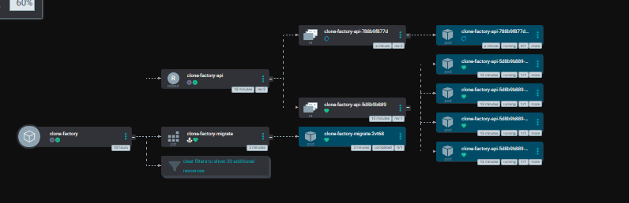
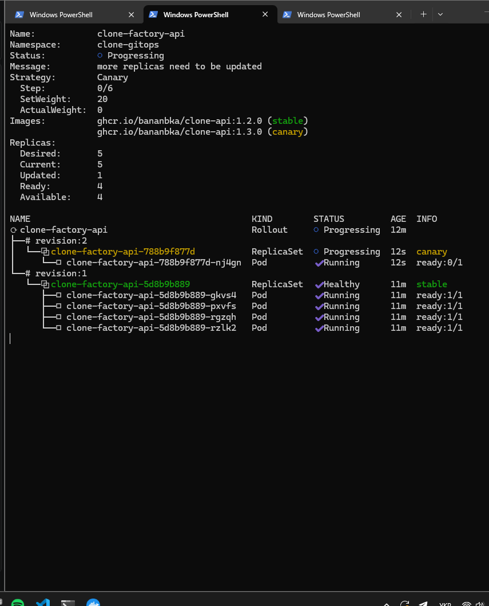
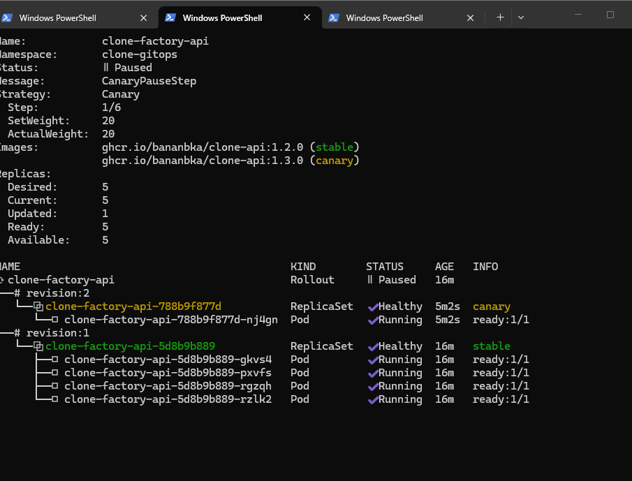
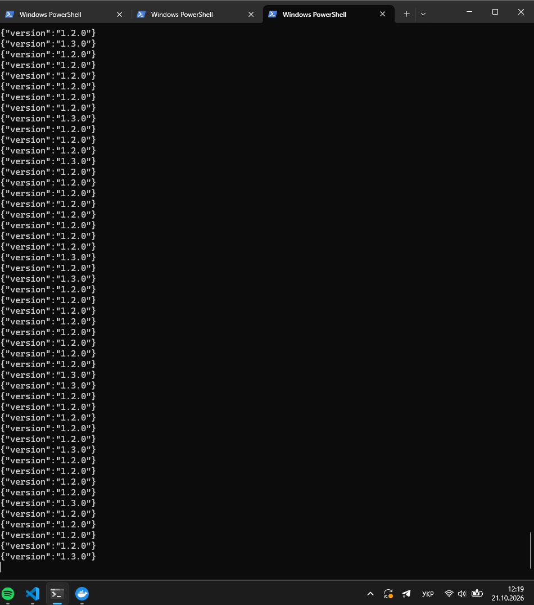
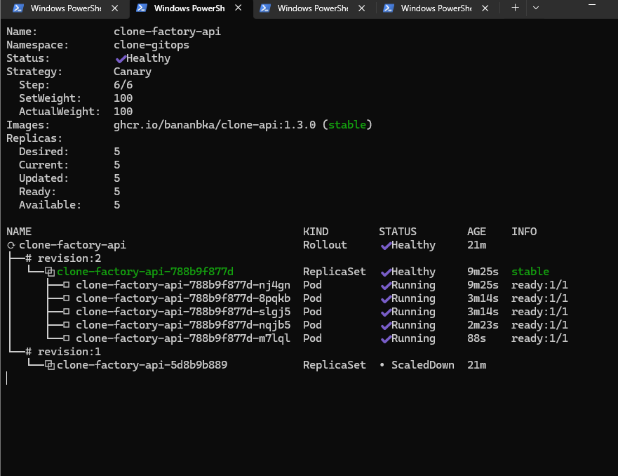
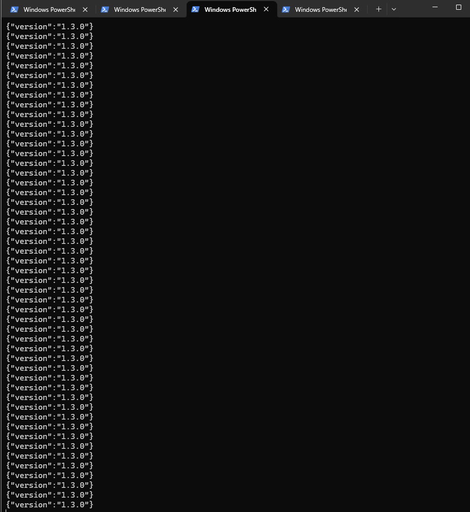

# Звіт: DevOps, лабораторна робота №6

Progressive delivery (canary) для API застосунку «Mycelium Consciousness» з Argo Rollouts.
Репозиторій конфігурації: <https://github.com/Bananbka/mycelium-gitops>.
Продовжує [ЛР-5](devops-lab5-report.md): Argo CD, App of Apps, namespace `clone-gitops`.

Виводи нижче скопійовані з терміналу; довгі рядки скорочені (позначено `…`).
Argo Rollouts: чарт `argo-rollouts` 2.43.8 (застосунок v1.10.1), minikube (docker driver).

## 1. Контролер Argo Rollouts через Argo CD

Контролер описаний окремим Application у `argocd-apps/argo-rollouts.yaml`, `root` підхоплює
його сам. Анотація `sync-wave: "-1"` ставить його раніше за застосунки. Версію чарту
взято з індексу <https://argoproj.github.io/argo-helm/index.yaml> (`2.43.8`).

```yaml
spec:
  source:
    repoURL: https://argoproj.github.io/argo-helm
    chart: argo-rollouts
    targetRevision: 2.43.8
  destination: {server: https://kubernetes.default.svc, namespace: argo-rollouts}
  syncPolicy:
    automated: {prune: true, selfHeal: true}
    syncOptions: [CreateNamespace=true]
```

Як радить методичка, контролер додано **окремим комітом** (`2d767e2`) і лише після того,
як він став Healthy, закомічено Rollout у чарт (`606ca1e`). До `argocd-apps/clone-factory.yaml`
додано `retry` (5 спроб, backoff 10 с × 2, до 3 хв) на випадок, якщо застосунок
синхронізується раніше, ніж з'являться CRD.

Плагін `kubectl argo rollouts` встановлено як `kubectl-argo-rollouts.exe` у каталог з PATH.

## 2. Rollout у Helm-чарті

Новий шаблон `templates/api-rollout.yaml` вмикається параметром `rollout.enabled` і
замінює Deployment API; сам `api-deployment.yaml` обгорнуто в
`{{- if not .Values.rollout.enabled }}`, щоб не було двох контролерів на одному
селекторі. Блок `template:` пода скопійовано з Deployment без змін, `spec.strategy`
береться з values (`{{- toYaml .Values.rollout.strategy | nindent 4 }}`). Версію чарту
піднято з `0.1.0` до `0.2.0`. Під Rollout переведено лише API (Celery, Postgres, Redis
і MinIO лишаються Deployment).

```
> helm template clone-factory charts/clone-factory -f charts/clone-factory/values-minikube.yaml | Select-String "kind: Rollout|kind: Deployment"
kind: Deployment  ×5     # worker, beat, postgres, redis, minio
kind: Rollout     ×1     # api
```

## 3. Стратегія: canary

`values-minikube.yaml`:

```yaml
rollout:
  enabled: true
  strategy:
    canary:
      steps:
        - setWeight: 20
        - pause: {}               # чекати ручного promote
        - setWeight: 60
        - pause: {duration: 30s}
        - setWeight: 80
        - pause: {duration: 30s}

api:
  replicas: 5
  resources:
    requests: {cpu: 50m, memory: 96Mi}
    limits: {cpu: 300m, memory: 256Mi}
```

П'ять реплік дають крок 20% рівно в один под. Ресурси api зменшено порівняно з
чартом (`192Mi`/`512Mi` → `96Mi`/`256Mi`), щоб п'ять реплік і ще один canary-под
вмістились у вузол minikube на ~7,5 ГБ пам'яті.

**Чому саме canary для цього проєкту.**
- API без стану: підтримує будь-яке співвідношення старих і нових подів, а база
  даних і міграції спільні, тому змішані версії не ламають один одного.
- Canary додає лише один под над нормою, а blue-green підняв би другу повну копію
  (10 подів API одночасно). Вузол minikube і так працює на межі пам'яті (в ЛР-5 при
  5 репліках api swap повністю заповнився).
- Поступові кроки з ручною паузою дають можливість перевірити нову версію на малій
  частці запитів, а `abort` повертає все до stable без переключення трафіку.
- Недолік: без ingress-контролера з поділом трафіку вага канарки лише наближена до
  частки подів (20% = 1 под із 5). Для цієї лаби цього достатньо.

Образи API для релізів зібрані з однієї версії коду, але з різним `APP_VERSION`
(`ARG APP_VERSION` у `Dockerfile.api`, `os.getenv("APP_VERSION")` у `main.py`,
коміт `fc8e3e0`), тож версію задає тег збірки:

```
ghcr.io/bananbka/clone-api:1.2.0   (stable на старті)
ghcr.io/bananbka/clone-api:1.3.0   (реліз)
ghcr.io/bananbka/clone-api:1.4.0   (для abort)
```

## 4. Реліз через Git (canary)

Перший перехід на Rollout: Argo CD видалив Deployment API і створив Rollout (короткий
простій, як попереджає методичка). У дереві застосунку з'явився Rollout, його
ReplicaSet-и й поди.



Реліз 1.3.0 комітом (`0bac239`): у `values-minikube.yaml` тег API `1.2.0` → `1.3.0`.

```
> git commit -am "Release api 1.3.0"; git push
> kubectl argo rollouts get rollout clone-factory-api -n clone-gitops --watch
Status:   ॥ Paused   (CanaryPauseStep)
Step:     1/6        SetWeight: 20   ActualWeight: 20
Images:   ghcr.io/bananbka/clone-api:1.2.0 (stable)
          ghcr.io/bananbka/clone-api:1.3.0 (canary)
Replicas: Desired 5, Current 5, Updated 1, Ready 5, Available 5
```





На паузі Argo CD показує застосунок як `Synced` / `Suspended`. Запити зсередини
кластера (port-forward з'єднується лише з одним подом і розподілу не покаже):

```
> kubectl -n clone-gitops run curl --rm -it --image=curlimages/curl -- sh -c 'while true; do curl -s http://clone-factory-api:8000/version; echo; sleep 0.5; done'
{"version":"1.2.0"} {"version":"1.3.0"} {"version":"1.2.0"} {"version":"1.2.0"} …
```

Приблизно кожна п'ята відповідь `1.3.0`:



Promote на ручній паузі:

```
> kubectl argo rollouts promote clone-factory-api -n clone-gitops
```

Rollout сам пройшов 60% (30 с) і 80% (30 с) і завершився:

```
Status:   ✔ Healthy      Step: 6/6   SetWeight: 100   ActualWeight: 100
Images:   ghcr.io/bananbka/clone-api:1.3.0 (stable)
revision:2  clone-factory-api-788b9f877d  Healthy  stable   (5 подів)
revision:1  clone-factory-api-5d8b9b889   ScaledDown
```





## 5. Скасування релізу

Реліз 1.4.0 комітом (`71a582a`), зупинка на першій паузі, `abort`:

```
> git commit -am "Release api 1.4.0"; git push
  … Status: ॥ Paused, Step 1/6, SetWeight 20; Argo CD: Synced / Suspended
> kubectl argo rollouts abort clone-factory-api -n clone-gitops
rollout 'clone-factory-api' aborted

> kubectl argo rollouts get rollout clone-factory-api -n clone-gitops
Status:   ✖ Degraded
Message:  RolloutAborted: Rollout aborted update to revision 3
Step:     0/6    SetWeight: 0    ActualWeight: 0
Images:   ghcr.io/bananbka/clone-api:1.3.0 (stable)
revision:3  clone-factory-api-64f96b8467  ScaledDown  canary

> kubectl -n argocd get app clone-factory
NAME            SYNC STATUS   HEALTH STATUS
clone-factory   Synced        Degraded
```

Чому `Synced` + `Degraded`: маніфест у кластері збігається з Git (там тег `1.4.0`), тому
Sync — Synced. Але реліз скасований і працює стара версія 1.3.0, тому Health —
Degraded: Argo CD не може вважати застосунок здоровим, поки бажаний стан (1.4.0) не
досягнутий. Завершуємо відкат через Git, а не командою `kubectl`, щоб Git і кластер
знову сказали одне й те саме:

```
> git revert --no-edit HEAD; git push
> git log --oneline -4
6612a63 Revert "Release api 1.4.0"
71a582a Release api 1.4.0
0bac239 Release api 1.3.0
606ca1e Argo Rollouts: canary Rollout for the api, retry on sync, smaller api resources

> kubectl -n argocd get app clone-factory
clone-factory   Synced   Healthy
> kubectl argo rollouts get rollout clone-factory-api -n clone-gitops
Status: ✔ Healthy   Step: 6/6   Images: ghcr.io/bananbka/clone-api:1.3.0 (stable)   Ready 5/5
```

Альтернатива: `kubectl argo rollouts retry rollout clone-factory-api`, якщо проблему
виправлено поза образом.

## 6. Проблеми, які виникли по дорозі

- **Плагін kubectl:** `%1 is not a valid Win32 application`. Завантажений через
  `Invoke-WebRequest` файл мав лише 1,3 МБ (оборваний), справжній плагін на порядок
  більший. Допомогло повторне завантаження через `curl.exe -L --fail`.
- **Порядок: контролер перед Rollout.** Rollout у чарті пушиться лише після Healthy
  контролера, інакше застосунок синхронізується без CRD (`no matches for kind "Rollout"`).
  Для цього контролер винесено в окремий коміт, а в Application API додано `retry`.
- **Пам'ять вузла.** Через нестачу пам'яті (див. ЛР-5) для п'яти реплік api зменшено
  `requests/limits`. Після цього canary-под стартував без проблем, на першому запуску
  новий образ `1.3.0` довго тягнувся з GHCR.
- **Push у GHCR:** вручну в `docker login` вводився пароль акаунта замість Personal
  Access Token (`denied: denied`, `unauthenticated`); для GHCR потрібен токен зі scope
  `write:packages`.

## 7. Підсумок

| Вимога | Результат |
|---|---|
| 1а. Контролер через Argo CD | `argocd-apps/argo-rollouts.yaml`, чарт 2.43.8, окремий коміт, Healthy |
| 1б. Плагін kubectl | `kubectl argo rollouts` встановлено |
| 2. Rollout у чарті | `api-rollout.yaml`, `rollout.enabled`, 5 реплік, Deployment API вимикається |
| 3. Стратегія | canary: 20% → ручна пауза → 60% → 30 с → 80% → 30 с |
| 4а. Реліз через Git | `1.2.0` → `1.3.0`: проміжний розподіл 1:4, відповіді обох версій, `promote`, Healthy |
| 5. Abort і відкат | `1.4.0` → `abort` → `Synced` + `Degraded`, `git revert` → `Healthy` |
