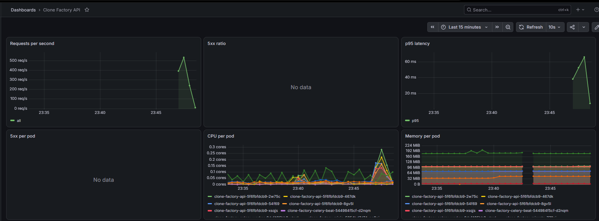
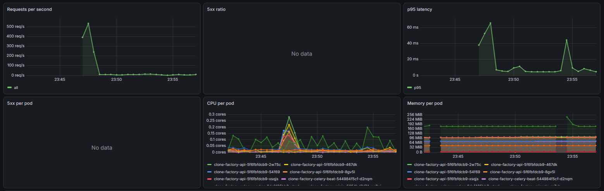
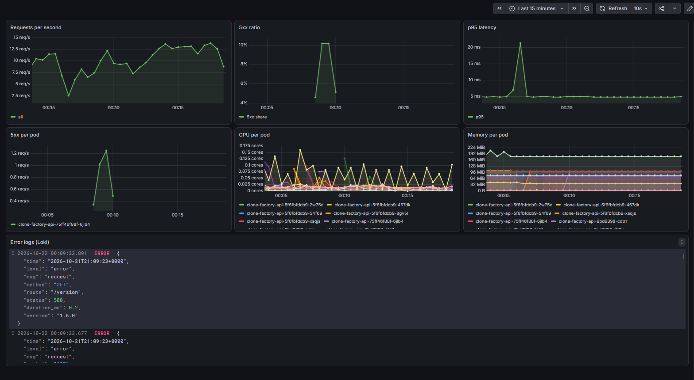

# Звіт: DevOps, лабораторна робота №7

Observability (метрики, логи, дашборд) і автоматичний відкат canary-релізу за метриками.
Репозиторій конфігурації: <https://github.com/Bananbka/mycelium-gitops>.
Продовжує [ЛР-5](devops-lab5-report.md) і [ЛР-6](devops-lab6-report.md): Argo CD, Argo Rollouts, canary.

Виводи нижче скопійовані з терміналу; довгі рядки скорочені (позначено `…`).
minikube: 4 CPU, 8 ГБ (Docker Desktop / WSL2 з ліміту 10 ГБ).

## 1. Стек моніторингу через Argo CD

Стек потребує більше пам'яті, ніж давав попередній кластер (вузол ~7,5 ГБ уже був на межі
свопінгу), тому minikube перестворено за методичкою. Завдяки GitOps усе повернулося з Git:

```
> minikube delete
> minikube start --cpus 4 --memory 8192
> kubectl create namespace argocd
> kubectl apply -n argocd --server-side --force-conflicts -f …/argo-cd/stable/manifests/install.yaml
# пароль admin змінено; Secret застосунку та Secret Grafana створені вручну (не в Git):
> kubectl -n clone-gitops create secret generic clone-factory-secret …
> kubectl -n monitoring create secret generic grafana-admin --from-literal=admin-user=admin --from-literal=admin-password=…
> kubectl apply -f bootstrap/root.yaml
```

Три нові Application у `argocd-apps/`, версії чартів зафіксовані (взяті з індексів репозиторіїв):

| Application | Чарт | Версія | Примітка |
|---|---|---|---|
| `kps` | `prometheus-community/kube-prometheus-stack` | 92.11.0 (operator v0.94.1) | `fullnameOverride: kps`, `ServerSideApply=true`, Grafana з `existingSecret`, sidecar шукає дашборди в усіх namespace, джерело Loki додано |
| `loki` | `grafana-community/loki` | 19.0.3 (Loki 3.7.9) | `SingleBinary`, файлове сховище, без кешів і canary |
| `alloy` | `grafana/alloy` | 1.14.0 (Alloy v1.21.0) | одна репліка, читає логи всіх подів, мітки `namespace`, `pod`, `app` |

Моніторинг додано **окремими комітами** (`061c2b1`) до чарту застосунку: ServiceMonitor
потребує CRD, які ставить `kps`. Усі застосунки в Argo CD стали `Synced` / `Healthy`:

```
> kubectl -n argocd get app
NAME            SYNC STATUS   HEALTH STATUS
alloy           Synced        Healthy
argo-rollouts   Synced        Healthy
clone-factory   Synced        Healthy
kps             Synced        Healthy
loki            Synced        Healthy
root            Synced        Healthy

> kubectl -n monitoring get pods
alertmanager-kps-alertmanager-0     2/2  Running      kps-operator-…                  1/1  Running
alloy-…                             2/2  Running      kps-prometheus-node-exporter-…  1/1  Running
kps-grafana-…                       3/3  Running      loki-0                          2/2  Running
kps-kube-state-metrics-…            1/1  Running      loki-gateway-…                  2/2  Running
prometheus-kps-prometheus-0         2/2  Running
```

## 2. Метрики застосунку

API на FastAPI, тому приклад із методички (Flask) переписано під нього: модуль
[`services/api/src/api/observability.py`](../services/api/src/api/observability.py)
(коміт `d82b95d`). Один middleware робить три речі: рахує запити, міряє тривалість і
пише JSON-лог.

- `http_requests_total{method, route, status}`, лічильник;
- `http_request_duration_seconds{route}`, гістограма;
- мітка `route` це **шаблон маршруту** (`/profiles/{profile_id}`), а не URL: інакше
  кожен id створював би нову часову серію. Невідомі шляхи потрапляють в `route="unknown"`;
- `/metrics`, `/health` і `/docs` не рахуються й не ламаються `FAIL_RATE` (проби і скрейп
  не повинні псувати статистику); сам `/metrics` не показується в OpenAPI.

Залежність `prometheus-client` додана в пакет `api` (`uv.lock` оновлено). Перевірка
локально, поза тестовим набором (його fixture-и чистять MinIO-бакет, тому набір відмовляється
стартувати без тестового бакета):

```
{"time": "…", "level": "info",  "msg": "request", "method": "GET", "route": "/version", "status": 200, "duration_ms": 22.5, "version": "1.5.0"}
{"time": "…", "level": "error", "msg": "request", "method": "GET", "route": "/version", "status": 500, "duration_ms": 0.1, "version": "1.5.0"}
http_requests_total{method="GET",route="/version",status="200"} 2.0
http_requests_total{method="GET",route="/version",status="500"} 1.0
http_requests_total{method="GET",route="unknown",status="404"} 1.0
http_request_duration_seconds_count{route="/version"} 3.0
```

Тести підготовлені в [`tests/test_observability.py`](../tests/test_observability.py)
(запускаються з `MINIO_BUCKET`, що містить `test`).

У чарті (версія `0.3.0`) метрики вмикаються прапором `metrics.enabled`:
[`templates/servicemonitor.yaml`](https://github.com/Bananbka/mycelium-gitops/blob/main/charts/clone-factory/templates/servicemonitor.yaml)
скрейпить іменований порт `http` Service API кожні 15 с. Прапор увімкнено окремим
комітом `02ef055`, коли CRD вже існували. Після цього метрики `http_requests_total`
з'явилися в Prometheus і на дашборді (п. 4–5).

## 3. Логи

Логи API це JSON у stdout, по одному об'єкту на рядок (час, рівень, метод, маршрут, статус,
`duration_ms`, `version`). Власний access-лог uvicorn вимкнено (`access_log=False`), щоб у
Loki не було нетипових рядків поряд із JSON. Alloy збирає логи подів через Kubernetes API, мітки
`namespace`, `pod`, `app`. Запити LogQL у Grafana Explore:

```
{namespace="clone-gitops"}
{namespace="clone-gitops"} | json | status >= 500
{namespace="clone-gitops"} | json | duration_ms > 50 | line_format "{{.route}} {{.duration_ms}}ms"
sum by (pod) (count_over_time({namespace="clone-gitops"} | json | status >= 500 [1m]))
```

## 4. Дашборд

Дашборд `Clone Factory API` (7 панелей) лежить у чарті як JSON і доставляється Argo CD як
ConfigMap із міткою `grafana_dashboard: "1"`
([`dashboards/clone-factory.json`](https://github.com/Bananbka/mycelium-gitops/blob/main/charts/clone-factory/dashboards/clone-factory.json),
[`templates/dashboard.yaml`](https://github.com/Bananbka/mycelium-gitops/blob/main/charts/clone-factory/templates/dashboard.yaml)).
Sidecar Grafana знаходить його сам, вручну створювати нічого не треба. Панелі:

| Панель | Запит |
|---|---|
| Запити за секунду | `sum(rate(http_requests_total{namespace="clone-gitops"}[1m]))` |
| Частка 5xx | `sum(rate(…{status=~"5.."}[1m])) / sum(rate(…[1m]))` |
| p95 затримки | `histogram_quantile(0.95, sum by (le) (rate(http_request_duration_seconds_bucket{…}[1m])))` |
| 5xx по подах | `sum by (pod) (rate(http_requests_total{…,status=~"5.."}[1m]))` |
| CPU подів | `sum by (pod) (rate(container_cpu_usage_seconds_total{…,container!=""}[1m]))` |
| Пам'ять подів | `sum by (pod) (container_memory_working_set_bytes{…,container!=""})` |
| Логи (Loki) | `{namespace="clone-gitops"} \| json \| level="error"` |

Через те, що дашборд є кодом у Git, його правки йдуть як експорт + коміт, а не як ручні зміни
в Grafana.

## 5. Навантаження

Постійний фон і потужний тест:

```
> kubectl create deployment load --image=curlimages/curl -- sh -c 'while true; do curl -s -o /dev/null http://clone-factory-api.clone-gitops.svc:8000/version; sleep 0.05; done'
> kubectl run hey --rm -it --restart=Never --image=williamyeh/hey -- -z 3m -c 20 http://clone-factory-api.clone-gitops.svc:8000/version
```

На дашборді під `hey` RPS піднявся з ~10 до ~530 req/s, p95 з ~5 до ~65 мс, CPU подів API з
~0,02 до ~0,3 ядра, пам'ять лишилася рівною (~100–190 МіБ на под). Після тесту залишився лише
фон `load` (~10 req/s), який потрібен аналізу в п. 6.





Панелі «5xx ratio» і «5xx по подах» порожні, бо помилок ще немає.

## 6. Автоматичний відкат за метриками

### 6а. AnalysisTemplate і стратегія

[`templates/analysistemplate.yaml`](https://github.com/Bananbka/mycelium-gitops/blob/main/charts/clone-factory/templates/analysistemplate.yaml)
питає Prometheus про частку успішних запитів (поріг 95%), 4 виміри по 30 с,
`failureLimit: 1`:

```
sum(rate(http_requests_total{namespace="clone-gitops",status!~"5.."}[1m]))
/
sum(rate(http_requests_total{namespace="clone-gitops"}[1m]))
```

Canary із ЛР-6 змінений: ручна пауза прибрана, рішення приймає аналіз (коміт `0353bf6`):

```yaml
steps:
  - setWeight: 20
  - pause: {duration: 30s}          # дати метрикам накопичитися
  - analysis: {templates: [{templateName: clone-factory-success-rate}]}
  - setWeight: 60
  - pause: {duration: 30s}
```

Без трафіку цей запит дає `NaN`, і аналіз провалиться навіть для хорошої версії, тому
постійний `load` із п. 5 лишається увімкненим.

### 6б. «Погана» поведінка

Змінна оточення `FAIL_RATE` (частка запитів, що отримують 500) задається через
`api.env` у `values-minikube.yaml`; за замовчуванням `"0"`. Той самий образ `1.6.0` стає
поганим лише завдяки значенню змінної (змінюється шаблон пода, тож стартує новий Rollout).

### 6в. Хороший реліз `1.5.0 → 1.6.0`

Коміт `69446d3`. AnalysisRun завершився `Successful` (всі 4 виміри `[1]`), Rollout `Healthy`:

```
Status: ✔ Healthy   Step: 5/5   Images: ghcr.io/bananbka/clone-api:1.6.0 (stable)
revision:2  clone-factory-api-9bd9898   ReplicaSet  ✔ Healthy  stable
            clone-factory-api-9bd9898-2-2   AnalysisRun  ✔ Successful  ✔ 4
```

### 6г. Поганий реліз, автоматичний abort, відкат

Коміт `4fca9c9` (`FAIL_RATE: "0.5"`). Під навантаженням канарка (1 под із 5, половина запитів
дають 500) знижує загальну частку успіху до ~90%, нижче порога 95%:

```
> kubectl -n clone-gitops get analysisrun clone-factory-api-75ff46f88f-3-2 -o jsonpath='{…measurements…}'
2026-10-21T21:08:25Z  Successful  [0.9579850085135188]
2026-10-21T21:08:55Z  Failed      [0.8995591830439074]
2026-10-21T21:09:25Z  Failed      [0.8987370848581338]
```

Перший вимір ще проходить (канарка щойно стартувала, вікно `rate` частково заповнене), два
наступні провалилися: `failed (2) > failureLimit (1)`. Rollout сам виконав abort і повернувся
на stable:

```
Status:   ✖ Degraded
Message:  RolloutAborted: Rollout aborted update to revision 3: Step-based analysis phase
          error/failed: Metric "success-rate" assessed Failed due to failed (2) > failureLimit (1)
Step:     0/5   SetWeight: 0   ActualWeight: 0
Images:   ghcr.io/bananbka/clone-api:1.6.0 (stable)
revision:3  clone-factory-api-75ff46f88f   ReplicaSet   • ScaledDown   canary
            clone-factory-api-75ff46f88f-3-2   AnalysisRun   ✖ Failed   ✔ 1,✖ 2
revision:2  clone-factory-api-9bd9898   ReplicaSet  stable   (5 подів, усі Running)

> kubectl -n argocd get app clone-factory
clone-factory   Synced   Degraded
```

**Чому `Synced` + `Degraded`:** маніфест у кластері збігається з Git (там `FAIL_RATE=0.5`), тому
Sync це `Synced`. Але реліз скасований і працює стара версія, тому Health це `Degraded`.

**Помилки видно лише в новій версії.** У Prometheus 5xx дав тільки canary-под:

```
> sum by (pod) (increase(http_requests_total{namespace="clone-gitops",status=~"5.."}[10m]))
clone-factory-api-75ff46f88f-6jlb4   90.6
```

У Loki запит `{namespace="clone-gitops"} | json | status >= 500` за 15 хв повернув 87 рядків, усі з
пода `clone-factory-api-75ff46f88f-6jlb4`; запит по решті подів порожній:

```
('clone-factory-api-75ff46f88f-6jlb4', '1.6.0', 500)   87
{"time": "…", "level": "error", "msg": "request", "method": "GET", "route": "/version", "status": 500, "duration_ms": 0.2, "version": "1.6.0"}
```

Поле `version` у логах однакове (образ той самий, відрізняється лише `FAIL_RATE`), тому нову
версію ідентифікує саме `pod` / ReplicaSet.



Відкат завершено через Git:

```
> git revert --no-edit HEAD; git push
7fbd233 Revert "Bad release: FAIL_RATE=0.5 (half of requests answer 500)"
4fca9c9 Bad release: FAIL_RATE=0.5 (half of requests answer 500)
69446d3 Release api 1.6.0
0353bf6 Canary with success-rate analysis (no manual pause), enable alert rule
> kubectl -n argocd get app clone-factory
clone-factory   Synced   Healthy
Rollout: ✔ Healthy, Step 5/5, 1.6.0 (stable), Ready 5/5
```

### 6д. Алерт (за бажанням)

[`templates/prometheusrule.yaml`](https://github.com/Bananbka/mycelium-gitops/blob/main/charts/clone-factory/templates/prometheusrule.yaml):
`CloneFactoryHighErrorRate`, частка 5xx > 5% протягом 1 хвилини. Під час поганого релізу
він перейшов у `pending` (`activeAt 21:08:56Z`), але до `Firing` не дійшов: Rollout
відкотився швидше за `for: 1m`. Методичка пояснює це й пропонує для демонстрації
тимчасово вимкнути `rollout.analysis.enabled` і випустити погану версію повністю.

```
> curl http://localhost:19090/api/v1/alerts
CloneFactoryHighErrorRate  pending  2026-10-21T21:08:56.909163497Z
```

## 7. Проблеми, які виникли по дорозі

- **Grafana: «Invalid username or password» при правильному паролі.** Порт 3000 тримав
  контейнер `clone-sandbox-grafana-1` з іншого проєкту на `127.0.0.1:3000`, а `kubectl port-forward`
  слухав лише IPv6 (`::1`). Браузер ішов на IPv4 і потрапляв у чужу Grafana. Допомогло
  `port-forward … 3001:80`.
- **Інтерактивні команди через `!`.** `argocd login`/`update-password` (пароль) і `kubectl run -it`
  не працюють без терміналу (`EOF`, `The handle is invalid`, `Unable to use a TTY`); `--watch`
  блокує сесію. Їх запускали в окремих вікнах PowerShell.
- **Тестовий набір відмовляється стартувати** без `MINIO_BUCKET` із `test` у назві (захист від
  видалення справжнього бакета). Перемикач `ALLOW_DESTRUCTIVE_TEST_BUCKET=1` не вмикали;
  логіку перевірено окремим скриптом.
- **Хороший реліз спершу «не стартував»:** Job міграції (Sync-хук) тягнув новий образ
  `1.6.0`, і sync стояв на `waiting for completion of hook`. Після завантаження образу (14 с)
  реліз пішов сам.
- **Перезапуски подів API (`restarts: 3`, причина `Error`)** сталися в усіх п'яти подів
  одночасно під час першого старту кластера (liveness-проба `/docs`, поки Postgres і міграції
  ще не готові), а не під навантаженням.

## 8. Підсумок

| Вимога | Результат |
|---|---|
| 1. Моніторинг через Argo CD | `kps` 92.11.0, `loki` 19.0.3, `alloy` 1.14.0, усі `Synced` / `Healthy`, Grafana відкривається |
| 2. Метрики | `/metrics`, `http_requests_total{method,route,status}` і гістограма затримки; ServiceMonitor, ціль UP |
| 3. Логи | JSON у stdout, Loki, запити LogQL з фільтром 5xx |
| 4. Дашборд | 7 панелей, JSON у чарті, ConfigMap `grafana_dashboard`, доставка через Argo CD |
| 5. Навантаження | `hey` (20 клієнтів, 3 хв) і фон; видно зростання RPS, p95, CPU; друга зміна: ендпоінт із помилками (`FAIL_RATE`, п. 6) |
| 6. Відкат за метриками | `AnalysisTemplate` (95%), canary з кроком `analysis`, `FAIL_RATE=0.5` → `AnalysisRun Failed` → автоматичний abort → `Synced` + `Degraded`, 5xx і логи лише з нового пода, `git revert` → `Healthy` |
| 6д*. Алерт | `PrometheusRule`: `pending`, до `Firing` не встиг через швидкий abort |

**Що додати зі скріншотів (виконати в UI):** Prometheus → Status → Targets (ціль UP);
Grafana Explore з логами 5xx; Argo CD з AnalysisRun `Failed` і статусом `Synced` / `Degraded`; Prometheus → Alerts
(`Pending`). Для більш чіткого `Firing` можна повторити погану версію з вимкненим
`rollout.analysis.enabled`.
