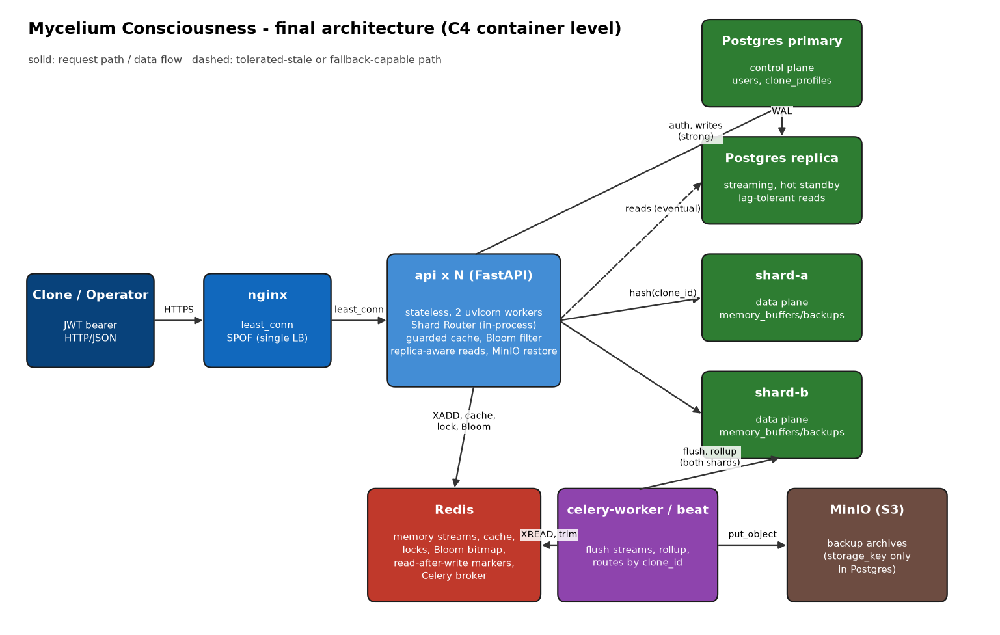

# Фінальна архітектура та інженерний паспорт системи (лаба 10)

Усі числа нижче виміряні на тому самому ноутбуці (12 vCPU / 7,4 GiB Docker VM,
k6 з `--cpus=2`, генератор і система на одному хості) з профілем навантаження
лаби 5 (сценарії A read / B write / C workflow, think time 0, 10 с прогріву +
30 с виміру). Сирі експорти: `load-tests/results/l10_*`, скрипти:
`profiling/run.sh`, `scripts/failure_scenarios.sh`, таблиці:
`profiling/final_table.py`, `profiling/failure_table.py`.

**Головне застереження.** Між сесіями вимірювань на цій машині один і той самий
білд дає відмінність до ±30 % (див. §3.2). Тому висновки про приріст
ґрунтуються на **чергуванні** (base ↔ final у тому самому вікні часу), а не на
двох окремих матрицях.

## 1. Архітектура (C4, рівень контейнерів)



| Контейнер | Відповідальність | Стан | Масштабування |
| --- | --- | --- | --- |
| nginx | єдина точка входу, `least_conn`, пасивний health (`max_fails=3`, `fail_timeout=15s`) | немає | вертикально; SPOF |
| `api` ×N (FastAPI, 2 uvicorn workers) | автентифікація, запис у буфер, читання бекапів, Shard Router, guarded cache, Bloom, read/write routing | немає (stateless, лаба 2) | горизонтально; ~190–250 RPS на інстанс |
| Redis | потоки `clone-stream:{id}`, кеш, Redis-lock, Bloom bitmap, маркери read-after-write, брокер Celery | AOF everysec | один вузол |
| Postgres primary (control plane) | `users`, `clone_profiles`; автентифікація кожного запиту | durable | один вузол, вертикально |
| Postgres replica | hot standby; читання, що терплять лаг, і режим read-only при падінні primary | streaming | один вузол |
| shard-a / shard-b (data plane) | `memory_buffers`, `memory_backups` за `clone_id` (1024 віртуальних бакети) | durable | додавання шардів = перенесення бакетів |
| celery-worker / beat | flush потоків у шарди, rollup у MinIO | немає | worker горизонтально; beat — один |
| MinIO | архіви бекапів | durable | один вузол (S3-сумісний) |

## 2. Наскрізний Request Flow

### 2.1 `POST /memories/write` (гарячий шлях запису)

Латентності — idle, послідовні запити по одному keep-alive з'єднанню всередині
docker-мережі (`profiling/idle_latency.py`, p50 / p95, мс; різниці між шарами —
з драбини `/_prof/*`).

| # | Крок | Внесок p50 | Що ламається | Захист / fallback | Виміряно |
| --- | --- | --- | --- | --- | --- |
| 1 | client → nginx → api (`least_conn`, 2 спроби) | ≈0,3 nginx + ≈0,5 каркас api | api-інстанс помер | інший інстанс; `max_fails` виводить мертвий із ротації | 0 помилок, p99 290 мс |
| 2 | JWT verify (HS256) + `users ⟕ clone_profiles` на primary (1 запит, лаба 9) | ≈1,1 разом | primary недоступний | GET → репліка (`replica-degraded`); запис → 503 `Retry-After: 5`; недійсний токен → 401 | див. §6 |
| 3 | валідація + `XADD`+`XLEN` pipeline у Redis + маркер `rw:*` до першого байта відповіді | ≈0,9 разом | Redis недоступний | 503 за ≈1 с (обмежені timeouts); вікно read-after-write 5 с | §6 |
| 4 | (асинхронно) celery: flush Redis → шард `hash(clone_id)` → rollup → MinIO | — | шард / MinIO недоступні | буфер лишається в Redis, повтор | лаба 1, 7 |

Разом p50: **3,9 мс через nginx, 3,1 мс напряму в api** (p95 4,5 мс).

### 2.2 `GET /memories/backups?limit=50`

| # | Крок | p50, мс | Що ламається | Захист |
| --- | --- | --- | --- | --- |
| 1 | nginx → api, JWT, auth-запит | ≈2,9 | як вище | як вище |
| 2 | Redis `GET` (cache-aside, TTL 60 с ± jitter) | HIT: 4,5 разом | Redis недоступний | `X-Cache: BYPASS`, читання з шарда без кешу |
| 3 | MISS: Postgres шарда власника (`ix_memory_backups_clone_id_period_end`, 0,27 мс) | BYPASS: 5,4 разом | шард недоступний | 503 лише для клонів цього шарду |
| 4 | відповідь + `X-DB-Node`, `X-Cache` | — | — | — |

## 3. Baseline vs Final

### 3.1 Чергування (основний доказ), 100 VUs, 2 api × 2 workers, середнє з 3 раундів

Три раунди `base5 → final` один за одним (обидва стеки підняті одночасно, у
кожен момент навантажується лише один; `profiling/run.sh one`).
`base5` — код гілки `alt-5` (Lab 5, одна БД, без реплік/шардів).

| Метрика | Сценарій | Lab 5 baseline | Final | Приріст |
| --- | --- | --- | --- | --- |
| Stable throughput, RPS | A read | 336 | 388 | **+15 %** |
| | B write | 332 | 381 | **+15 %** |
| | C workflow | 330 | 398 | **+21 %** |
| p50, мс | A / B / C | 113 / 167 / 152 | 104 / 152 / 145 | −8 % / −9 % / −5 % |
| p95, мс | A / B / C | 513 / 332 / 421 | 420 / 246 / 273 | −18 % / −26 % / −35 % |
| p99, мс | A / B / C | 835 / 449 / 626 | 675 / 308 / 363 | −19 % / −31 % / −42 % |
| Error rate at saturation | A / B / C | 0 % | 0 % | — |

### 3.2 Матриця 10 / 50 / 100 / 200 VUs (форма насичення)

`profiling/artifacts/final_table.md` (повна), тут скорочено; baseline і final
зняті в різний час сесії, тому абсолютний розрив **завищений** відносно §3.1:

| Сценарій | VUs | Baseline RPS | Final RPS | Baseline p95 | Final p95 | Baseline p99 | Final p99 |
| --- | --- | --- | --- | --- | --- | --- | --- |
| A | 10 | 277 | 450 | 36 | 19 | 51 | 25 |
| A | 200 | 280 | 431 | 1474 | 578 | 2518 | 848 |
| B | 10 | 280 | 519 | 30 | 16 | 40 | 21 |
| B | 200 | 284 | 449 | 911 | 696 | 1351 | 1108 |
| C | 10 | 292 | 527 | 35 | 18 | 54 | 23 |
| C | 200 | 261 | 498 | 1211 | 629 | 1946 | 955 |

Форма та сама, що в лабі 5: **плато від ~10 VUs до 200 VUs** (насичення на
≈10 VUs), помилок 0 %, деградація проявляється латентністю черги.
Повторний прогін того самого final-білду через годину дав 350–390 RPS замість
450–520, тобто розкид між сесіями порівнянний із самим приростом — тому §3.1
первинний.

**Saturation Threshold: ≈10 VUs** (і для baseline, і для final); **Stable
Throughput: ≈380–400 RPS** (чергування), до ≈500 RPS у «найкращому» вікні.

## 4. Атрибуція покращень

| Крок | Що змінилося | Виміряний ефект | Де |
| --- | --- | --- | --- |
| Лаба 3 / горизонтальне масштабування | api ×1 → ×2 → ×4 | B: 388 → 618 → 821 RPS (2→4 обмежено CPU хоста) | §5 |
| Лаба 4 / Redis cache | cache-aside для списку бекапів | −83 % читань таблиці, +15 % RPS (A) | README, лаба 5 |
| Лаба 6 / репліка | читання з standby | RPS без змін (CPU API — стеля); **доступність читань** при падінні primary: 0–2 % помилок | §6 |
| Лаба 7 / шарди | `memory_*` за `clone_id` | RPS не росте; повністю шардована топологія **−6…−18 % RPS** проти одного Postgres на цьому хості (§7) | §7 |
| Лаба 8 / захист кешу | single-flight, lock, SWR, jitter, Bloom | не видно в усталеному профілі; під stampede 17,6 % → 0 % 502, 6–8 → 1 обчислення | README лаби 8 |
| Лаба 9 / профілювання | зайві round trips (`pre_ping`, `selectinload`) | **+26…36 % RPS**, p95 −11…−35 % (back-to-back у тій самій сесії) | `profiling/README.md` |
| Лаба 10 / стійкість | `TolerantSession`, 503 замість 500, nginx без `http_503`, Redis fail-fast; pure-ASGI middleware, pipeline | пропускна здатність **не змінилась** (−8…+5 %, шум; clean A/B до/після); помилки при падінні primary 75–94 % → 2–5 % | §6 |

Підсумок: baseline → final = **+15…21 % RPS, p95 −18…−35 %**. Це менше, ніж
+26…36 % лаби 9 окремо, бо лаби 6–8 додають накладні витрати на кожен запит
(маршрутизація читань, Shard Router, маркери read-after-write, обгортка
кешу); це видно в абляції §7. Pure-ASGI middleware і pipeline `XADD`+`XLEN`
не дали вимірюваного приросту — залишено, бо всі фінальні виміри зняті з
ними; видалення — окреме рішення, а не оптимізація.

## 5. Межі масштабованості

Масштабування api на цій машині (B write, 100 VUs, 30 с; одиничні прогони):

| api інстансів | RPS | p95, мс | CPU api | CPU Postgres (усі) | Помилки |
| --- | --- | --- | --- | --- | --- |
| 1 | 388 | 465 | 200 % | 24 % | 0 % |
| 2 | 618 | 225 | 398 % | 42 % | 0 % |
| 4, пули за замовчуванням (10+5) | 808 | 269 | 662 % | 86 % | 0,6 % (B); **75 % (A)** |
| 4, пули 5+2 | 821 | 189 | 645 % | 93 % | 0 % |

Перша стеля при зростанні в 2–5×:

1. **CPU Python-воркерів api** (≈200 % на контейнер; ≈10–11 мс CPU на запит).
   Лінійного росту нема вже на 4 інстансах: 12 vCPU хоста ділять api (≈650 %),
   Postgres, Redis, nginx і сам k6.
2. **Бюджет з'єднань Postgres.** `max_connections = 100`, а при 4 інстансах ×
   2 воркери × (control 15 + replica 15 + 2 шарди × 7) потенційно ≈350. Із
   пулами за замовчуванням виміряно «too many clients» і **75 % помилок
   сценарію A**; зі зменшеними пулами (5+2) — 0 %. Далі потрібен PgBouncer.
3. **Control-plane primary**: кожен запит робить автентифікаційний lookup
   (свідомо без кешу), тож це єдиний спільний вузол, що росте лінійно з RPS.

## 6. Ревізія відмовостійкості (під навантаженням, 50 VUs, 40 с; збій 15 с)

Компонент зупинявся на 15-й секунді виміру і піднімався через 15 с
(`scripts/failure_scenarios.sh`). Error % — частка запитів, що не 2xx; у
замкненому циклі швидкі відмови «роздувають» і кількість запитів, і частку,
тому подано також число збійних запитів.

| Відмова | Сценарій | Запитів | Збійних | Error % | p95, мс | p99, мс |
| --- | --- | --- | --- | --- | --- | --- |
| один api-інстанс | A read | 21715 | 0 | 0,0 | 185 | 271 |
| | B write | 24438 | 0 | 0,0 | 185 | 290 |
| Redis | A read | 16063 | 1 | 0,0 | 515 | 539 |
| | B write | 20609 | 1046 | 5,1 | 176 | 1010 |
| | C workflow | 23496 | 1029 | 4,4 | 130 | 1006 |
| read replica | A read | 28558 | 380 | 1,3 | 133 | 200 |
| | B write | 24734 | 288 | 1,2 | 140 | 209 |
| shard-b | A read (кеш) | 30596 | 0 | 0,0 | 101 | 154 |
| | A read (без кешу) | 15317 | 257 | 1,7 | 229 | 2892 |
| | B write | 36080 | 0 | 0,0 | 79 | 137 |
| control-plane primary | A read | 14046 | 275 | 2,0 | 148 | 3009 |
| | A read (без кешу) | 7582 | 0 | 0,0 | 620 | 3028 |
| | B write | 12578 | 674 | 5,4 | 183 | 3004 |

### Що саме знайшов цей прогін (і що було виправлено)

| # | Знахідка | Доказ | Виправлення |
| --- | --- | --- | --- |
| 1 | **Падіння primary під навантаженням = 75–94 % помилок** замість заявленого в лабі 6 read-only режиму | `l10_fail_primary_{A,B}_before.json`: 58 504 запити, 43 856 збійних, 114 317× nginx 502 «no live upstreams» | три причини нижче |
| 1a | `proxy_next_upstream … http_503` + `max_fails=3`: застосунковий 503 («БД недоступна») рахувався збоєм інстансу, обидва інстанси виходили з ротації на 15 с | лог nginx | прибрано `http_503` з `proxy_next_upstream` |
| 1b | Помилки asyncpg на мертвому з'єднанні (`InternalClientError: cannot switch to state`, `ConnectionDoesNotExistError`, `CannotConnectNowError`) не були у списку «втрати вузла» → 500 | traceback у логах api | розширено `CONNECTIVITY_ERRORS` і обробник винятків |
| 1c | `session.close()` → rollback на мертвому з'єднанні кидав виняток **після** відповіді (teardown залежності) → reset з'єднання → nginx `error` → ще раз 1a | «Exception in ASGI application» ×108 | `TolerantSession.close()` |
| 2 | **Redis недоступний під змішаним навантаженням = 71 % помилок** (а не лише записи): необроблений `RedisError` → 500 → reset → nginx викидає інстанси | `l10_fail_redis_C_before.json`: 43 089× 502 | обробник `RedisError` → 503, `socket_connect_timeout=1 s` |
| 3 | Вимкнення `pool_pre_ping` у лабі 9 було перевірене лише вбивством бекендів на живому сервері; зупинка primary під конкурентним навантаженням виявила пункти 1b/1c | цей прогін | тест `tests/test_degradation_handlers.py`; компроміс уточнено в `profiling/README.md` |

Після виправлень: падіння primary — читання обслуговуються з репліки
(p99 ≈3 с — це `connect_timeout` на мертвий primary, **невирішене**: немає
breaker для primary), записи → 503. Падіння Redis — читання 0 %, записи 503 за
≈1 с. Не виправлено: **немає буфера запису без Redis** (запис недоступний
повністю), немає автоматичного failover primary.

## 7. SPOF і «ціна ускладнення»

| SPOF | Чому не усунуто | Що це дало б |
| --- | --- | --- |
| nginx | один хост, лабораторний масштаб; HA потребує Keepalived/VRRP або DNS/anycast | зникає повна недоступність при падінні LB |
| Postgres primary (control plane) | failover потребує Patroni/Raft і fencing; репліка вже є, promote ручний | авто-promote, RTO секунди |
| Redis (буфер запису, кеш, lock, Bloom) | Sentinel/Cluster ускладнює Streams-семантику; AOF everysec обмежує втрату ≈1 с | запис переживає падіння вузла |
| MinIO (один вузол) | розподілений режим потребує ≥4 дисків/вузлів | rollup не відкладається |
| celery-beat (один) | дублювання розкладу при масштабуванні | лідер-вибори |
| primary кожного шарду | реплікація шардів = ×2 вузлів | падіння шарду не ховає клонів |

### Абляція топології (100 VUs, 30 с, api ×2; поспіль)

| Сценарій | Повна (2 шарди + репліка) | Один Postgres | Різниця |
| --- | --- | --- | --- |
| A read | 451 RPS, p95 294 | 533 RPS, p95 319 | один БД +18 % |
| B write | 548 RPS, p95 254 | 581 RPS, p95 275 | +6 % |
| C workflow | 500 RPS, p95 298 | 584 RPS, p95 254 | +17 % |

**Які шари можна вилучити, якщо навантаження впаде у 10×** (≈40 RPS при
стелі одного api ≈200 RPS): шарди і Shard Router, репліку з read/write
routing, Bloom-фільтр і Redis-lock/SWR (залишити простий TTL-кеш), другий
api-інстанс і nginx-балансування (залишити TLS-термінатор). Лишаються Redis
(буфер запису — суть системи), один Postgres, MinIO, celery. Це прибирає
≈6–18 % накладних витрат на запит і половину операційних вузлів.

## 8. Компроміси консистентності (PACELC)

| Операція | Рівень | Механізм | Ціна |
| --- | --- | --- | --- |
| автентифікація, `POST /memories/write`, мутації профілю | **strong** (primary) | запит завжди на primary | при падінні primary — 503 (CP у вибірці P) |
| читання власних змін клоном | **read-your-own-writes** | маркер `rw:*` у Redis, 5 с, до відповіді | +1 Redis-виклик на запис |
| читання профілів/списків, що терплять лаг | **eventual** | репліка; заголовок `X-Read-Consistency` | stale ≈ мс (виміряний лаг) |
| список бекапів, `/fleet/leaderboard` | **eventual, обмежений TTL** | кеш 60 с / 30 с (+SWR 30 с), інвалідація при restore | stale до TTL |
| записані спогади | **buffered, eventual до durable** | Redis AOF everysec → Postgres за ≤60 с → MinIO | вікно втрати ≈1 с при падінні Redis |
| крос-шардові агрегати | **без атомарності** | scatter-gather, id унікальні лише в шарді | немає 2PC; шард недоступний → весь агрегат 503 |

PACELC: при розділенні (P) обрано доступність читань (репліка, кеш, BYPASS) і
відмову запису (CP для запису); без розділення (E) обрано низьку латентність
над найсвіжішими читаннями (EL).

## 9. FINAL SYSTEM ENGINEERING SUMMARY

```
=== FINAL SYSTEM ENGINEERING SUMMARY ===
Architecture Style:    Stateless FastAPI instances behind nginx; Redis Streams write buffer;
                       Celery rollup to S3; control plane (Postgres primary + streaming replica)
                       and a data plane sharded by clone_id over 2 shards (1024 virtual buckets)
Primary Workload Type: Write-heavy ingest (append-only memory stream) + small cached reads; mixed
Stable Throughput:     ~380-400 RPS at 100 VUs (A/B/C, interleaved vs baseline: +15..21 %);
                       up to ~500 RPS in the best window; 2 api x 2 workers, shared 12-vCPU laptop
p95 / p99 Latencies:   100 VUs: 246-420 ms / 308-675 ms; 10 VUs: 16-19 ms / 21-25 ms;
                       idle single request: 3.9 ms (write), 4.5 ms (cached read) at p50
Saturation Point:      ~10 VUs (flat to 200 VUs, 0 % errors)
Main Bottleneck:       Python API worker CPU (~200 % per container, ~10 ms CPU/request);
                       next tier: Postgres connection budget (max_connections 100) and the
                       control-plane primary that serves every auth lookup
Resilience Strategy:   Replica circuit breaker + primary-fallback, read-only degraded mode,
                       single-flight + Redis lock + stale-while-revalidate, Bloom + negative cache,
                       TTL jitter, bounded timeouts with 503 instead of 500, nginx failover
Consistency Model:     Strong for auth and writes; read-your-own-writes window (5 s);
                       eventual for replica and cache reads; buffered-eventual for memory writes
Identified SPOFs:      nginx, Postgres primary (manual promote), Redis (write path), MinIO,
                       celery-beat, each shard primary
Next Scaling Step:     PgBouncer + smaller per-process pools; cache the auth identity (short TTL);
                       Redis Sentinel/replica; Patroni for primary failover; more api hosts
```

## 10. Обмеження вимірювань

- Генератор навантаження і система на одному хості; k6 обмежений 2 CPU.
- Одна ітерація на точку, окрім чергування §3.1 (3 раунди); розкид між
  сесіями до ±30 %. Таблиці §5 і §7 — одиничні прогони, орієнтовні.
- Замкнений цикл (k6 `constant-vus`): швидкі відмови збільшують кількість
  запитів і частку помилок; хвости при насиченні — нижня оцінка
  (coordinated omission).
- Через порт хоста Docker Desktop малі POST отримують стабільні ≈40 мс;
  idle-латентності зняті всередині docker-мережі.
- Лабораторні проби `/_prof/*` не є частиною публічного API
  (`PROFILING_ENDPOINTS=0` за замовчуванням).
