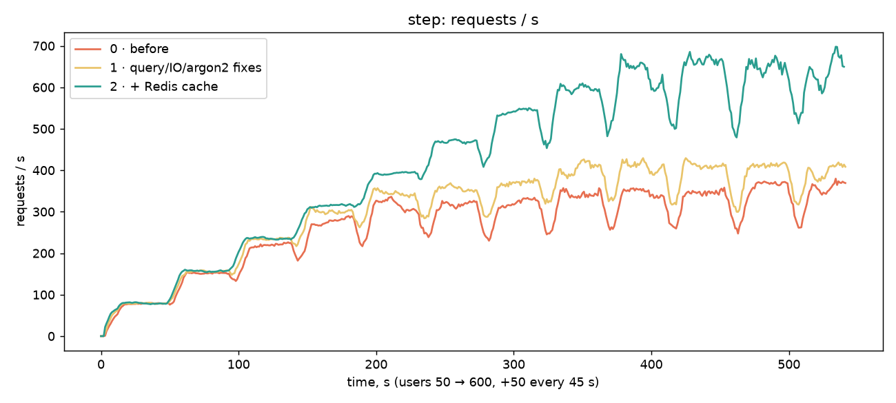
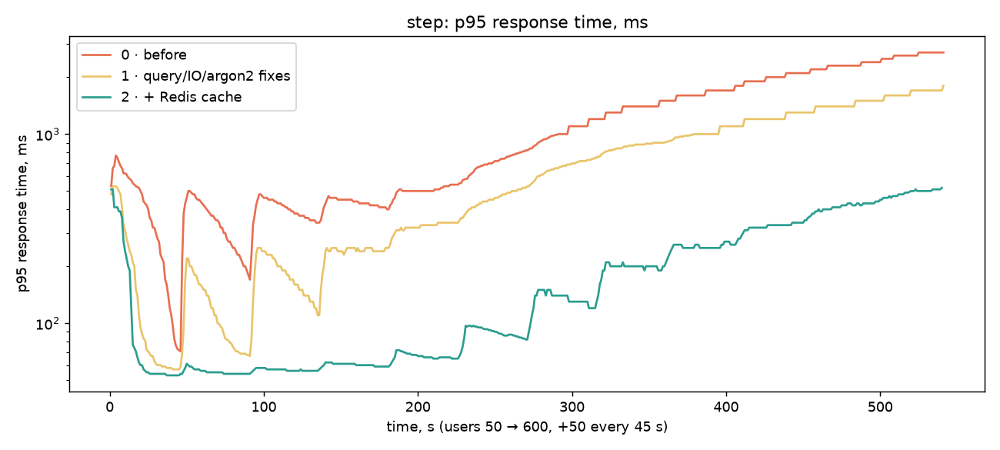
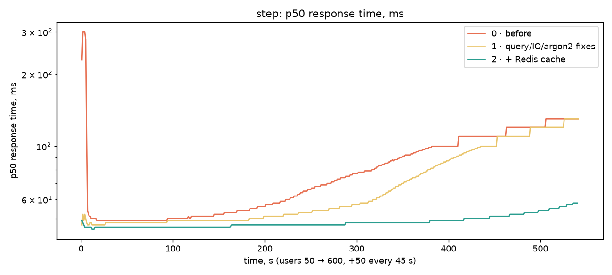
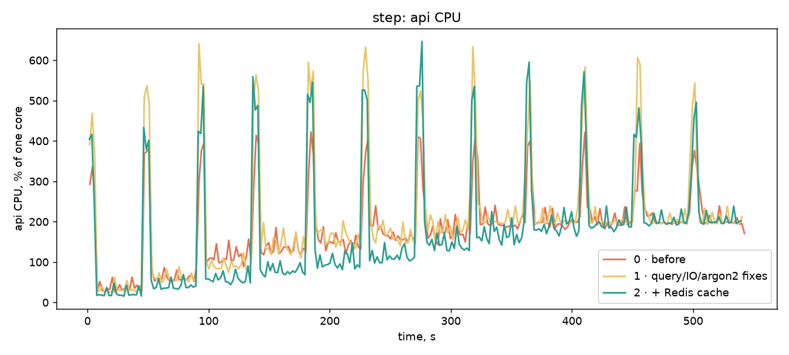
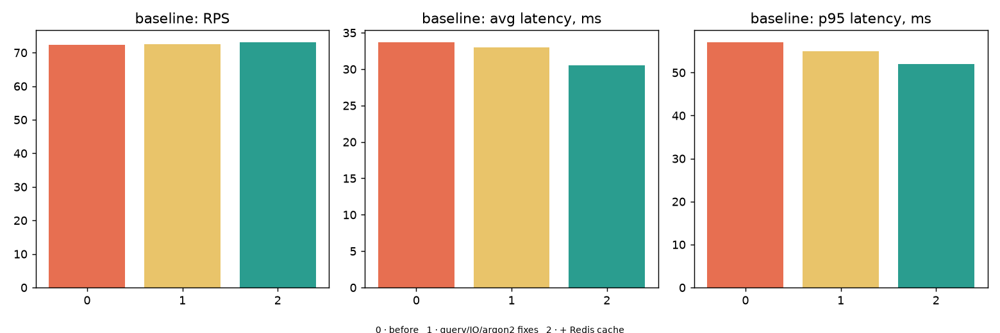

# Лабораторна робота №7 — оптимізація продуктивності

Метод: той самий інструмент (Locust) і ті самі профілі, що в ЛР №4 (`baseline`:
50 VUsers, 3 хв; `step`: 50 → 600 VUsers, +50 кожні 45 с), той самий стенд —
sandbox, **1 репліка `api`** (2 процеси uvicorn), `docker compose`, Windows 11 +
Docker Desktop, Locust на тій самій машині. Кожен етап міряється на чистому стеку
(`down -v`, нові акаунти), скрипт — `scripts/run_stage.sh`; порівняння й графіки —
`loadtests/compare_stages.py`. Етап 0 — код ЛР №6 без жодних змін, виміряний
заново (а не взятий зі звіту ЛР №4), щоб порівнювати на одному залізі й у той самий
день. Один прогін кожного профілю на етап, повторів немає — різницю менше ~5 %
вважайте шумом. На хості паралельно працювали сторонні (простоюючі) контейнери
інших проєктів.

| Етап | Що змінено |
| --- | --- |
| 0 · before | код ЛР №6 |
| 1 · code fixes | argon2 поза event loop, `XADD`+`XLEN` в один pipeline, один `LEFT JOIN` замість двох запитів на автентифікацію; кеші вимкнено (`*_CACHE_TTL_SECONDS=0`) |
| 2 · + Redis cache | кеш автентифікованого суб'єкта і списку бекапів, TTL 30 с |

## 1. Вузькі місця і обрані стратегії

Висновки ЛР №4 (див. `docs/load-testing/report.md`) і повторний вимір етапу 0:
`api` впирається в CPU (≈180–200 % при двох процесах) уже з 200–300 VUsers,
затримка росте лінійно (p95 300 мс → 2,7 с), БД при цьому завантажена на 36 % ядра.
Профіль запиту показав три джерела зайвої роботи:

| # | Вузьке місце | Де | Стратегія |
| --- | --- | --- | --- |
| 1 | **Кожен** авторизований запит (≈90 % трафіку) робить 2 SELECT у Postgres (`selectinload`: users, потім clone_profiles) — той самий результат, що змінюється раз на місяці | `api/deps.py::get_current_user` | (а) один `LEFT JOIN` — спрощення запиту; (б) кеш у Redis з TTL — **кешування** |
| 2 | argon2 (~85 мс CPU, 64 МіБ) виконується синхронно в `async`-обробнику: блокує event loop усього процесу, поки хешується один логін | `routers/auth.py` | винести в потік, з обмеженням паралелізму (семафор, 2 хеші на процес = ≤128 МіБ) — **оптимізація обробки** |
| 3 | `append_memory` — два послідовні round trip до Redis (`XADD`, потім `XLEN`) на найгарячішому ендпоінті (70 % запитів) | `shared/streams.py` | один pipeline — **менше мережевих викликів** |
| 4 | Список бекапів — окремий SELECT на кожен виклик | `GET /memories/backups` | кеш у Redis з TTL та інвалідацією |

Індекси: аудит показав, що гарячі запити вже покриті (`users_pkey`,
`uq_clone_profiles_user_id`, `ix_memory_backups_clone_id_period_end`), тож нових
індексів не додавалось; їх вплив підтверджено контрфактуально в розділі 4.

## 2. Що реалізовано

- `shared/cache.py` — read-through кеш: JSON у Redis, `cache:principal:{user_id}` та
  hash `cache:backups:{clone_id}` (поле = `limit`). TTL — `AUTH_CACHE_TTL_SECONDS`,
  `BACKUPS_CACHE_TTL_SECONDS` (30 с; 0 вимикає). Збій Redis = cache miss, не помилка.
- У кеші автентифікації лише поля, потрібні запитам (id, email, role, дані профілю),
  **без хешу пароля**; деактивовані користувачі не кешуються.
- **Інвалідація** при кожній зміні даних, а TTL — лише страховка від гонки:
  `PATCH /profiles/{me,id}`, `PATCH /admin/clones/{id}/subscription`,
  `POST /admin/users/{id}/deactivate` скидають principal; restore, resurrect і
  rollup у `celery_worker.pipeline` скидають список бекапів.
- Кешований профіль — об'єкт без сесії; `PATCH /profiles/me` перечитує рядок із БД
  перед записом (`populate_existing`).
- Тести `tests/test_cache.py` (13): попадання, відсутність хешу в Redis, видимість
  `PATCH`/зміни тарифу/деактивації одразу, ізоляція за власником, окремі ключі для
  різних `limit`, інвалідація rollup/restore, TTL=0, відмова Redis, pipeline, async-argon2.
  У решті набору кеші вимкнені (`conftest`), повний набір — 165 тестів зелені.

## 3. Результати «до / після»

### Контрольний (`baseline`, 50 VUsers)

| Метрика | 0 · before | 1 · code fixes | 2 · + cache | Δ |
| --- | --- | --- | --- | --- |
| RPS (середній) | 72 | 73 | 73 | +1 % |
| Latency avg, мс | 34 | 33 | 31 | −9 % |
| Latency p50 / p95 / p99, мс | 48 / 57 / 68 | 48 / 55 / 61 | 46 / 52 / 55 | p95 −9 %, p99 −19 % |
| Error rate | 0 % | 0 % | 0 % | – |
| CPU `api`, % (середній) | 43 | 39 | 28 | **−34 %** |
| RAM `api` (пік), МіБ | 301 | 304 | 302 | 0 |

RPS не росте, бо Locust — замкнений цикл із паузами 0,2–1 с: 50 користувачів
фізично не можуть видати більше ≈80 req/s. Виграш видно в **ресурсах**: при тому ж
навантаженні CPU `api` на третину менший, затримка менша.

| Ендпоінт (avg / p95, мс) | 0 | 1 | 2 |
| --- | --- | --- | --- |
| GET /profiles/me | 8 / 12 | 6 / 10 | **4 / 6** |
| GET /memories/backups | 9 / 14 | 8 / 12 | **5 / 8** |
| GET /memories/stream/status | 8 / 13 | 7 / 11 | 5 / 7 |
| GET /health | 6 / 10 | 6 / 9 | 5 / 8 |
| POST /memories/write | 52 / 58 | 51 / 56 | 48 / 53 |
| POST /auth/login | 87 / 120 | 92 / 120 | 85 / 100 |

### Ступінчастий (`step`, 50 → 600 VUsers)

| Метрика | 0 · before | 1 · code fixes | 2 · + cache | Δ 0→2 |
| --- | --- | --- | --- | --- |
| Запитів за 9 хв | 146 685 | 167 629 | 232 678 | **+59 %** |
| RPS середній / пік | 271 / 380 | 310 / 429 | **431 / 698** | +59 % / +84 % |
| Latency avg, мс | 587 | 439 | **141** | **−76 %** |
| Latency p50, мс | 130 | 130 | 58 | −55 % |
| Latency p95, мс | 2700 | 1800 | **520** | **−81 %** |
| Error rate | 0,00 % (2) | 0 % | 0 % | – |
| CPU `api`, % (середній) | 182 | 204 | 174 | −5 % (при +59 % запитів) |
| CPU `db`, % | 36 | 34 | **9** | **−75 %** |
| RAM `api` (пік), МіБ | 382 | 515 | 453 | +19 % |
| RAM Redis (пік), МіБ | 16 | 20 | 25 | +9 |

Затримка p95 за кроками навантаження (мс) — етапи 0 / 1 / 2:

| VUsers | 50 | 100 | 150 | 200 | 250 | 300 | 350 | 400 | 450 | 500 | 550 | 600 |
| --- | --- | --- | --- | --- | --- | --- | --- | --- | --- | --- | --- | --- |
| 0 | 300 | 304 | 392 | 431 | 512 | 740 | 1066 | 1400 | 1660 | 2017 | 2320 | 2650 |
| 1 | 81 | 95 | 168 | 244 | 332 | 474 | 695 | 878 | 1028 | 1237 | 1434 | 1667 |
| 2 | 57 | 55 | 56 | 60 | 66 | 89 | 134 | 199 | 255 | 330 | 419 | 497 |

RPS за кроками: етап 0 виходить на плато ≈310–350 з 250–300 VUsers; етап 1 —
≈400 з 400; етап 2 росте до ≈650 і плато досягає лише біля 500 VUsers.
Комфортна межа (p95 < 500 мс) зсунулась зі ≈150–200 до ≈550 VUsers.







Повні таблиці — `docs/optimization/summary.md`.

## 4. EXPLAIN ANALYZE (додаткове завдання)

Повний вивід — [`optimization/explain_analyze.txt`](optimization/explain_analyze.txt)
(`scripts/explain_analyze.sql`; 5 000 клонів × 40 бекапів = 200 000 рядків у
транзакції, яка відкочується). Скорочено:

| Запит | План | Час виконання |
| --- | --- | --- |
| Список бекапів **з** `ix_memory_backups_clone_id_period_end` | `Limit → Index Scan Backward`, 5 буферів | **0,044 мс** |
| той самий **без** індексу (`DROP INDEX` у транзакції) | `Gather Merge → Sort → Parallel Seq Scan`, `Rows Removed by Filter: 99 980`, 2309 буферів | **22,65 мс** (×515) |
| Автентифікація, **до**: 2 запити | `Index Scan users_pkey` + `Index Scan uq_clone_profiles_user_id` | 0,045 + 0,026 мс |
| Автентифікація, **після**: `LEFT JOIN` | `Nested Loop Left Join` з двох Index Scan | 0,071 мс |
| `find_due_clones` (агрегат по всіх бекапах) з індексом / без | `HashAggregate` над `Seq Scan` у обох (планувальник не використовує індекс — агрегат читає всі рядки) | 46 / 53 мс |

Висновки: (1) індекс на `(clone_id, period_end)` дає на порядки швидше читання
списку — він був потрібен, і тепер це виміряно; (2) `JOIN` не прискорює саму БД
(0,07 мс проти 0,07 мс сумарно) — виграш лише в **одному round trip менше** на кожен
запит, тобто в мережі й у роботі event loop, а не в плані; (3) `find_due_clones`
читає всю таблицю бекапів (46 мс на 200 тис. рядків) — виконується раз на годину в
celery, тому не критично, але на мільйонах рядків потребуватиме `LATERAL`/`DISTINCT ON`
замість глобального `GROUP BY` (не робилось тут).

## 5. Висновки: що дало найбільше

1. **Кеш у Redis — найбільший внесок.** Від етапу 1 до 2: RPS +39 %, p95
   1800 → 520 мс (−71 %), CPU `db` 34 → 9 %. Усі авторизовані запити перестали ходити
   в Postgres. Разом з етапом 1 це +59 % RPS і −81 % p95 на `step`.
2. **Виправлення коду (етап 1)** — +14 % RPS, p95 2700 → 1800 мс (−33 %), але вони
   міряні разом: окремо внесок argon2 / pipeline / JOIN я не вимірював. Найімовірніше,
   головне — `JOIN`+argon2: нові користувачі під час кроків `step` більше не заморожують
   event loop (p95 на кроці 50 VUsers упав 300 → 81 мс — це якраз хвиля логінів).
3. **Гіпотеза ЛР №4 про Nagle/delayed-ACK у `POST /memories/write` не підтвердилась.**
   Pipeline прибрав один round trip, але затримка запису лишилась ≈50 мс
   (52 → 51 → 48 мс). Імовірно, ці ~40–50 мс — на боці клієнта (Locust/requests
   шле заголовки й тіло POST окремими сегментами на Windows loopback), але це ще
   одна гіпотеза, не перевірена.
4. **Ціна кешу**: +19 % RAM `api` на `step` (етап 1 це робить і без кешу — більше
   потоків/пам'яті під argon2 і більше оброблених запитів), +9 МіБ Redis, та
   **неактуальність**: зміна, яку не пройшла інвалідація (пряма правка БД поза API),
   буде видима до 30 с. Для безпеки: деактивація/зміна тарифу через API скидають
   кеш одразу; роль береться з кешованого запису, тож пряму зміну ролі чи
   `is_active` в БД поза API слід супроводжувати `DEL cache:principal:<id>`.
5. **Що лишилось вузьким місцем:** CPU `api` (≈175–200 %, 2 процеси) досі на межі;
   `login` (argon2) залишається 770 мс avg на піку — це свідома ціна безпеки; наступні
   кроки — горизонтальне масштабування (ЛР №6: `API_REPLICAS=3`) і Locust з окремої
   машини.

## Відтворення

```bash
scripts/run_stage.sh s0-before                       # (на коміті ЛР №6)
AUTH_CACHE_TTL_SECONDS=0 BACKUPS_CACHE_TTL_SECONDS=0 scripts/run_stage.sh s1-code
scripts/run_stage.sh s2-cache
PYTHONIOENCODING=utf-8 uv run --group load python loadtests/compare_stages.py s0-before s1-code s2-cache
docker compose -f infra/docker-compose.yaml exec -T db \
  psql -U admin -d clone_memory_sandbox < scripts/explain_analyze.sql
```
