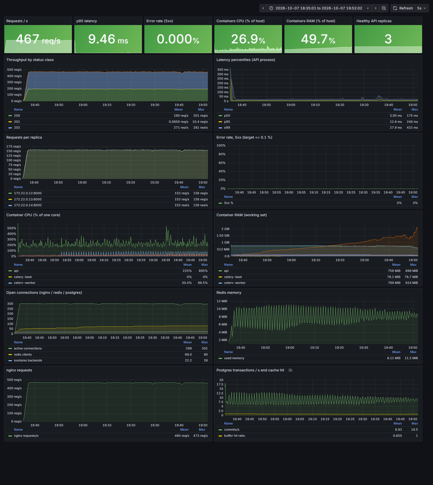
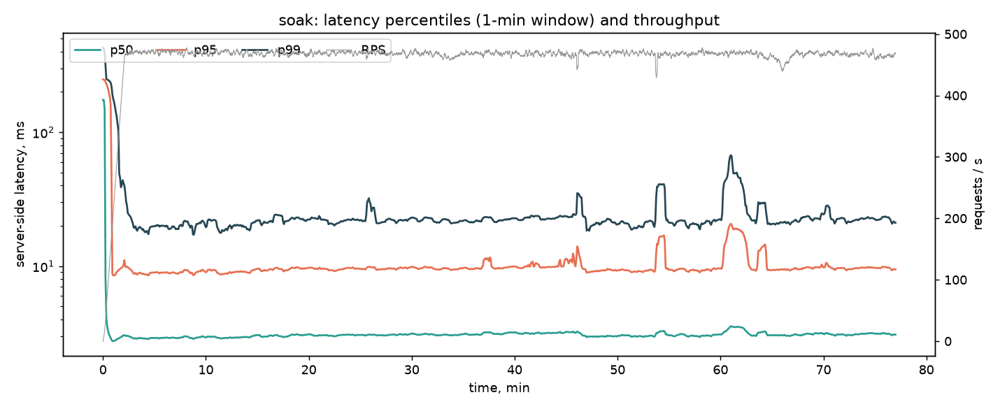
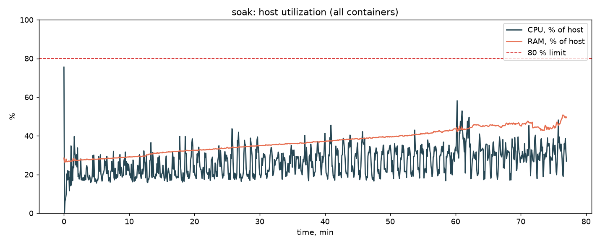
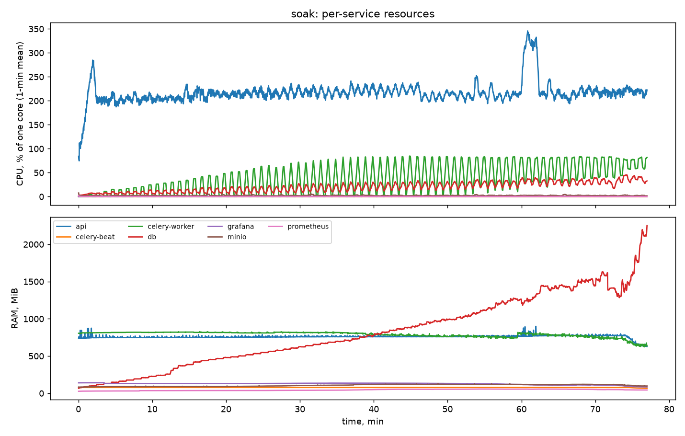
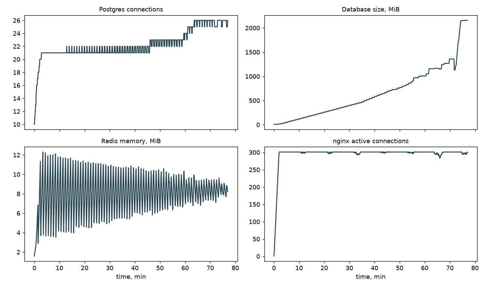
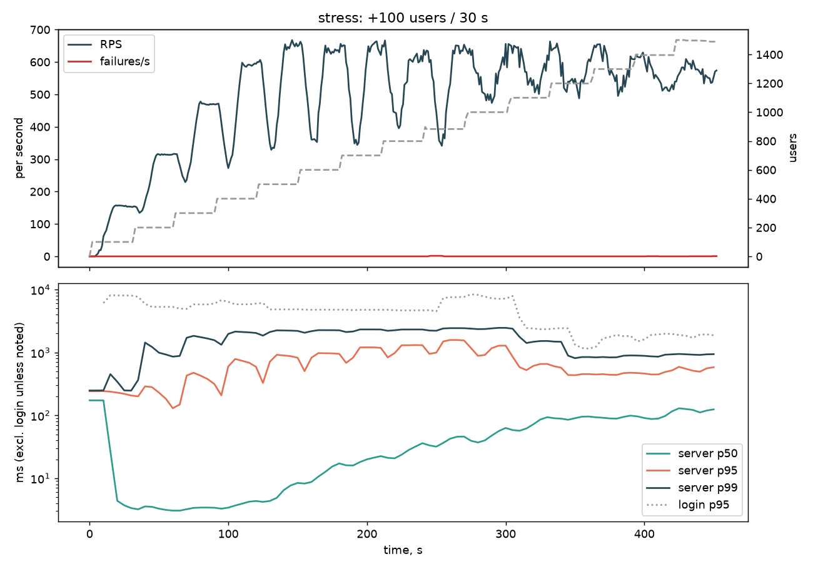
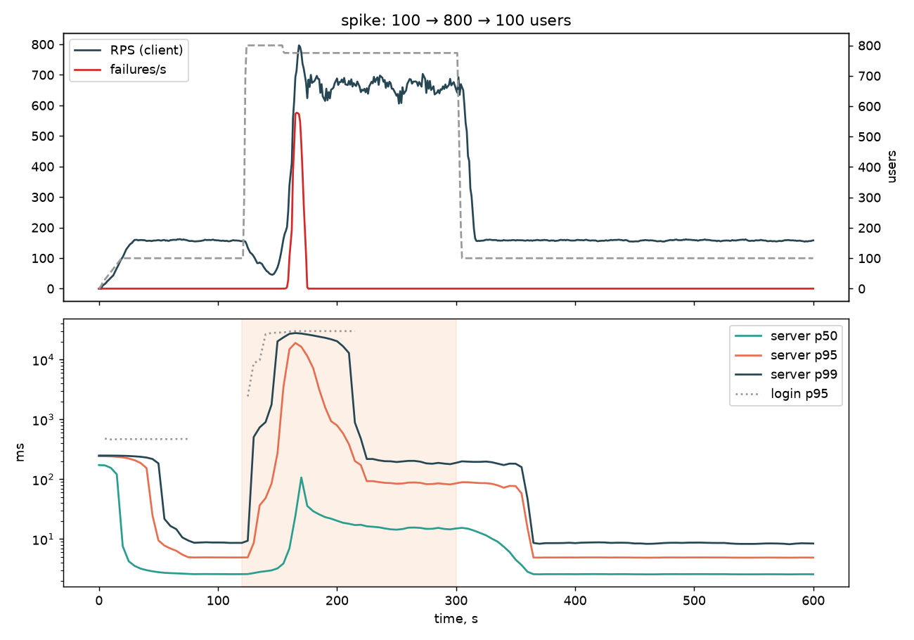

# Лабораторна робота №8 — фінальне тестування стабільності

Стенд: sandbox, `docker compose`, nginx → **3 репліки `api`** (по 2 процеси
uvicorn), Postgres 16, Redis 7, MinIO, `celery-worker`, `celery-beat`, плюс
Prometheus + Grafana. Хост — Windows 11, Docker Desktop (VM: 12 ядер,
7,4 ГіБ RAM), Locust на тій самій машині. Код — стан після ЛР №7 (кеш Redis,
argon2 в потоках) і ЛР №6 (балансування). Усе нижче виміряно, а не оцінено;
сирі CSV лежать у `results/` (не комітяться), графіки — у `docs/stability/`.

## 1. Профіль стабільності і критерії

**Максимум системи** знайдено стрес- і spike-тестами (розділ 4): 3 репліки
вичерпують CPU API (≈600 % = 6 процесів uvicorn) при **≈550–665 RPS**
(665 RPS — стабільне плато spike-тесту на 800 користувачах; 570 RPS — найкращий
крок ступінчастого тесту, де додатково заважали хвилі логінів).

**Профіль soak:** 300 VUsers (сценарій ЛР №4: 55 % запис `POST /memories/write`,
решта — читання), ramp-up 2 хв, далі плато. Це ≈ **470 RPS = 70 % від 665 RPS**.
Тривалість: **75 хв плато (77 хв усього)** — перекриває 60-хвилинний TTL
access-токена, тож у тест потрапляє й хвиля повторних логінів.

**Критерії успіху** (з завдання): CPU ≤ 80 %, RAM ≤ 80 %, Error Rate ≤ 0,1 %.
Утилізацію рахую по хосту (Docker VM): сума CPU/RAM усіх контейнерів / (12 ядер,
7,4 ГіБ). Додатково: затримка і ресурси не повинні деградувати з часом.

## 2. Моніторинг (додаткове завдання 2)

```bash
docker compose -f infra/docker-compose.yaml -f infra/docker-compose.monitoring.yaml up -d
# Grafana http://localhost:3000 (дашборд "Clone Factory - stability"), Prometheus :9090
```

| Джерело | Що дає |
| --- | --- |
| `GET /metrics` кожної репліки `api` (`api/metrics.py`, `prometheus_client` у multiprocess-режимі; Prometheus знаходить репліки через DNS `api`) | RPS, гістограма затримки за маршрутом/статусом, 5xx |
| nginx `stub_status` + nginx-prometheus-exporter | активні з'єднання, запити |
| redis_exporter, postgres_exporter | пам'ять Redis, клієнти, з'єднання Postgres, розмір БД, cache hit |
| `stats-exporter` (`infra/monitoring/stats_exporter`) | CPU/RAM кожного контейнера через Docker API |

cAdvisor не підійшов: під Docker Desktop (WSL2) він бачить лише кореневий cgroup,
без розбивки по контейнерах, тому per-service дані дає невеликий експортер, що
читає те саме джерело, що й `docker stats`. `/metrics` назовні закрито (nginx
відповідає 404). Логи контейнерів обмежено ротацією (10 МБ × 3), щоб довгий тест
не заповнив диск.



> Важливо про методику. У CSV Locust (`*_stats_history.csv`) колонки перцентилів
> **кумулятивні** за весь прогін, тож вони не показують дрейф затримки в часі.
> Для часових графіків затримки взято серверні перцентили з Prometheus (`rate()`
> за 1 хв), а клієнтські значення — лише підсумкові (`*_stats.csv`) і середню
> затримку, що рахується по різницях лічильників.

## 3. Soak-тест (75 хв, 300 VUsers)

### Підсумковий протокол

| Метрика | Значення |
| --- | --- |
| Запитів | 2 134 853 |
| RPS: середній за прогін / плато / пік | 462 / 468 / 478 |
| Затримка (клієнт) avg / min / max | 38 / 3 / 30 060 мс ¹ |
| Затримка (клієнт) p50 / p95 / p99 | 49 / 64 / 84 мс |
| Затримка (сервер, плато) p50 / p95 / p99 | 3,1 / 9,9 / 22,9 мс |
| **Error rate** | **0,004 %** (78 з 2 134 853) |
| CPU хоста: середній / максимум (1 хв) | 26,4 % / 42,1 % |
| RAM хоста: середня / максимум | 37,5 % / 51,4 % |

¹ Максимум 30 с — це 78 запитів, що завершились `ConnectionResetError` (таймаут
Locust 30 с); їх немає в p99. Це 78 разових розривів з'єднання за 77 хв, без
кластеризації й без жодного 5xx на боці API.

| Критерій | Ціль | Виміряно | Результат |
| --- | --- | --- | --- |
| CPU (макс., середнє за 1 хв) | ≤ 80 % | 42,1 % | **PASS** |
| RAM (макс.) | ≤ 80 % | 51,4 % | **PASS** |
| Error rate | ≤ 0,1 % | 0,004 % | **PASS** |

| Ендпоінт (клієнт) | Запитів | Помилок | Avg, мс | p95, мс | p99, мс |
| --- | --- | --- | --- | --- | --- |
| POST /memories/write | 1 254 977 | 46 | 56 | 69 | 91 |
| GET /profiles/me | 376 103 | 17 | 11 | 21 | 38 |
| GET /memories/backups | 251 074 | 10 | 12 | 24 | 44 |
| GET /memories/stream/status | 125 935 | 4 | 11 | 22 | 41 |
| GET /health | 126 164 | 1 | 11 | 23 | 44 |
| POST /auth/login | 300 | 0 | 149 | 230 | 290 |
| POST /auth/login (renew) | 300 | 0 | 217 | 330 | 580 |

(Клієнтська затримка запису ≈50 мс проти 3 мс на сервері — це накладні витрати
Locust/Windows loopback, див. ЛР №7.)

### Часові графіки






### Аналіз довгострокової поведінки

**Затримка — без деградації.** Серверна p50 2,9 → 3,1 мс, p95 9,0 → 9,7 мс
(перші vs останні 10 хв плато), RPS 470 → 467. Короткі сплески (≈54 і ≈61 хв,
p95 до 17–20 мс): перший (≈54 хв) збігається з піком CPU `api`, причину я не
встановлював; другий — **хвиля повторних логінів при спливанні токенів**: усі 300 користувачів залогінились у перші 2 хв, тож їхні
токени (TTL 60 хв) спливають одночасно; 300 повторних логінів система
проковтнула без жодної помилки (login p95 ≈0,45 с на піку).

**Витоків пам'яті в застосунку немає.** RAM `api` (3 репліки разом) 749 → 748 МіБ
(тренд +7 МіБ/год, шум), `celery-worker` 818 → 725 МіБ, Redis 7,9 → 8,4 МіБ,
nginx 13 → 14 МіБ. З'єднання виходять на плато і не ростуть: активні з'єднання
nginx 300 → 300, з'єднання Postgres 21 → 26 (пул досяг стелі), клієнти Redis
54 → 80 (теж плато).

**Знайдена проблема довгострокової поведінки: безмежне зростання буфера
`memory_buffers`.** Це не витік у коді, а наслідок дизайну (запис → Redis →
*один рядок `bytea` на клона* → бекап за розкладом тарифу, у free — раз на місяць):

| Показник | 5–15 хв | 30–40 хв | 45–55 хв | 65–75 хв |
| --- | --- | --- | --- | --- |
| Розмір БД, МіБ | 190 | 561 | 884 | 2153 |
| Частка часу, коли `celery-worker` зайнятий (>20 % CPU) | 12 % | 40 % | 57 % | **78 %** |
| CPU `celery-worker`, % ядра (середнє) | 10 | 33 | 47 | 62 |

- БД виросла з 90 до **2,2 ГіБ за годину** (кінцевий стан: 185 клонів,
  1,26 млн записів, 507 МБ корисного payload, до 21 тис. записів у клона; таблиця
  `memory_buffers` займає 2193 МБ, з них корисних лише ≈23 % — решта це мертві
  версії TOAST-значень: кожен flush переписує **весь** blob клона, а autovacuum не
  встигає).
- Час задачі `flush_due_streams` росте лінійно з розміром буферів: наприкінці
  тесту одне виконання тривало **47–52 с із 60-секундного інтервалу**
  (див. журнал celery) — ще трохи, і flush перестане вкладатись в інтервал, а
  Redis-стріми почнуть накопичуватись.
- RAM контейнера `db` виросла 197 → 1564 МіБ (це переважно кеш сторінок/буфери
  роздутої таблиці, не витік — це припущення, не перевірене), але саме вона дає
  зростання RAM хоста з ≈33 % до 51 %. Лінійна екстраполяція (оцінка, не вимір,
  ≈15 п.п./год): поріг 80 % RAM (≈5,9 ГіБ) досягається приблизно через 2–3 години
  такого навантаження.

Тобто за 75 хв жоден критерій не порушено, але **система не є стабільною за
ресурсами на горизонті годин**: вона деградує повільно й предбачувано.

### Перший прогін (для повноти)

Перший soak (62 хв) показав **Error rate 1,56 % (FAIL)**: 26 547 із 26 646
помилок — `401 Unauthorized` у перші ~2 хв після 60-ї хвилини. Причина — не
система, а сценарій: Locust логінився один раз, токен має TTL 60 хв, а клієнт не
вмів його оновлювати. Решта (99 розривів з'єднання, 0,006 %) вкладались у
критерій. Сценарій виправлено (`locustfile.py`: після 401 — повторний логін і
повтор запиту, окремим рядком `POST /auth/login (renew)`, щоб оновлення не
ховались), перевірено на TTL = 1 хв і повторно прогнано 75 хв — це прогін, що
наведений вище. Інші показники першого прогону збігаються з другим (затримка,
CPU/RAM, ріст БД до 1,1 ГіБ за 62 хв; графіки `docs/stability/*_run1.png`).

## 4. Стрес- і spike-тести (додаткове завдання 1)

### Покроковий стрес (`stress`: +100 користувачів кожні 30 с до 1500)

| Users | RPS | p50, мс | p95, мс | p99, мс | Error % | CPU api, % | CPU хоста, % |
| --- | --- | --- | --- | --- | --- | --- | --- |
| 100 | 135 | 52 | 233 | 323 | 0,00 | 291 | 29 |
| 200 | 281 | 3 | 246 | 1146 | 0,00 | 414 | 40 |
| 300 | 408 | 3 | 428 | 1744 | 0,00 | 566 | 54 |
| 400 | 492 | 4 | 703 | 2083 | 0,00 | 659 | 63 |
| 500 | 526 | 6 | 851 | 2208 | 0,00 | 599 | 55 |
| 600 | 543 | 12 | 936 | 2243 | 0,00 | 639 | 61 |
| 700 | 529 | 19 | 1111 | 2283 | 0,00 | 644 | 61 |
| 800 | 536 | 26 | 1225 | 2305 | 0,00 | 620 | 62 |
| 900 | 516 | 39 | 1414 | 2376 | 0,00 | 681 | 64 |
| 1000 | 532 | 45 | 1063 | 2399 | 0,00 | 635 | 62 |
| 1100 | 557 | 69 | 594 | 1547 | 0,00 | 648 | 60 |
| 1200 | 543 | 90 | 475 | 1007 | 0,01 | 541 | 55 |
| 1300 | 561 | 91 | 451 | 852 | 0,00 | 482 | 48 |
| 1400 | 550 | 91 | 462 | 883 | 0,00 | 492 | 52 |
| 1500 | 570 | 120 | 530 | 927 | 0,08 | 438 | 46 |

(Перцентилі серверні, вікно 1 хв, **без** `/auth/login`; p95/p99 завищені, бо на
кожному кроці 100 нових користувачів одночасно логінуться, а argon2 забирає CPU
в усіх; p95 самих логінів на цих кроках — 2–7 с.)



**Точка зламу.** Це не відмова, а насичення: з ≈400 користувачів CPU `api`
впирається в **≈600–680 %** (усі 6 процесів uvicorn зайняті), RPS виходить на
плато ≈530–570, і далі зростає лише затримка — p50 3 → 120 мс, p95 > 1 с з
≈700 користувачів. Помилок практично немає навіть на 1500 користувачах (0,08 %):
система повільнішає, а не падає (на відміну від ЛР №4, де на одній репліці
з 350 користувачів йшли розриви з'єднань). Хост завантажено лише на ≈60 %, тож
наступний ресурс — кількість процесів `api` (`API_WORKERS`, репліки).

### Різкий сплеск (`spike`: 100 → 800 → 100 користувачів)

| Фаза | RPS (сервер) | p50, мс | p95, мс | p99, мс |
| --- | --- | --- | --- | --- |
| до сплеску (100 користувачів) | 159 | 3 | 5 | 9 |
| перші 60 с стрибка до 800 | 143 | 16 | 5490 | 13 021 |
| плато сплеску (800 користувачів) | 665 | 15 | 98 | 254 |
| останні 3 хв (знову 100) | 158 | 3 | 5 | 9 |



- Миттєвий вхід 700 нових користувачів = 700 одночасних логінів (argon2). Система
  дала **5 759 помилок (3,4 % запитів) за 18 секунд** (502 від nginx і 500 на
  логіні, `t = 157…175 с`), після чого помилок не було зовсім, хоча 800 користувачів
  тримались ще ≈2 хв; на плато вона віддавала 665 RPS при p95 98 мс.
- **Відновлення:** після скидання навантаження серверний p95 повернувся в межі
  3× від початкового (і без помилок) за **≈70 с**; жодного втручання (рестарту)
  не знадобилось, репліки лишились healthy.
- Слабке місце — саме синхронна хвиля логінів (так само, як і 60-та хвилина
  soak-тесту). Захист: ліміт швидкості/черга логінів, jitter у TTL токенів.

Інформаційно: помилки при сплеску — це 502 `Bad Gateway`, які генерує nginx
(upstream не встигає прийняти з'єднання), тому в серверних 5xx API їх немає
(Prometheus показав `err_pct = 0`); клієнтський error rate — єдине джерело
істини про них.

## 5. Висновок: готовність до експлуатації

**Вимоги стабільності виконано для заданого профілю:** 75 хв при 70 % від
максимуму — CPU хоста ≤ 42 % (ліміт 80), RAM ≤ 51 % (80), помилки 0,004 %
(0,1), затримка стабільна (p95 9 → 9,7 мс), витоків пам'яті, зростання з'єднань,
помилок 5xx — немає. Автоматичне відновлення після піку підтверджено (≈70 с).

**Але з єдиним суттєвим застереженням — до довгої експлуатації продукт готовий
умовно.** Soak виявив повільну деградацію, яку короткі тести не бачать:
буфер `memory_buffers` росте безмежно до першого бекапу (для free-тарифу це
місяць), flush переписує весь blob клона, тому час flush, навантаження на Postgres
і розмір БД ростуть лінійно (флаш уже займав 47–52 с із 60). Рекомендації (у цій
роботі не реалізовувались, бо змінюють модель зберігання):

1. Запускати rollup за розміром буфера (наприклад, при N тисячах записів), а не
   лише за тарифом; або писати flush дописуваними чанками (окремі рядки/сегменти),
   а не переписуванням одного `bytea`.
2. Налаштувати autovacuum для `memory_buffers` (мертві TOAST-версії дали ×4
   до корисного розміру) і додати алерт на розмір БД та тривалість flush.
3. Додати jitter до TTL токенів і ліміт на швидкість логінів (див. spike).
4. Масштабувати `api` (процеси/репліки) — єдиний ресурс, що насичується при
   ≈600 RPS; Locust варто винести на окрему машину.

Обмеження: один прогін кожного тесту, генератор на тому ж хості, тривалість
75 хв (мінімум рекомендованого діапазону 1–4 год), екстраполяції позначені як
оцінки.

## Відтворення

```bash
docker compose -f infra/docker-compose.yaml -f infra/docker-compose.monitoring.yaml up -d --build
export COMPOSE_FILES="-f infra/docker-compose.yaml -f infra/docker-compose.monitoring.yaml" API_REPLICAS=3
scripts/run_stage.sh lab8-stress stress spike
SOAK_USERS=300 SOAK_MINUTES=75 scripts/run_stage.sh lab8-soak soak
# поки Prometheus ще працює:
python loadtests/prom_export.py results/lab8-soak/soak_prom.csv <start_epoch> <end_epoch>
uv run --group load python loadtests/final_report.py soak results/lab8-soak
uv run --group load python loadtests/final_report.py stress results/lab8-stress
uv run --group load python loadtests/final_report.py spike results/lab8-stress
```
